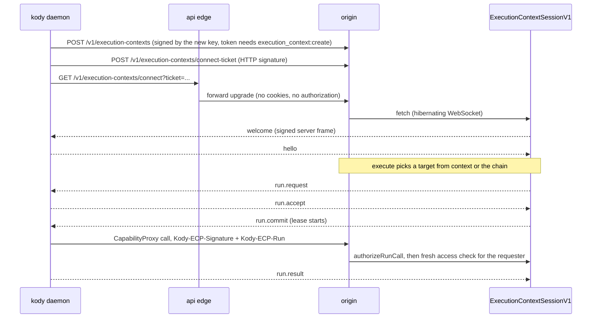

# Execution contexts

An execution context is a machine running `kody daemon` that registered with
Kody. Execute runs can go there instead of Kody cloud. Everything is behind the
`execution-contexts` feature flag (off by default, audience
`experiments_opt_in`). With the flag off, management routes answer
`403 { error: "feature_disabled" }`, and passing `context`, `fallback` or
`requires` fails with `feature_disabled`, and runs without them run on Kody
cloud.

## Pieces

| Piece                                                                                     | Where                                                                                            |
| ----------------------------------------------------------------------------------------- | ------------------------------------------------------------------------------------------------ |
| Protocol (envelopes, frames, HTTP signatures, replay, server keys, vectors)               | `packages/shared/src/execution-context-protocol/`                                                |
| Session Durable Object (`ExecutionContextSessionV1`, one per context, on `kody-platform`) | `packages/worker/src/execution-contexts/session-do.ts`                                           |
| Registration, connect ticket, connect, server keys                                        | `packages/worker/src/execution-contexts/key-routes.ts`                                           |
| Management, sharing, chain, runs, audit                                                   | `packages/worker/src/execution-contexts/service.ts`, MCP `executionContext*` / `executionChain*` |
| Routing for execute (`context`, `fallback`, `requires`)                                   | `packages/worker/src/execution-contexts/routing.ts`, `execute-routing.ts`                        |
| Lease authentication on CapabilityProxy and package graph                                 | `packages/worker/src/open-api/authenticate.ts`                                                   |
| API edge WebSocket forward (rate limited per context and IP)                              | `packages/api-worker/src/edge.ts`                                                                |
| CLI (`kody context`, `kody chain`, `kody daemon`)                                         | `packages/cli/src/execution-context/`                                                            |

## Lifecycle

## Rules that matter

- The private key is generated on the machine and never leaves it. The CLI
  stores it AES-256-GCM encrypted, wrapped by the OS keyring or
  `KODY_CONTEXT_KEY_PASSPHRASE`.
- Server frames are signed with `ECP_FRAME_SIGNING_KEYS`; daemons trust only
  keys published at `/v1/execution-contexts/server-keys` and signed by a root
  key pinned in `server-keys.ts`. That route serves the committed test key set
  only when the configured signer is a test key, and the production set
  otherwise. Without `ECP_FRAME_SIGNING_KEYS` the session refuses to connect, so
  set it (through the Deploy workflow's secrets, never by hand) before turning
  the flag on anywhere.
- Every API hop a run makes re-checks the requester's current access (account
  state, org membership, share, opt-in, attachment). Lost access ends the lease
  with `access_lost`. Leaving a team or org, opting out, detaching and narrowing
  a share also end in-flight leases right away.
- Context runs never start workflows, never run `execute`, and call only the
  runtime APIs the grant allows. Credentialed calls (`authenticatedFetch`,
  `gatewayFetch`, `oauthClientCredentials`, `credentialClient*`) need a grant
  that allows credentials and run from Kody cloud, so credential values never
  reach the machine.
- Chains are per user per org, hold up to 3 contexts, and Kody cloud is always
  the last entry when present. A chain PUT with anything after cloud is a 400.
  Leaving cloud out makes the chain strict.
- A named context never falls back unless the run passes `fallback: "chain"`.
  `requires: ["fs" | "lan"]` skips Kody cloud.
- Context runs are recorded in run records with `metadata.executionContext`
  (`runList` filter `execution_context_id`) and do not count toward hosted
  execute quota.
- The connect ticket is a bearer secret in a query parameter: the edge never
  logs it and Sentry request URLs redact it.

Decision record:
[0083](../decisions/0083-context-runs-never-see-credential-values.md).
