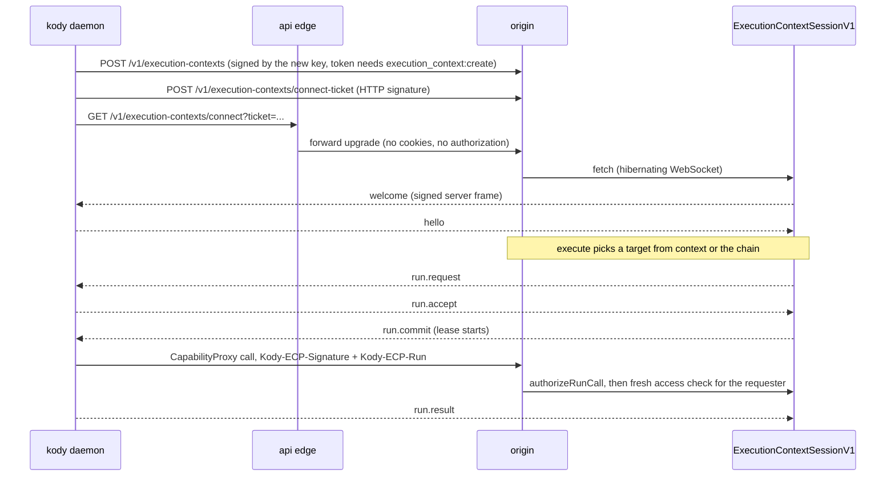
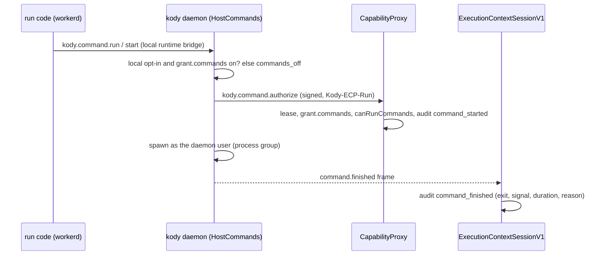

# Execution contexts

An execution context is a machine running `kody daemon` that registered with
Kody. Execute runs can go there instead of Kody cloud. Everything is behind the
`execution-contexts` feature flag (off by default, audience
`experiments_opt_in`). With the flag off, management routes answer
`403 { error: "feature_disabled" }`, and passing `context`, `fallback` or
`requires` fails with `feature_disabled`, and runs without them run on Kody
cloud.

## Pieces

| Piece                                                                                     | Where                                                                                                       |
| ----------------------------------------------------------------------------------------- | ----------------------------------------------------------------------------------------------------------- |
| Protocol (envelopes, frames, HTTP signatures, replay, server keys, vectors)               | `packages/shared/src/execution-context-protocol/`                                                           |
| Session Durable Object (`ExecutionContextSessionV1`, one per context, on `kody-platform`) | `packages/worker/src/execution-contexts/session-do.ts`                                                      |
| Registration, connect ticket, connect, server keys                                        | `packages/worker/src/execution-contexts/key-routes.ts`                                                      |
| Management, sharing, chain, runs, audit                                                   | `packages/worker/src/execution-contexts/service.ts`, MCP `executionContext*` / `executionChain*`            |
| Routing for execute (`context`, `fallback`, `requires`)                                   | `packages/worker/src/execution-contexts/routing.ts`, `execute-routing.ts`                                   |
| Lease authentication on CapabilityProxy and package graph                                 | `packages/worker/src/open-api/authenticate.ts`                                                              |
| API edge WebSocket forward (rate limited per context and IP)                              | `packages/api-worker/src/edge.ts`                                                                           |
| CLI (`kody context`, `kody chain`, `kody daemon`)                                         | `packages/cli/src/execution-context/`                                                                       |
| Host commands (ADR 0093): process manager, authorize hop, opt-in route                    | `packages/cli/src/execution-context/host-commands.ts`, `packages/worker/src/execution-contexts/commands.ts` |

## Lifecycle



## Background service

`kody daemon install` (or `kody connect`, which registers then installs) runs
the daemon as a per-user service so it survives reboots and crashes. Code:
`packages/cli/src/execution-context/service.ts` (unit/plist generation, status
diagnostics) and `service-commands.ts` (install, status, logs, restart,
uninstall, `kody update`), `auto-update.ts`, and `runner-lock.ts`.

- Linux: a `systemd --user` unit `kody-daemon-<ecid>.service` with
  `Restart=always`, `RestartPreventExitStatus=0`, a start limit, and
  `WantedBy=default.target`. Install checks linger and prints
  `sudo loginctl enable-linger <user>` instead of running it.
- macOS: a LaunchAgent `codes.kody.daemon.<ecid>` loaded with
  `launchctl bootstrap gui/<uid>`, `RunAtLoad`, `KeepAlive` on unsuccessful
  exit, `ThrottleInterval`.
- Windows: a Task Scheduler task `\Kody\kody-daemon-<ecid>` registered with
  `schtasks /Create /XML` (UTF-16): logon trigger for the current user,
  `InteractiveToken`, `LeastPrivilege`, no time limit, no admin. Its action runs
  `daemon-task.ps1` (the "unit", in the context dir) hidden; the script is the
  supervisor, relaunching the daemon after a crash and stopping on the
  stay-stopped exit code. The daemon tees its own `daemon.log`. Stop/uninstall
  `schtasks /End`s the task and `taskkill /T /F`s the daemon tree (no process
  groups on Windows). No Windows Service.
- Windows runtime: workerd `windows-64` (also used on Windows arm64 under
  emulation), cached as `workerd.exe` under `%LOCALAPPDATA%\kody\cache`.
  Host-folder paths are native (`fs-access.ts`: drive letters, UNC, `\\?\`
  stripped, case-insensitive containment, junctions resolved by `realpath`);
  `host-fs-shim.ts` forwards Windows-shaped paths and keeps `/bundle`, `/tmp`,
  `/dev` virtual. Orphan reaping reads command lines with
  `Get-CimInstance Win32_Process` (`process-tree.ts`). Signals: `raiseSignal`
  dispatches in-process on Windows, since signalling yourself is a hard
  TerminateProcess that skips cleanup.
- Units hold only paths, the context id, `PATH`, and `KODY_DAEMON_SERVICE`. No
  API token or passphrase. Install refuses root and refuses an npx, pnpm dlx,
  bunx or temp-dir CLI (the path would vanish); it points at
  `npm install -g @kodycodes/cli`.
- Key unwrap without a prompt: a background service has no TTY, so a
  passphrase-wrapped key cannot be used. Install offers to rewrap it with a file
  key (`wrapping-key`, mode 600, next to `key.enc`). The machine key stays
  Ed25519 and signs every request.
- Revoke or delete stops it for good: a `revoked` frame or a 401/403 `revoked` /
  `unknown_context` refusal makes `runDaemon` return instead of reconnecting.
  The daemon writes `stopped.json`, disables its own service, and exits 0, which
  neither manager restarts. Foreground and service share this path.
- `daemon.json` records pid, CLI version, and manager; `kody daemon status`
  reads it to flag a service still on an older CLI. SIGTERM drains in-flight
  runs before exit, so `kody daemon restart` and `kody update` finish runs
  first. Re-running install repairs the unit.
- Auto-update (`auto-update.ts`): on start and every ~4h (±30 min) the daemon
  reads npm's `latest` for `@kodycodes/cli`, downloads the tarball, checks its
  sha512 integrity, extracts it into the managed store
  (`$XDG_DATA_HOME/kody/cli` on Linux, `<config>/cli` elsewhere), reuses the
  running install's dependencies when their ranges still match (else
  `npm install` into the staging dir), proves `kody version` prints the new
  version, then points `current.json` at it. Never older; failures back off (1h
  doubling to 24h) in `update-state.json`. Once runs and background host
  commands finish (`drainHold`, max 24h) the daemon drains and relaunches:
  services and supervised children exit 75 (the manager restarts them; the
  unit's CLI hands off at start), a terminal or desktop daemon supervises the
  new version as a child (`KODY_DAEMON_SUPERVISED=1`). A new version that exits
  within 60s falls back to the old one; three such starts mark it bad. Off:
  `autoUpdate` in the local policy or `KODY_DAEMON_AUTO_UPDATE=0`. The
  capability `autoUpdate: on|off` shows on the context page.
- One runner per context (`runner-lock.ts`): `daemon.lock` (O_EXCL, pid,
  launcher, version) is taken after the start-time hand-off. A second terminal
  or desktop daemon exits naming the holder; a service polls until it frees. A
  server-side `1012 replaced` close makes `runDaemon` return `replaced`: the
  daemon logs the other local `kody daemon` processes (by command line) and
  exits instead of reconnecting.

## Revoke, then delete

- `executionContextRevoke` (`DELETE /v1/execution-contexts/{id}`,
  `kody context revoke <name>`) kills the key, disconnects the daemon, cancels
  in-flight runs and releases the name. The row stays and still lists as revoked
  for 30 days.
- `executionContextDelete` (`POST /v1/execution-contexts/{id}/delete`,
  `kody context delete <name>`, the Delete button on a revoked context's detail
  pane) permanently removes a revoked context. It needs
  `execution_context:delete` plus Manage on the context, only runs in the owner
  org, and refuses a context that is not revoked with `context_not_revoked`.
- `deleteContext` in `service.ts` drops the context from every chain (cloud
  stays last, an emptied chain falls back to cloud), soft-deletes its
  `execution_context` grants and bumps each affected org's access epoch, then
  deletes its opt-ins, org attachments, chain entries and row. There are no
  foreign keys on these tables, so add any new dependent table to that batch.
- Run records keep their own copy of the context id and name in
  `metadata.executionContext`, so `ranOn` still renders the deleted machine. The
  context's session Durable Object history is unreachable once the row is gone;
  its storage is left to expire with the object.

## Host commands

[ADR 0093](../decisions/0093-execution-context-host-commands.md) lets context
runs run shell commands on the machine through `kody.command.*`. Two switches
must both be on, and either one turns it off:

- **Local opt-in**: `commands.enabled` in the machine's
  `execution-context-policy.json` (`fs-access.ts`), set by
  `kody context commands on|off` or the desktop's **Machine › Allow commands**.
  Missing means off.
- **Server state**: `grant.commands.enabled` in `grant_json`. Only the signed
  machine route `POST /v1/execution-contexts/commands` (`key-routes.ts`, ECP
  HTTP signature plus a consumed nonce) sets it to `true`.
  `executionContextUpdate` accepts `false` and refuses `true` with
  `commands_opt_in_local`. Either write bumps `grant_version` and pushes a
  `grant.update`, so a daemon applies it at once.

Then the caller needs `execution_context:command`. `loadContextAccess` computes
`canRunCommands`: always for the operator, otherwise only with a grant row whose
`command` column is set. Presets and `all_members` never set it;
`executionContextShareSet` with `commands: true` does (`extraPermissions` in
`access-writes.ts`). A future profile withholds it by leaving the permission
out; there is no other special case.

Call path:



- `HostCommands` lives for the daemon, not the run, so background jobs outlive
  the 90 second run window. Jobs belong to the requester; others get
  `command_not_found`. Turning either switch off, revoke, and daemon shutdown
  kill every job's process group.
- Audit rows hold the command (first 1000 characters, trimmed further so the row
  stays valid JSON), cwd, env keys, run id, and background flag. Authorization
  requests and audit rows never carry env values; command output can, if the
  command prints them.
- Saved package code gets the same `kody.command`: the package-bound `kody`
  wrapper (`__kodyCreatePackageBoundKody` in `local-execute-runtime-support.ts`)
  passes `command` through like `mcp`, so the opt-in, grant, and authorize hop
  checks above apply unchanged.
- Kody cloud and `--local` runs get a `kody.command` whose methods throw
  `execution_context_command_requires_context` (`runtime-source-modules.ts`);
  the authorize hop refuses any other principal with the same code.
- Windows: PowerShell (`pwsh`, else `powershell.exe`) or `cmd.exe` with
  `shell: 'cmd'`, UTF-8 output, hidden windows; `.cmd`/`.bat` files resolve
  through `PATH`/`PATHEXT` and run through `cmd.exe` with escaped args
  (`windows-command.ts`); every kill is `taskkill /T /F`.

Tests: `packages/cli/test/host-commands.test.ts` (process manager, real
commands), `packages/cli/test/execution-context.test.ts` (real daemon and
workerd against a fake ECP server), and
`packages/worker/src/execution-contexts/commands.node.test.ts` (authorization,
denials, sharing, audit). CI runs the CLI ones on Linux, macOS, Windows x64, and
Windows ARM (`host-commands` job in `validate.yml`).

### End-to-end check

`tools/e2e/execution-context-commands.ts` checks a real deployment unattended.
It registers a throwaway context with temporary `XDG_CONFIG_HOME`,
`XDG_STATE_HOME`, and `XDG_DATA_HOME` directories, turns commands on locally,
starts a daemon, runs an `execute` routed to the context that runs a foreground
command and a background start, poll, and kill, checks the audit log for
`command_started` and `command_finished`, then revokes and deletes the context.
It never touches the default CLI config or an existing context.

```sh
KODY_API_TOKEN=<token with execution_context:create, execution_context:execute, execution_context:command, execution_context:delete> \
  npm run e2e:context-commands -- --api-url https://api.kody.codes
```

The account needs the `execution-contexts` experiment on. PR previews lack
`ECP_FRAME_SIGNING_KEYS`, so the daemon cannot connect there; run it against
production (or any deployment with signing keys).

## Rules that matter

- The private key is generated on the machine and never leaves it. The CLI
  stores it AES-256-GCM encrypted, wrapped by the OS keyring or
  `KODY_CONTEXT_KEY_PASSPHRASE`. The keyring is `@napi-rs/keyring`: macOS
  Keychain, Linux Secret Service, Windows Credential Manager (usable by the
  logon task, so Windows keeps the keyring by default). The service file-key
  fallback is mode 600 on POSIX; on Windows it relies on the user profile ACL.
- Server frames are signed with `ECP_FRAME_SIGNING_KEYS`; daemons trust only
  keys published at `/v1/execution-contexts/server-keys` and signed by a root
  key pinned in `server-keys.ts`. That route serves the committed test key set
  only when the configured signer is a test key, and the production set
  otherwise. Without `ECP_FRAME_SIGNING_KEYS` the session refuses to connect, so
  set it (through the Deploy workflow's secrets, never by hand) before turning
  the flag on anywhere.
- TEST ONLY: previews and local dev serve the committed key set signed by
  `root-test-1`, whose private key is public. The CLI trusts it only when
  `KODY_ECP_TRUST_TEST_ROOT=1` is set and the API host is an https
  `*.workers.dev` preview or `localhost` (`serverKeyRootsFor` in
  `packages/cli/src/execution-context/client.ts`); kody.codes and every other
  host ignore the variable. Never set it on a real machine.
- Every API hop a run makes re-checks the requester's current access (account
  state, org membership, share, opt-in, attachment). Lost access ends the lease
  with `access_lost`. Leaving a team or org, opting out, detaching and narrowing
  a share also end in-flight leases right away.
- The operator's own runs have the same Kody access as in Kody cloud: they start
  workflows and call `contextRuns: 'deny'` capabilities (the request carries
  `credential.contextRunByOperator`, which lineage keeps across workflow and
  queue boundaries). A nested `execute` runs on Kody cloud. Runs by anyone else
  never start workflows or call `contextRuns: 'deny'` capabilities
  (`context_run_denied`). Every context run calls only the runtime APIs the
  grant allows. Credentialed calls (`authenticatedFetch`, `gatewayFetch`,
  `oauthClientCredentials`, `credentialClient*`) run from Kody cloud, so
  credential values never reach the machine.
- Grants have no credential setting, and there is no context-level credential
  narrowing. Every run on a context uses the requester's credentials exactly as
  the same run in Kody cloud (token scopes, credential picks and grants, package
  capabilities, org grants). On a shared context only the operator and people
  who opted in can run at all (`loadContextAccess`, `not_opted_in`), and that
  opt-in is the consent for credential use; its notice (`trust-copy.ts`,
  `universal/execution-context-trust-copy.ts`) says the machine can use their
  credentials and read the responses while a run is active. Routing never skips
  a context for credential reasons.
- A busy context (daemon not accepting, or every slot taken) is skipped like an
  offline one and the chain falls through; `ranOn.attempts` records
  `outcome: "busy"`. The session counts runs dispatched but not yet accepted
  toward `maxConcurrent`, so concurrent dispatches cannot overshoot it, and a
  daemon `run.reject` with `code: "busy"` is a busy attempt too. A named context
  without `fallback: "chain"` fails with an error that says it was busy.
- The daemon enforces the grant's `egress` (from `welcome`, re-applied on
  `grant.update`) inside local workerd: outbound `fetch` goes through an
  egress-gate worker (`packages/cli/src/local-egress.ts`) set as
  `globalOutbound`. A refusal reaches the run as a plain error naming the mode,
  the blocked host (and port), and that the machine owner can change it with
  `executionContextUpdate` `grant.egress`, instead of workerd's
  `internal error; reference = …`.
- Chains are per user per org, hold up to 3 contexts, and Kody cloud is always
  the last entry when present. A chain PUT with anything after cloud is a 400.
  Leaving cloud out makes the chain strict.
- Every routed execute response carries `ranOn` (MCP `structuredContent`, CLI
  `--json`, `POST /v1/execute`); input or setup errors before routing may omit
  it:
  `{ kind: "cloud" | "context", id: "cloud" | "ec_…", name: "Kody cloud" | context name, yours?, attempts, fellBackToCloud }`.
  `attempts` lists contexts that passed on the run with reasons. A short text
  line says the same with friendly names only, e.g.
  `Ran on build-box (your machine).` or
  `Ran on Kody cloud after build-box was busy.` `executionContext` stays for
  runs that involved a context. `runGet` adds the same `metadata.ranOn` to
  execute runs, and `executionContextRunList` rows carry `ranOn`
  (`{ kind, id, name }`, or null when the run did not start there).
- A named context never falls back unless the run passes `fallback: "chain"`.
  `requires: ["fs" | "lan"]` skips Kody cloud.
- Host folders: the daemon mounts `grant.fs` intersected with the machine's
  local policy (`kody context policy`, stored as `execution-context-policy.json`
  in the CLI config dir; absent means none), canonicalized with `realpath`,
  narrower mode wins. Mounts are re-applied on `grant.update` and policy edits.
  The daemon advertises `features: ["fs"]` in `hello` / `capabilities.update`
  only while a folder is mounted, and routing refuses `requires: ["fs"]` with
  `no_fs` (grant lists none) or `no_local_fs` (local policy allows none). In the
  run, a `node:fs` shim sends host paths over the run-secret loopback bridge,
  which enforces the mounts on the Node side; see
  [CLI README](../../../packages/cli/README.md#execution-context-host-folders).
- A run (`execute` `chain`) or automation (`execution` on jobs, webhooks,
  subscriptions and workflow steps) can set its own `context` or `chain`, which
  overrides the default chain. API/MCP/UI overrides beat the manifest.
  Automation context runs use the access of the person the automation runs as.
- Offline or unusable targets fail the run by default, listing each skipped
  entry. `whenOffline: "queue"` waits for reconnect for `queueMinutes` (default
  60, max 1440), re-checks access and the grant on reconnect, and fails with
  `execution_context_queue_expired` when the time runs out.
- A committed run that the daemon stops answering for ends `lost` 30s after its
  deadline. A reconnecting daemon lists the committed runs it still holds
  (`heldRuns`) and finished results (`pendingResults`) in `hello`; Kody ends the
  rest as `lost` at once. A started run is never re-run. Daemons that omit
  `heldRuns` keep the deadline timer.
- A daemon runs up to `--max-concurrent` runs at once (or
  `KODY_CONTEXT_MAX_CONCURRENT`; default 2, max 8), capped by the grant's
  `limits.maxConcurrent`. It advertises that number in `capabilities` and in
  every `status` frame, and Kody only dispatches while a slot is free, so
  routing and chain skipping see `busy` only when every slot is taken. Each run
  still gets its own workerd process and temp dir; nothing is shared between
  runs except granted host folders (concurrent runs with the same `rw` folder
  write the same host files) and the daemon's package-graph cache (bounded LRU,
  32 entries, 60s, keyed by requester, org, conversation and module source).
  Code that imports saved packages is never cached, so package access is
  re-checked every run.
- `run.result` carries `timing` on the daemon's clock (`queueMs`, `setupMs`,
  `packageGraphMs`, `packageGraphCached`, `executeMs`, `daemonMs`). Kody adds
  `serverMs` (commit to result on its clock) and `transitMs`
  (`serverMs - daemonMs`: dispatch plus return) and returns it as
  `structuredContent.ranOn.timing` on `execute`.
- Context runs are recorded in run records with `metadata.executionContext`
  (`runList` filter `execution_context_id`) and do not count toward hosted
  execute quota.
- The connect ticket is a bearer secret in a query parameter: the edge never
  logs it and Sentry request URLs redact it.

Decision records:
[0083](../decisions/0083-context-runs-never-see-credential-values.md),
[0086](../decisions/0086-automation-execution-contexts.md).
