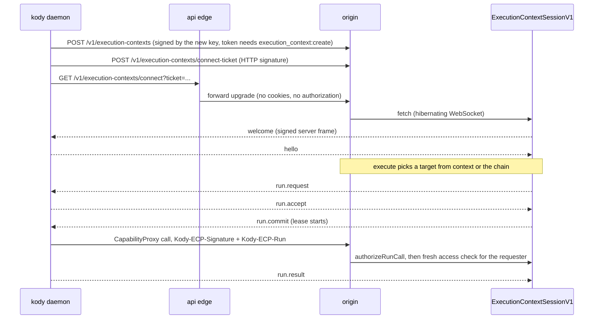

# Execution contexts

An execution context is a machine running `kody daemon` that registered with
Kody. Execute runs can go there instead of Kody cloud. Everything is behind the
`execution-contexts` feature flag (off by default, audience
`experiments_opt_in`). With the flag off, management routes answer
`403 { error: "feature_disabled" }`, and passing `context`, `fallback` or
`requires` fails with `feature_disabled`, and runs without them run on Kody
cloud.

## Pieces

| Piece                                                                                     | Where                                                                                            |
| ----------------------------------------------------------------------------------------- | ------------------------------------------------------------------------------------------------ |
| Protocol (envelopes, frames, HTTP signatures, replay, server keys, vectors)               | `packages/shared/src/execution-context-protocol/`                                                |
| Session Durable Object (`ExecutionContextSessionV1`, one per context, on `kody-platform`) | `packages/worker/src/execution-contexts/session-do.ts`                                           |
| Registration, connect ticket, connect, server keys                                        | `packages/worker/src/execution-contexts/key-routes.ts`                                           |
| Management, sharing, chain, runs, audit                                                   | `packages/worker/src/execution-contexts/service.ts`, MCP `executionContext*` / `executionChain*` |
| Routing for execute (`context`, `fallback`, `requires`)                                   | `packages/worker/src/execution-contexts/routing.ts`, `execute-routing.ts`                        |
| Lease authentication on CapabilityProxy and package graph                                 | `packages/worker/src/open-api/authenticate.ts`                                                   |
| API edge WebSocket forward (rate limited per context and IP)                              | `packages/api-worker/src/edge.ts`                                                                |
| CLI (`kody context`, `kody chain`, `kody daemon`)                                         | `packages/cli/src/execution-context/`                                                            |

## Lifecycle

## Revoke, then delete

- `executionContextRevoke` (`DELETE /v1/execution-contexts/{id}`,
  `kody context revoke <name>`) kills the key, disconnects the daemon, cancels
  in-flight runs and releases the name. The row stays and still lists as revoked
  for 30 days.
- `executionContextDelete` (`POST /v1/execution-contexts/{id}/delete`,
  `kody context delete <name>`, the Delete button on a revoked context's detail
  pane) permanently removes a revoked context. It needs
  `execution_context:delete` plus Manage on the context, only runs in the owner
  org, and refuses a context that is not revoked with `context_not_revoked`.
- `deleteContext` in `service.ts` drops the context from every chain (cloud
  stays last, an emptied chain falls back to cloud), soft-deletes its
  `execution_context` grants and bumps each affected org's access epoch, then
  deletes its opt-ins, org attachments, chain entries and row. There are no
  foreign keys on these tables, so add any new dependent table to that batch.
- Run records keep their own copy of the context id and name in
  `metadata.executionContext`, so `ranOn` still renders the deleted machine. The
  context's session Durable Object history is unreachable once the row is gone;
  its storage is left to expire with the object.

## Rules that matter

- The private key is generated on the machine and never leaves it. The CLI
  stores it AES-256-GCM encrypted, wrapped by the OS keyring or
  `KODY_CONTEXT_KEY_PASSPHRASE`.
- Server frames are signed with `ECP_FRAME_SIGNING_KEYS`; daemons trust only
  keys published at `/v1/execution-contexts/server-keys` and signed by a root
  key pinned in `server-keys.ts`. That route serves the committed test key set
  only when the configured signer is a test key, and the production set
  otherwise. Without `ECP_FRAME_SIGNING_KEYS` the session refuses to connect, so
  set it (through the Deploy workflow's secrets, never by hand) before turning
  the flag on anywhere.
- Every API hop a run makes re-checks the requester's current access (account
  state, org membership, share, opt-in, attachment). Lost access ends the lease
  with `access_lost`. Leaving a team or org, opting out, detaching and narrowing
  a share also end in-flight leases right away.
- Context runs never start workflows, never run `execute`, and call only the
  runtime APIs the grant allows. Credentialed calls (`authenticatedFetch`,
  `gatewayFetch`, `oauthClientCredentials`, `credentialClient*`) run from Kody
  cloud, so credential values never reach the machine.
- Grants have no credential setting. The operator's own runs on their context
  use credentials exactly as the same run in Kody cloud (token scopes,
  credential picks and grants, package capabilities, org grants). Anyone else's
  run on a shared context uses no credentials (`credential-grant.ts`). Each hop
  derives this from operator and requester and puts it on the request
  (`credential.contextCredentialIds`: `null` for the operator, empty for anyone
  else), and `resolveCredential` refuses before reading a value
  (`context-credential-grant.ts`). The streaming gateway-fetch hop uses the same
  check as `gatewayFetch`.
- Before a run starts, routing works out which credentials it can use
  (`run-credential-use.ts`): the entry module and every `kody:` package its
  static imports reach, read from publish metadata (needs closure, credential
  stamp) or, once per source and commit, from the published files (KV
  `credential-use:v2`). Only a run on someone else's context needs this: when it
  can use a credential the context is skipped (`credentials_operator_only`), so
  the chain falls through to the next entry or cloud.
- A busy context (daemon not accepting, or every slot taken) is skipped like an
  offline one and the chain falls through; `ranOn.attempts` records
  `outcome: "busy"`. The session counts runs dispatched but not yet accepted
  toward `maxConcurrent`, so concurrent dispatches cannot overshoot it, and a
  daemon `run.reject` with `code: "busy"` is a busy attempt too. A named context
  without `fallback: "chain"` fails with an error that says it was busy.
- The daemon enforces the grant's `egress` (from `welcome`, re-applied on
  `grant.update`) inside local workerd: outbound `fetch` goes through an
  egress-gate worker (`packages/cli/src/local-egress.ts`) set as
  `globalOutbound`. A refusal reaches the run as a plain error naming the mode,
  the blocked host (and port), and that the machine owner can change it with
  `executionContextUpdate` `grant.egress`, instead of workerd's
  `internal error; reference = …`.
- Chains are per user per org, hold up to 3 contexts, and Kody cloud is always
  the last entry when present. A chain PUT with anything after cloud is a 400.
  Leaving cloud out makes the chain strict.
- Every routed execute response carries `ranOn` (MCP `structuredContent`, CLI
  `--json`, `POST /v1/execute`); input or setup errors before routing may omit
  it:
  `{ kind: "cloud" | "context", id: "cloud" | "ec_…", name: "Kody cloud" | context name, yours?, attempts, fellBackToCloud }`.
  `attempts` lists contexts that passed on the run with reasons. A short text
  line says the same with friendly names only, e.g.
  `Ran on build-box (your machine).` or
  `Ran on Kody cloud after build-box was busy.` `executionContext` stays for
  runs that involved a context. `runGet` adds the same `metadata.ranOn` to
  execute runs, and `executionContextRunList` rows carry `ranOn`
  (`{ kind, id, name }`, or null when the run did not start there).
- A named context never falls back unless the run passes `fallback: "chain"`.
  `requires: ["fs" | "lan"]` skips Kody cloud.
- Host folders: the daemon mounts `grant.fs` intersected with the machine's
  local policy (`kody context policy`, stored as `execution-context-policy.json`
  in the CLI config dir; absent means none), canonicalized with `realpath`,
  narrower mode wins. Mounts are re-applied on `grant.update` and policy edits.
  The daemon advertises `features: ["fs"]` in `hello` / `capabilities.update`
  only while a folder is mounted, and routing refuses `requires: ["fs"]` with
  `no_fs` (grant lists none) or `no_local_fs` (local policy allows none). In the
  run, a `node:fs` shim sends host paths over the run-secret loopback bridge,
  which enforces the mounts on the Node side; see
  [CLI README](../../../packages/cli/README.md#execution-context-host-folders).
- A run (`execute` `chain`) or automation (`execution` on jobs, webhooks,
  subscriptions and workflow steps) can set its own `context` or `chain`, which
  overrides the default chain. API/MCP/UI overrides beat the manifest.
  Automation context runs use the access of the person the automation runs as.
- Offline or unusable targets fail the run by default, listing each skipped
  entry. `whenOffline: "queue"` waits for reconnect for `queueMinutes` (default
  60, max 1440), re-checks access and the grant on reconnect, and fails with
  `execution_context_queue_expired` when the time runs out.
- A committed run that the daemon stops answering for ends `lost` 30s after its
  deadline. A reconnecting daemon lists the committed runs it still holds
  (`heldRuns`) and finished results (`pendingResults`) in `hello`; Kody ends the
  rest as `lost` at once. A started run is never re-run. Daemons that omit
  `heldRuns` keep the deadline timer.
- A daemon runs up to `--max-concurrent` runs at once (or
  `KODY_CONTEXT_MAX_CONCURRENT`; default 2, max 8), capped by the grant's
  `limits.maxConcurrent`. It advertises that number in `capabilities` and in
  every `status` frame, and Kody only dispatches while a slot is free, so
  routing and chain skipping see `busy` only when every slot is taken. Each run
  still gets its own workerd process and temp dir; nothing is shared between
  runs except granted host folders (concurrent runs with the same `rw` folder
  write the same host files) and the daemon's package-graph cache (bounded LRU,
  32 entries, 60s, keyed by requester, org, conversation and module source).
  Code that imports saved packages is never cached, so package access is
  re-checked every run.
- `run.result` carries `timing` on the daemon's clock (`queueMs`, `setupMs`,
  `packageGraphMs`, `packageGraphCached`, `executeMs`, `daemonMs`). Kody adds
  `serverMs` (commit to result on its clock) and `transitMs`
  (`serverMs - daemonMs`: dispatch plus return) and returns it as
  `structuredContent.ranOn.timing` on `execute`.
- Context runs are recorded in run records with `metadata.executionContext`
  (`runList` filter `execution_context_id`) and do not count toward hosted
  execute quota.
- The connect ticket is a bearer secret in a query parameter: the edge never
  logs it and Sentry request URLs redact it.

Decision records:
[0083](../decisions/0083-context-runs-never-see-credential-values.md),
[0086](../decisions/0086-automation-execution-contexts.md).
