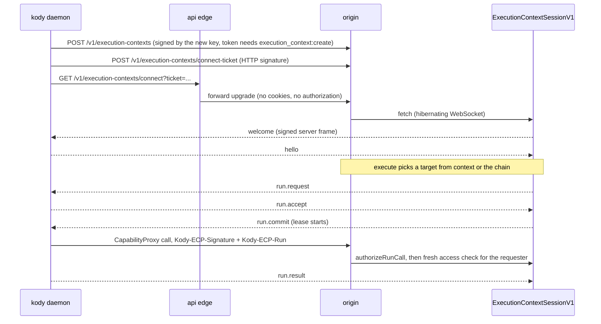
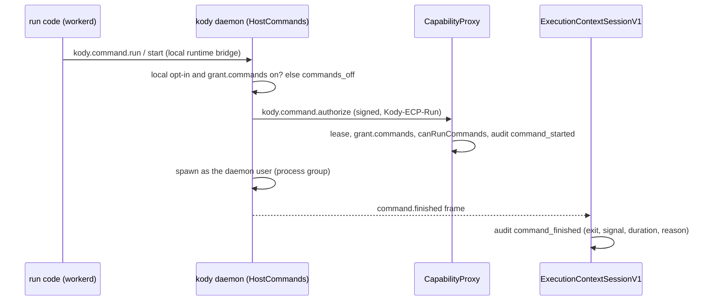

# Execution contexts

An execution context is a machine running `kody daemon` that registered with
Kody. Execute runs can go there instead of Kody cloud. Everything is behind the
`execution-contexts` feature flag (off by default, audience
`experiments_opt_in`). With the flag off, management routes answer
`403 { error: "feature_disabled" }`, and passing `context`, `fallback` or
`requires` fails with `feature_disabled`, and runs without them run on Kody
cloud.

## Pieces

| Piece                                                                                     | Where                                                                                                       |
| ----------------------------------------------------------------------------------------- | ----------------------------------------------------------------------------------------------------------- |
| Protocol (envelopes, frames, HTTP signatures, replay, server keys, vectors)               | `packages/shared/src/execution-context-protocol/`                                                           |
| Session Durable Object (`ExecutionContextSessionV1`, one per context, on `kody-platform`) | `packages/worker/src/execution-contexts/session-do.ts`                                                      |
| Registration, connect ticket, connect, server keys                                        | `packages/worker/src/execution-contexts/key-routes.ts`                                                      |
| Management, sharing, chain, runs, audit                                                   | `packages/worker/src/execution-contexts/service.ts`, MCP `executionContext*` / `executionChain*`            |
| Routing for execute (`context`, `fallback`, `requires`)                                   | `packages/worker/src/execution-contexts/routing.ts`, `execute-routing.ts`                                   |
| Lease authentication on CapabilityProxy and package graph                                 | `packages/worker/src/open-api/authenticate.ts`                                                              |
| API edge WebSocket forward (rate limited per context and IP)                              | `packages/api-worker/src/edge.ts`                                                                           |
| CLI (`kody context`, `kody chain`, `kody daemon`)                                         | `packages/cli/src/execution-context/`                                                                       |
| Website Start functions (page, chain, daemon card, desktop setup)                         | `packages/worker/start/server/execution-contexts.ts`                                                        |
| Website capability hops, page data, machine-access grants                                 | `packages/worker/src/app/handlers/execution-contexts.ts`                                                    |
| Host commands (ADR 0093): process manager, authorize hop, opt-in route                    | `packages/cli/src/execution-context/host-commands.ts`, `packages/worker/src/execution-contexts/commands.ts` |

The
[website page contract](../../../packages/worker/universal/execution-contexts.ts)
keeps the current context page and its cursor separate from the chain.
`chainContexts` supplies any resolved chain contexts missing from that page. See
the [listing reference](../../use/execution-contexts.md#listing-machines) for
paging and the chain-wide summary.

## Lifecycle



## Background service

`kody daemon install` (or `kody connect`, which registers then installs) runs
the daemon as a per-user service so it survives reboots and crashes. Code:
`packages/cli/src/execution-context/service.ts` (unit/plist generation, status
diagnostics) and `service-commands.ts` (install, status, logs, restart,
uninstall, `kody update`), `auto-update.ts`, and `runner-lock.ts`.

- Linux: a `systemd --user` unit `kody-daemon-<ecid>.service` with
  `Restart=always`, `RestartPreventExitStatus=0`, a start limit, and
  `WantedBy=default.target`. Install checks linger and prints
  `sudo loginctl enable-linger <user>` instead of running it.
- macOS: a LaunchAgent `codes.kody.daemon.<ecid>` loaded with
  `launchctl bootstrap gui/<uid>`, `RunAtLoad`, `KeepAlive` on unsuccessful
  exit, `ThrottleInterval`.
- Windows: a Task Scheduler task `\Kody\kody-daemon-<ecid>` registered with
  `schtasks /Create /XML` (UTF-16): logon trigger for the current user,
  `InteractiveToken`, `LeastPrivilege`, no time limit, no admin. Its action runs
  `daemon-task.ps1` (the "unit", in the context dir) hidden; the script is the
  supervisor, relaunching the daemon after a crash and stopping on the
  stay-stopped exit code. The daemon tees its own `daemon.log`. Stop/uninstall
  `schtasks /End`s the task and `taskkill /T /F`s the daemon tree (no process
  groups on Windows). No Windows Service.
- Windows runtime: workerd `windows-64` (also used on Windows arm64 under
  emulation), cached as `workerd.exe` under `%LOCALAPPDATA%\kody\cache`.
  Host-folder paths are native (`fs-access.ts`: drive letters, UNC, `\\?\`
  stripped, case-insensitive containment, junctions resolved by `realpath`);
  `host-fs-shim.ts` forwards Windows-shaped paths and keeps `/bundle`, `/tmp`,
  `/dev` virtual. Orphan reaping reads command lines with
  `Get-CimInstance Win32_Process` (`process-tree.ts`). Signals: `raiseSignal`
  dispatches in-process on Windows, since signalling yourself is a hard
  TerminateProcess that skips cleanup.
- Units hold only paths, the context id, `PATH`, and `KODY_DAEMON_SERVICE`. No
  API token or passphrase. Install refuses root and refuses an npx, pnpm dlx,
  bunx or temp-dir CLI (the path would vanish); it points at
  `npm install -g @kodycodes/cli`.
- Key unwrap without a prompt: a background service has no TTY, so a
  passphrase-wrapped key cannot be used. Install offers to rewrap it with a file
  key (`wrapping-key`, mode 600, next to `key.enc`). The machine key stays
  Ed25519 and signs every request.
- Revoke or delete stops it for good: a `revoked` frame or a 401/403 `revoked` /
  `unknown_context` refusal makes `runDaemon` return instead of reconnecting.
  The daemon writes `stopped.json`, disables its own service, and exits 0, which
  neither manager restarts. Foreground and service share this path.
- `daemon.json` records pid, CLI version, and manager; `kody daemon status`
  reads it to flag a service still on an older CLI. SIGTERM drains in-flight
  runs before exit, so `kody daemon restart` and `kody update` finish runs
  first. Re-running install repairs the unit.
- Auto-update (`auto-update.ts`): on start and every ~4h (±30 min) the daemon
  reads npm's `latest` for `@kodycodes/cli`, downloads the tarball, checks its
  sha512 integrity, extracts it into the managed store
  (`$XDG_DATA_HOME/kody/cli` on Linux, `<config>/cli` elsewhere), reuses the
  running install's dependencies when their ranges still match (else
  `npm install` into the staging dir), proves `kody version` prints the new
  version, then points `current.json` at it. Never older; failures back off (1h
  doubling to 24h) in `update-state.json`. Once runs and background host
  commands finish (`drainHold`, max 24h) the daemon drains and relaunches:
  services and supervised children exit 75 (the manager restarts them; the
  unit's CLI hands off at start), a terminal or desktop daemon supervises the
  new version as a child (`KODY_DAEMON_SUPERVISED=1`). A new version that exits
  within 60s falls back to the old one; three such starts mark it bad. Off:
  `autoUpdate` in the local policy or `KODY_DAEMON_AUTO_UPDATE=0`. The
  capability `autoUpdate: on|off` shows on the context page.
- One runner per context (`runner-lock.ts`): `daemon.lock` (O_EXCL, pid,
  launcher, version) is taken after the start-time hand-off. A second terminal
  or desktop daemon exits naming the holder; a service polls until it frees. A
  server-side `1012 replaced` close makes `runDaemon` return `replaced`: the
  daemon logs the other local `kody daemon` processes (by command line) and
  exits instead of reconnecting.
- Desktop setup is staged (sign in → personal register → optional team attach →
  runner). **Manage setup** / team-first setup in a team org
  (`putDesktopExecutionFirst` with `targetOrgSlug`) attaches the personal
  registration to that org and puts it first in the org chain; it does not
  register the machine again. The context page **Daemon** card and desktop
  **This machine** call `runExecutionContextDaemonAction` (pause, resume,
  restart, update, logs).

## Revoke, then delete

- `executionContextRevoke` (`DELETE /v1/execution-contexts/{id}`,
  `kody context revoke <name>`) kills the key, disconnects the daemon, cancels
  in-flight runs and releases the name. The row stays and still lists as revoked
  for 30 days.
- `executionContextDelete` (`POST /v1/execution-contexts/{id}/delete`,
  `kody context delete <name>`, the Delete button on a revoked context's detail
  pane) permanently removes a revoked context. It needs
  `execution_context:delete` plus Manage on the context, only runs in the owner
  org, and refuses a context that is not revoked with `context_not_revoked`.
- `deleteContext` in `service.ts` drops the context from every chain (cloud
  stays last, an emptied chain falls back to cloud), soft-deletes its
  `execution_context` grants and its machine capabilities' grants, bumps each
  affected org's access epoch, then deletes its machine capabilities, opt-ins,
  org attachments, chain entries and row. There are no foreign keys on these
  tables, so add any new dependent table to that batch.
- Run records keep their own copy of the context id and name in
  `metadata.executionContext`, so `ranOn` still renders the deleted machine. The
  context's session Durable Object history is unreachable once the row is gone;
  its storage is left to expire with the object.

## Host commands

[ADR 0093](../decisions/0093-execution-context-host-commands.md) lets context
runs run shell commands on the machine through `kody.command.*`. Two switches
must both be on, and either one turns it off:

- **Local opt-in**: `commands.enabled` in the machine's
  `execution-context-policy.json` (`fs-access.ts`), set by
  `kody context commands on|off` or the desktop's **Machine › Allow commands**.
  Missing means off.
- **Server state**: `grant.commands.enabled` in `grant_json`. Only the signed
  machine route `POST /v1/execution-contexts/commands` (`key-routes.ts`, ECP
  HTTP signature plus a consumed nonce) sets it to `true`.
  `executionContextUpdate` accepts `false` and refuses `true` with
  `commands_opt_in_local`. Either write bumps `grant_version` and pushes a
  `grant.update`, so a daemon applies it at once.

Then the caller needs `execution_context:command`, and only the operator has it:
`loadContextAccess` sets `canRunCommands` for the operator alone. Commands run
as the machine's OS user, which holds the machine's Kody login and context key,
so anyone else with commands could act as the machine and see other people's
runs. `executionContextShareSet` refuses `commands: true` with
`commands_operator_only`; command grants written earlier stay in `grants` and
confer nothing. The daemon also never hands `hostCommands` to a shared run
(`sharedRun` on `run.request`). A profile withholds it by leaving the permission
out.

Commands inherit the daemon's environment minus every `KODY_*` variable (the CLI
token, `KODY_CONTEXT_KEY_PASSPHRASE`), and a `cwd` inside the credential
denylist (below) is refused. Both are defense in depth: a command runs as the
same OS user and can still read those files.

Call path:



- `HostCommands` lives for the daemon, not the run, so background jobs outlive
  the 90 second run window. Jobs belong to the requester; others get
  `command_not_found`. Turning either switch off, revoke, and daemon shutdown
  kill every job's process group.
- Audit rows hold the command (first 1000 characters, trimmed further so the row
  stays valid JSON), cwd, env keys, run id, and background flag. Authorization
  requests and audit rows never carry env values; command output can, if the
  command prints them.
- When a run loads saved packages, origin records them on the run's lease as the
  package graph is served (`recordRunPackages`, `run-packages.ts`): `entries`
  (imported directly by the run's code) and `all` (entries plus what they
  import). `command_started` carries `entryPackageIds` (first 8) and
  `packageCount`. Code on the machine cannot be trusted to say which package it
  is, so this set, not the call, is what attribution uses. Ad hoc code has
  neither field.
- Saved package code gets the same `kody.command`: the package-bound `kody`
  wrapper (`__kodyCreatePackageBoundKody` in `local-execute-runtime-support.ts`)
  passes `command` through like `mcp`, so the opt-in, grant, and authorize hop
  checks above apply unchanged.
- Kody cloud and `--local` runs get a `kody.command` whose methods throw
  `execution_context_command_requires_context` (`runtime-source-modules.ts`);
  the authorize hop refuses any other principal with the same code.
- Windows: PowerShell (`pwsh`, else `powershell.exe`) or `cmd.exe` with
  `shell: 'cmd'`, UTF-8 output, hidden windows; `.cmd`/`.bat` files resolve
  through `PATH`/`PATHEXT` and run through `cmd.exe` with escaped args
  (`windows-command.ts`); every kill is `taskkill /T /F`.

Tests: `packages/cli/test/host-commands.test.ts` (process manager, real
commands), `packages/cli/test/execution-context.test.ts` (real daemon and
workerd against a fake ECP server), and
`packages/worker/src/execution-contexts/commands.node.test.ts` (authorization,
denials, sharing, audit). CI runs the CLI ones on Linux, macOS, Windows x64, and
Windows ARM (`host-commands` jobs in `validate.yml`). On main pushes, Validate
skips the macOS jobs and `macos-main.yml` runs them outside the deploy gate, so
a macOS runner shortage cannot hold production. A failure there opens the "main:
macOS host commands failing" issue.

### Machine access data model

Machine access narrows these powers per person, profile and package.

- `machine_capabilities` (migration `0276-machine-capabilities.sql`) holds one
  row per power a machine offers: kind `shell`, `command`, `lan` or `fs`, plus a
  name unique within the context and kind. The machine defines a capability;
  Kody stores who may use it.
- A grant on one is a `grants` row with resource type `machine_capability` and
  the permission `machine_capability:use`. Like `execution_context:execute`, it
  counts only as a grant on the capability, never from a role, so checks must
  read the grant directly. `allowed_packages_json` is the capability's package
  list.
- Who may change those grants is decided on the context
  (`execution_context:manage_access`). `accessGrant` refuses to add one, and
  `accessRevoke` removes one.
- Org transfer leaves capabilities and their grants in the owning org, like the
  context.
- The machine layer lives in the local policy file under `capabilities`
  (`packages/cli/src/execution-context/machine-capabilities.ts`), edited with
  `kody context capability`. A named command is a fixed `exec` plus a list of
  allowed argument shapes (exact words, or a pattern the whole argument must
  match); `resolveMachineCommand` returns the `execFile` call or refuses with
  `machine_command_args_refused`. A local network entry is IP addresses or CIDR
  ranges plus ports. Executable paths stay on the machine.
- A run uses a named command with `kody.command.run({ capability, args })`. The
  daemon (`HostCommands`) resolves it from local policy, refuses any field but
  `args`, `timeoutMs` and `maxOutputBytes`, and sends `kody.command.authorize`
  the name and arguments. Origin (`assertNamedCapabilityAccess`) requires a live
  `command` row, the operator or a grant (next item), the profile chain and
  token scope for `machine_capability:use`, and the package rule over the
  lease's entry packages (`packagesNotAllowed`, a copy of a credential's
  `allowed_packages` rule; a truncated package set is refused). It does not need
  the shell opt-in, and turning the shell off leaves named-command jobs running.
- The unrestricted shell is the entry `shell` / `shell`. Migration 0283 adds it
  to every context with host commands on and `ensureShellCapability` adds it
  when a machine turns them on. It is listed only while commands are on and
  keeps its package list across off and on. With an empty list, shell commands
  only log the packages the default rule would refuse (`wouldBlockPackageIds` on
  `command_started`); a list the operator set is enforced.
- While host commands are on and the shell's package list is empty, the operator
  holds an `open_shell` notice (`refreshOpenShellNotice` in `box-notices.ts`,
  backfilled by migration 0286). It is recomputed when the machine turns host
  commands on or off, when the shell's package list changes, and with the other
  notices. Its fingerprint is the constant `open-shell`, so a dismissal ("keep
  the shell") holds until the notice is cleared and raised again.
- `executionContextShellSuggestions` (`suggestShellNarrowing` in
  `machine-access.ts`, operator only) reads the newest 1000 `command_started`
  audit rows of the caller's org that carry no `capability` (shell calls, not
  named commands) from the session DO and groups them by entry package and by
  the program each command starts with (`shell-suggestions.ts`). The context
  page shows the counts inside the open shell notice. It is computed on read and
  stored nowhere, so it never outlives the 30 day audit retention.
- The machine wide local network switch (`grant.egress.mode` `public-and-lan`)
  is the entry `lan` / `*`, a name no machine can define. Migration 0284 adds it
  to every context with the switch on, and `ensureNetworkCapability` adds it
  when the switch is turned on or first used. It is listed only while the switch
  is on and is never shareable. `authorizeContextLan` with capability `*` lets
  anyone who can run on the context through, records `lan_used` with
  `wholeNetwork` and `wouldBlockPackageIds`, and enforces a non-empty package
  list. On a context run in `public-and-lan` mode the egress gate asks through
  the same bridge route with capability `*` before the run's first request to
  each local address or local name (`localhost`, `.localhost`, `.local`) and
  port, and blocks the request on a refusal. Parallel first requests to one
  address ask once. Any other host name that resolves to a local address is not
  asked about. `kody execute --local --allow-private-network` never asks.
  `setMachineAccessPackages` saves a list for it only when the context's last
  reported client is Kody CLI 3.44.0 or newer (`wholeNetworkAskCliVersion`), and
  refuses with `daemon_outdated` otherwise, since an older machine does not ask.
  A machine downgraded after the list is saved stops asking.
- The operator sets an entry's package list with
  `executionContextMachineAccessPackagesSet` (`setMachineAccessPackages`,
  `shell`, `command`, `lan` and `fs` kinds, saved package ids, at most 50,
  audited as `machine_access_packages_changed`). The list lives in
  `machine_capabilities.allowed_packages_json`, survives the machine's reports
  and is cleared when the machine removes the entry.
- Someone other than the operator needs the context shared with them
  (`access.usable`) and a live `machine_capability` grant holding
  `machine_capability:use` that reaches them as a user, a team member, or an org
  member (`hasMachineAccessGrant` in `machine-access.ts`). Only the operator
  adds one (`grantMachineAccess`, `command` and `lan` kinds only); the operator,
  Manage holders and org owners list and revoke. The check runs on every use, so
  a revoke or an unshare stops the next call. On the machine a `sharedRun` gets
  `HostCommands` with `namedOnly`, which refuses every shell call before asking
  Kody, and the machine's `lan` entries; host folders stay unmounted.
- A profile gets a `machine_capability` grant from the person it acts for, who
  must be the operator or hold a grant themselves (`grantMachineAccess` with a
  `profile` subject, written by `grantResourceToProfile`, the same writer as
  package grants to profiles: own active profile, every parent holds it first).
  `hasMachineAccessGrant` never matches a profile grant; the profile chain check
  in `assertNamedCapabilityAccess` reads it. That person revokes it, as do the
  operator, Manage holders and org owners. The three machine access tools pass
  the surface gate with `execution_context:manage_access` or
  `execution_context:execute`; without `manage_access`
  (`MachineAccessScope.withoutManageAccess`) a caller only grants, lists and
  revokes on their own profiles. A caller acting as a profile grants only to its
  sub-profiles (`grantResourceToProfile`, packages too). Someone who neither
  manages the machine nor has it shared with them is refused before any
  definition is read.
- Every entry package of a run that uses a named command or local network
  destination must declare it in its own published `kody.machine`, by name and
  kind (`packagesNotDeclaring` in `machine-needs.ts`, reading the commit runs
  are served, not a publish still building), or the call fails with
  `machine_need_undeclared`, which names the packages and the JSON to add.
  Packages an entry imports are not asked and do not declare for it; ad hoc code
  has nothing to declare. For host folders a missing declaration is only logged
  (`undeclaredPackageIds` on `fs_used`) when a live `fs` row exists. With none,
  `authorizeContextFolder` returns `machine_capability_off` before checking
  declarations or writing `fs_used`; the daemon still allows the folder call.
- A run reaches a named local network destination with a plain `fetch`. The
  egress gate worker (`packages/cli/src/local-egress.ts`) gets the machine's
  `lan` entries in its policy. When the grant's egress mode would refuse a
  request and its host is an IP literal inside an entry's addresses and ports,
  the gate asks the bridge (`/lan-authorize`), which sends `kody.lan.authorize`
  with the name, address and port. Origin (`authorizeContextLan`) applies the
  same checks as a named command against the `lan` row and records `lan_used`.
  Allowed requests leave through a second workerd network service (`lan`) that
  only the gate is bound to, with redirects handed back to the run so each hop
  is checked. The bridge re-reads local policy before each ask
  (`machineLanCovers`), so an entry narrowed or removed during a run stops
  working. Host names are never matched, so DNS rebinding cannot widen an entry.
- Origin also accepts `fs` entries in a machine's report (one per host folder,
  summary: path and mode) and `kody.fs.authorize` with a folder's name
  (`authorizeContextFolder`). Folders predate machine capabilities, so that hop
  requires a live `fs` row and the operator, records `fs_used`, and only logs
  the packages the default rule would refuse (`wouldBlockPackageIds`); a
  non-empty `allowed_packages` list is enforced. It asks for no new token scope.
  The CLI reports each folder in the local policy under a name
  (`folderCapabilityNames`): the one `kody context policy allow` saved with the
  rule, else the folder's own name, with a hash of the path when another folder
  shares it. Names never depend on rule order. Folders count toward the 100
  entry report limit, checked when one is allowed or defined. `resolveHostPath`
  asks once per folder per run before the first call that uses it, and a write
  also asks for every allowed folder inside the path. A refusal fails that call
  with `EACCES` and is asked again on the next. `machine_capability_off` (Kody
  has no `fs` row yet) lets the call through, since there is no list to enforce.
  Run code cannot call `kody.fs.authorize` itself.
- The machine reports its definitions to Kody with
  `POST /v1/execution-contexts/capabilities`, signed with the context key like
  the host commands opt-in, so only the machine can add or widen one. It sends
  the full set (kind, name, description, and a summary: argument shapes, or
  hosts and ports); `syncMachineDefinedCapabilities` upserts `command` and `lan`
  rows, and a definition the machine dropped is marked `removed_at`, its grants
  are soft-deleted and its package list is cleared.
  `kody context capability add|remove` reports right away, and the daemon
  reports when it starts and when the policy file changes. Changes are audited
  as `machine_capabilities_changed`.

  ```json
  {
  	"name": "kdocker",
  	"description": "Inspect and restart containers on the NAS",
  	"exec": ["node", "/volume1/docker/kody-docker-helper/kdocker.mjs"],
  	"args": [
  		["ps"],
  		["logs", { "pattern": "^[a-zA-Z0-9][a-zA-Z0-9_.-]{0,62}$" }],
  		["compose", "rebuild"]
  	],
  	"background": false,
  	"timeoutMs": 120000
  }
  ```

### End-to-end check

`tools/e2e/execution-context-commands.ts` checks a real deployment unattended.
It registers a throwaway context with temporary `XDG_CONFIG_HOME`,
`XDG_STATE_HOME`, and `XDG_DATA_HOME` directories, turns commands on locally,
starts a daemon, runs an `execute` routed to the context that runs a foreground
command and a background start, poll, and kill, checks the audit log for
`command_started` and `command_finished`, then revokes and deletes the context.
It never touches the default CLI config or an existing context.

```sh
KODY_API_TOKEN=<token with execution_context:create, execution_context:execute, execution_context:command, execution_context:delete> \
  npm run e2e:context-commands -- --api-url https://api.kody.codes
```

The account needs the `execution-contexts` experiment on. PR previews sign with
the committed test key set; set `KODY_ECP_TRUST_TEST_ROOT=1` to run it against a
preview (see the TEST ONLY rule below).

## Rules that matter

- The private key is generated on the machine and never leaves it. The CLI
  stores it AES-256-GCM encrypted, wrapped by the OS keyring or
  `KODY_CONTEXT_KEY_PASSPHRASE`. The keyring is `@napi-rs/keyring` for Linux
  Secret Service and Windows Credential Manager (usable by the logon task, so
  Windows keeps the keyring by default). macOS goes through `/usr/bin/security`
  (`keyring-entry.ts`); the machine-key reads use the async runner, which prints
  a wait notice after 1.5 s, kills `security` after `KODY_KEYCHAIN_TIMEOUT_MS`
  (2 min), and tracks it in `helperChildren` so SIGINT, SIGTERM, SIGHUP and exit
  kill it too. The file key (`--key-storage file`, any OS) is mode 600 on POSIX;
  on Windows it relies on the user profile ACL.
- Server frames are signed with `ECP_FRAME_SIGNING_KEYS`; daemons trust only
  keys published at `/v1/execution-contexts/server-keys` and signed by a root
  key pinned in `server-keys.ts`. That route serves the committed test key set
  only when the configured signer is a test key, and the production set
  otherwise. Without `ECP_FRAME_SIGNING_KEYS` the session refuses to connect, so
  set it (through the Deploy workflow's secrets, never by hand) before turning
  the flag on anywhere.
- TEST ONLY: previews and local dev serve the committed key set signed by
  `root-test-1`, whose private key is public. The CLI trusts it only when
  `KODY_ECP_TRUST_TEST_ROOT=1` is set and the API host is an https
  `*.workers.dev` preview or `localhost` (`serverKeyRootsFor` in
  `packages/cli/src/execution-context/client.ts`); kody.codes and every other
  host ignore the variable. Never set it on a real machine.
- Sharing with all members is the `all_members` flag on the context or its
  attachment, never an `org`-subject grant (access-writes refuses one on
  `execution_context`). Compiled access turns the flag into Use
  (`execution_context:read`, `:execute`) on that context for every live Member,
  so they pass the capability surface check like a person or team share;
  `executionContextShareSet` and detach bump `access_epoch` so the change
  applies on the next request.
- Every API hop a run makes re-checks the requester's current access (account
  state, org membership, share, opt-in, attachment). Lost access ends the lease
  with `access_lost`. Leaving a team or org, opting out, detaching and narrowing
  a share also end in-flight leases right away.
- The operator's own runs have the same Kody access as in Kody cloud: they start
  workflows and call `contextRuns: 'deny'` capabilities (the request carries
  `credential.contextRunByOperator`, which lineage keeps across workflow and
  queue boundaries). A nested `execute` runs on Kody cloud. Runs by anyone else
  never start workflows or call `contextRuns: 'deny'` capabilities
  (`context_run_denied`). Every context run calls only the runtime APIs the
  grant allows. Credentialed calls (`authenticatedFetch`, `gatewayFetch`,
  `oauthClientCredentials`, `credentialClient*`) run from Kody cloud, so
  credential values never reach the machine.
- Grants have no credential setting, and there is no context-level credential
  narrowing. Every run on a context uses the requester's credentials exactly as
  the same run in Kody cloud (token scopes, credential picks and grants, package
  capabilities, org grants). On a shared context only the operator and people
  who opted in can run at all (`loadContextAccess`, `not_opted_in`), and that
  opt-in is the consent for credential use; its notice (`trust-copy.ts`,
  `universal/execution-context-trust-copy.ts`) says the machine can use their
  credentials and read the responses while a run is active. Routing never skips
  a context for credential reasons.
- A busy context (daemon not accepting, or every slot taken) is skipped like an
  offline one and the chain falls through; `ranOn.attempts` records
  `outcome: "busy"`. The session counts runs dispatched but not yet accepted
  toward `maxConcurrent`, so concurrent dispatches cannot overshoot it, and a
  daemon `run.reject` with `code: "busy"` is a busy attempt too. A named context
  without `fallback: "chain"` fails with an error that says it was busy.
- The daemon enforces the grant's `egress` (from `welcome`, re-applied on
  `grant.update`) inside local workerd: outbound `fetch` goes through an
  egress-gate worker (`packages/cli/src/local-egress.ts`) set as
  `globalOutbound`. A refusal reaches the run as a plain error naming the mode,
  the blocked host (and port), and that the machine owner can change it with
  `executionContextUpdate` `grant.egress`, instead of workerd's
  `internal error; reference = …`.
- Chains are per user per org, hold up to 8 contexts, and Kody cloud is always
  the last entry when present. A chain PUT with anything after cloud is a 400.
  Leaving cloud out makes the chain strict.
- Every routed execute response carries `ranOn` (MCP `structuredContent`, CLI
  `--json`, `POST /v1/execute`); input or setup errors before routing may omit
  it:
  `{ kind: "cloud" | "context", id: "cloud" | "ec_…", name: "Kody cloud" | context name, yours?, attempts, fellBackToCloud }`.
  `attempts` lists contexts that passed on the run with reasons. A short text
  line says the same with friendly names only, e.g.
  `Ran on build-box (your machine).` or
  `Ran on Kody cloud after build-box was busy.` `executionContext` stays for
  runs that involved a context. `runGet` adds the same `metadata.ranOn` to
  execute runs, and `executionContextRunList` rows carry `ranOn`
  (`{ kind, id, name }`, or null when the run did not start there).
- A named context never falls back unless the run passes `fallback: "chain"`.
  `requires: ["fs" | "lan"]` skips Kody cloud.
- Host folders: the daemon mounts `grant.fs` intersected with the machine's
  local policy (`kody context policy`, stored as `execution-context-policy.json`
  in the CLI config dir; absent means none), canonicalized with `realpath`,
  narrower mode wins. Mounts are re-applied on `grant.update` and policy edits.
  The daemon advertises `features: ["fs"]` in `hello` / `capabilities.update`
  only while a folder is mounted, and routing refuses `requires: ["fs"]` with
  `no_fs` (grant lists none) or `no_local_fs` (local policy allows none). Host
  folders are for the operator's own runs: the daemon mounts nothing for a
  `sharedRun`, and routing refuses a shared run with `requires: ["fs"]`
  (`fs_operator_only`). Daemons that follow that rule advertise
  `host-operator-only` (`ecpHostOperatorOnlyFeature`); older daemons mount
  folders for every run, so routing skips shared runs on a context with
  `grant.fs` whose daemon lacks it (`fs_daemon_outdated`). A credential denylist
  (`credentialDenylist` in `fs-access.ts`: the Kody CLI config dir with its
  tokens, context keys and this policy, SSH, GPG, git, cloud CLI and
  package-manager credentials, OS keyring files) is never mounted and is refused
  inside a mounted folder, symlinks included. In the run, a `node:fs` shim sends
  host paths over the run-secret loopback bridge, which enforces the mounts on
  the Node side; see
  [CLI README](../../../packages/cli/README.md#execution-context-host-folders).
- A context's operator must stay a live member of the run's org. Once they
  leave, `loadContextAccess` reports `operator_left` for everyone else, so their
  machine stops taking other members' runs (fail closed).
- A run's credential call map (`execute` `credentials`) is stored on its lease
  in the session DO (`ExecutionContextLease.credentials`). CapabilityProxy
  applies it to the run's lease-authenticated callbacks and refuses a
  `credentials` field from the machine, so the machine cannot pick other
  credentials for the requester.
- A run (`execute` `chain`) or automation (`execution` on jobs, webhooks,
  subscriptions and workflow steps) can set its own `context` or `chain`, which
  overrides the default chain. API/MCP/UI overrides beat the manifest.
  Automation context runs use the access of the person the automation runs as.
- Offline or unusable targets fail the run by default, listing each skipped
  entry. `whenOffline: "queue"` waits for reconnect for `queueMinutes` (default
  60, max 1440), re-checks access and the grant on reconnect, and fails with
  `execution_context_queue_expired` when the time runs out.
- A committed run that the daemon stops answering for ends `lost` 30s after its
  deadline. A socket drop does not stop the daemon's runs: a reconnecting daemon
  lists in `hello` the committed runs it still holds plus finished ones Kody has
  not acked (`heldRuns`), then sends each queued `run.result` over the new
  socket until Kody sends `run.result.ack`. Kody ends the rest as `lost` at once
  and sends `run.cancel` for held runs it already ended while the daemon was
  away. Kody also applies finished results sent inline in `pendingResults`. A
  started run is never re-run. Daemons that omit `heldRuns` keep the deadline
  timer.
- A daemon runs up to `--max-concurrent` runs at once (or
  `KODY_CONTEXT_MAX_CONCURRENT`; default 2, max 8), capped by the grant's
  `limits.maxConcurrent`. It advertises that number in `capabilities` and in
  every `status` frame, and Kody only dispatches while a slot is free, so
  routing and chain skipping see `busy` only when every slot is taken. Each run
  still gets its own workerd process and temp dir; nothing is shared between
  runs except granted host folders (concurrent runs with the same `rw` folder
  write the same host files) and the daemon's package-graph cache (bounded LRU,
  32 entries, 60s, keyed by requester, org, conversation and module source).
  Code that imports saved packages is never cached, so package access is
  re-checked every run.
- `run.result` carries `timing` on the daemon's clock (`queueMs`, `setupMs`,
  `packageGraphMs`, `packageGraphCached`, `executeMs`, `daemonMs`). Kody adds
  `serverMs` (commit to result on its clock) and `transitMs`
  (`serverMs - daemonMs`: dispatch plus return) and returns it as
  `structuredContent.ranOn.timing` on `execute`.
- Context runs are recorded in run records with `metadata.executionContext`
  (`runList` filter `execution_context_id`) and do not count toward hosted
  execute quota.
- The connect ticket is a bearer secret in a query parameter: the edge never
  logs it and Sentry request URLs redact it.

Decision records:
[0083](../decisions/0083-context-runs-never-see-credential-values.md),
[0086](../decisions/0086-automation-execution-contexts.md).
