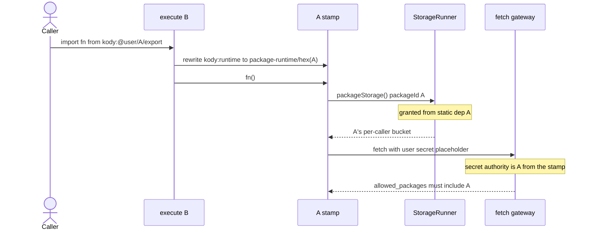
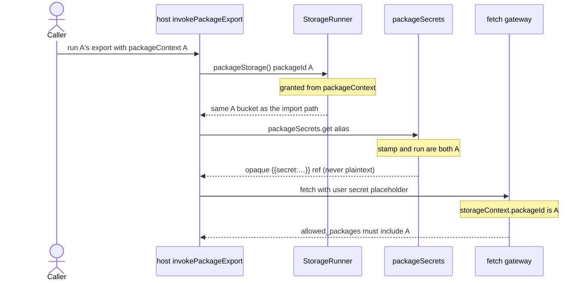
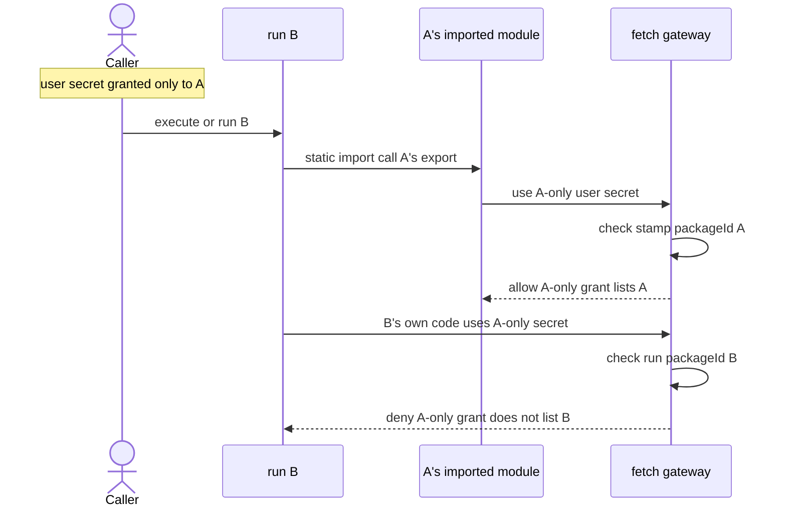
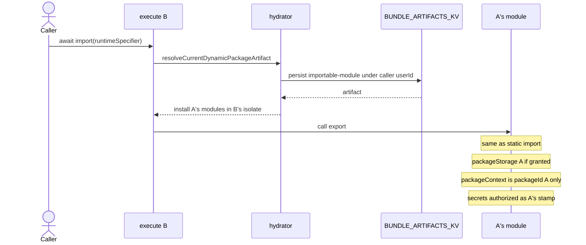
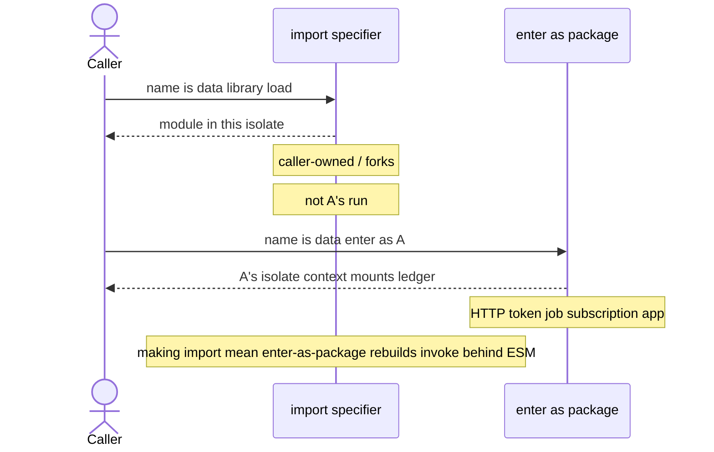

# `packageStorage()` grants and stamp-aligned secrets

How `packageStorage()` and user-secret authority work when imports resolve only
in the caller's org (a package from another org, including `@kody/*`, is forked
first; see
[0067](./decisions/0067-cross-org-grants-replace-shares-and-platform-accounts.md))
and under [0037](./decisions/0037-no-author-packages-invoke.md) (authors compose
with static import / `import(specifier)` / workflows; external clients use
inbound webhooks).

Related: [#1337](https://github.com/kody-hq/kody/pull/1337) (fail-closed
grants), [#1691](https://github.com/kody-hq/kody/pull/1691) (caller secrets on
package use), [#1742](https://github.com/kody-hq/kody/pull/1742) (0037).

## What the code does

`packageStorage()` and secret reads are two layers. The stamp routes identity;
the grant is the security boundary.

1. **Stamp (bundler).** Modules that originate from a saved package rewrite
   `kody:runtime` to `.__kody_virtual__/package-runtime/<hex(packageId)>.js`.
   That module closes `packageStorage` and `packageSecrets` over the declaring
   package UUID. Ad hoc execute entry code is unstamped and rewrites to
   `.__kody_virtual__/public-runtime.js`. Both re-export an explicit allowlist
   of public `kody:runtime` names. The shared runtime's stamp helpers
   (`__kodyCreatePackageBoundSecrets`, `__kodyMeterStaticPackageExport`, …)
   enter secret authority for any id, so they stay bundler-internal: an import
   specifier (or a manifest / wrangler path value) that targets
   `.__kody_virtual__/` fails the build, and computed `import()` of those paths
   throws. Comments and strings that only name the directory build fine. See
   `createPackageRuntimeModuleSource`, `createPublicRuntimeModuleSource`, and
   `rewriteKodyImports`.
2. **Grant (host).** `collectPackageStorageGrantIds` in
   `packages/worker/src/mcp/run-kody-registry.ts` builds the set from
   host-controlled provenance only:
   - the run's `packageContext.packageId` (when the run _is_ a package)
   - each static dependency `packageId`, including `transitive: true` entries:
     packages that a dependency's export statically imports from files reachable
     from that export (`resolveKodyDependenciesForEntryPoint` in
     `module-graph-workspace.ts`). Execute that imports only A still grants B
     when A's export imports B. Static-call metering, popularity, and republish
     staleness stay direct-only.
   - dynamic-import artifact ids installed during hydration
3. **Enforce.** `createPackageStorageKodyTools` rejects any sandbox-supplied
   `packageId` outside that set. Secret mounts (`packageSecrets`) do not take an
   author-selected package id on `kody.packageSecretGet` / `Has`. The host
   honors only the stamp identity (hidden ALS / capability field) or the run
   package, and only when that id is in the grant set. Then `allowed_packages` /
   implicit read checks run as that package. The StorageRunner name is
   `(callerUserId, package:{packageId})`, so a granted id is a **per-caller**
   bucket.

Static imports resolve only to packages in the caller's org, so every static
dependency id is one the org owns. A package from another org (for example
`@kody/github`) is `communityFork`ed first, and the bucket is the **fork's**
UUID. Static imports receive `packageStorage()` grants and stamp-aligned secret
authority.

`packageContext` in a statically imported module from execute is bound to the
declaring package like `packageStorage()`: it is `{ packageId }` with that
package's id, and the run's full context only when the run _is_ that package.
Code that needs the ambient run (hosted URL, app paths) must run as that
package: inbound webhooks for external clients, or a job / subscription / app
surface.

Issue `#1691` is user-scope `{{secret}}` placeholders resolved at the fetch
gateway for the calling user. The gateway authorizes those placeholders as the
**stamp** when the call site is stamped (and the id is in the provenance set),
otherwise as the run.

## Recommended model (secrets, storage, context)

An org forks a package from another org and then only runs **its** copy. Three
facts, one rule each:

| Thing              | Identity                         | Rule                                                                                                     |
| ------------------ | -------------------------------- | -------------------------------------------------------------------------------------------------------- |
| `packageStorage()` | declaring module (bundler stamp) | A's code hits `(callerUserId, package:{A.id})` when granted                                              |
| `packageContext`   | declaring module (bundler stamp) | A's code reads `{ packageId: A }`; the full run context only when the run _is_ A                         |
| Secrets            | declaring module (bundler stamp) | user-secret `allowed_packages` and `packageSecrets` mounts check the stamp when the call site is stamped |

The grant set says which buckets a run may reach; the calling package says whose
bucket it is. Importer code and other packages in the same run cannot read or
write A's bucket by passing A's id to `kody.packageStorage*` or the app bridge.
Only A's own `packageStorage()` reaches it. The same holds for `credential()`: a
credential client opens as the calling package (its needs, mappings, and bound
Keys), so naming A's id on `kody.credentialClient*` or the app bridge is denied.

**Composition:** static `import` when the name is known (library in this
isolate). Computed `import(specifier)` when the name is data (caller-owned /
forks). Workflows when you need exactly-once. Do not point `packageContext` at
“the” imported module. Computed `import()` is a library load, not
enter-as-package.

Importing A is a trust decision that **A’s stamped code** may use secrets locked
to A (or A’s `kody.secretMounts`). A must not return secret values to callers.
B’s own code still cannot read an A-only secret. Writes (`secretSet` /
`secretDelete`) stay fail-closed: the stamp package still needs an
`allowed_packages` grant.

Static import of caller-owned A (including a fork). Storage and secrets follow
A; the run stays B or execute.

Enter A as a package run (HTTP token, job, subscription, or app). New isolate.
Storage is still A's bucket. Secrets and context are A's.

A-only secret, B imports A vs B’s own code. The stamp is what lets A’s export
succeed without granting the secret to B.

On ad hoc execute with no `packageId` and no stamp, the `allowed_packages` check
is skipped (`assertPackageCanAccessResolvedSecret` returns). Execute entry code
can use **your** user secrets through `{{secret}}`. It cannot use A's
`packageSecrets` mounts. A's stamped module, imported into that execute, uses
A's grants and mounts.

## Dynamic `import()` for caller-owned names

Literal `import("kody:@...")` is a teaching error: known names are static
imports. Computed `import(specifier)` for `kody:@` names loads caller-owned /
forked modules through a host library-load bridge
(`resolveCurrentDynamicPackageArtifact` / nested evaluate with the caller's
`packageContext` and callee stamp grants). Authors compose with static `kody:@`
imports, `import(specifier)`, or workflows; `packages` stays `null`
([#1750](https://github.com/kody-hq/kody/issues/1750)).

If the specifier is a **caller-owned** package and `import()` means “library
load in this isolate,” storage, context, and secrets match static import: A's
bucket, A's `{ packageId }` as `packageContext`, A's stamp for secret authority
when the loaded module is stamped. That is not enter-as-package.

The persist step writes under the **caller**, which is safe because the
specifier can only resolve to a package in the caller's org.

ESM `import()` has no `params`, no `idempotencyKey`, and does not start a
package run. Ambient `packageContext` stays this run. Do not overload `import()`
to secretly enter a package run.

