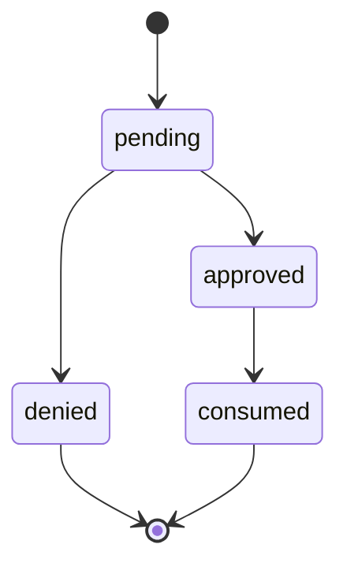
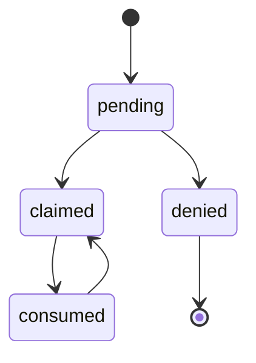
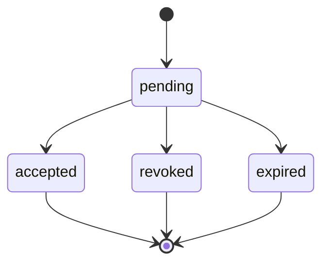

# Explicit state machines

<!-- Generated by tools/generate-state-machines.ts. Do not edit. -->

Every lifecycle/status column and multi-step UI flow is declared with
`defineStateMachine`. The graph is the source of truth for types, runtime
validation, SQL transition guards, and this agent-readable reference.

## Adding a machine

Declare a dependency-light module next to the domain, export the machine and a
`StateOf<typeof machine>` type alias, and register its machine and source path
in `packages/worker/src/state-machines.ts`. Run
`npm run state-machines:generate` and add focused graph tests. Existing stored
values and wire contracts stay unchanged.

Declare SQL guards with `machine.guard({ from: 'approved', to: 'consumed' })`.
The guard validates every source-to-target pair and returns a SQL literal list
of the explicit source states. Both fields accept a state or an array of states.
Hoist fixed guards to module-level constants; preserve operation-specific
sources (such as consumed-to-claimed rollback) rather than broadening
compare-and-set guards to every incoming edge. Use `sourcesOf` to discover graph
predecessors.

## oauth_device_authorizations.status

Device requests await a decision before an approved request can be consumed.

Source:
[`packages/worker/src/oauth-device/device-authorization-state.ts`](../../packages/worker/src/oauth-device/device-authorization-state.ts)

| State    | May transition to |
| -------- | ----------------- |
| pending  | approved, denied  |
| approved | consumed          |
| denied   | — (terminal)      |
| consumed | — (terminal)      |

## agent_registrations.status

Registrations await a claim decision, then consumption with retry rollback when
token minting fails.

Source:
[`packages/worker/src/agent-registration/agent-registration-state.ts`](../../packages/worker/src/agent-registration/agent-registration-state.ts)

| State    | May transition to |
| -------- | ----------------- |
| pending  | claimed, denied   |
| claimed  | consumed          |
| denied   | — (terminal)      |
| consumed | claimed           |

## invites.status

Pending invitations close through acceptance, revocation, recipient decline or
expiry.

Source:
[`packages/worker/src/orgs/invite-state.ts`](../../packages/worker/src/orgs/invite-state.ts)

| State    | May transition to          |
| -------- | -------------------------- |
| pending  | accepted, revoked, expired |
| accepted | — (terminal)               |
| revoked  | — (terminal)               |
| expired  | — (terminal)               |
