# Explicit state machines

<!-- Generated by tools/generate-state-machines.ts. Do not edit. -->

Owned lifecycles use event-driven XState machines. Unconstrained replacement
fields are status enums, not state machines. Stored values and wire contracts
remain unchanged.

Framework-owned request state (such as TanStack Query mutations) is used
directly, not wrapped in another machine. App-owned UI flows own interaction
with an XState actor (`useActor`, `useActorRef`, or `createActor`). View types
carry validation and receipt payload for `uiState`. `sendUiEvent` rejects
illegal transitions synchronously, including submissions arriving before React
has rendered a pending state.

## Adding a machine

Declare a flat XState machine next to the domain, with named operation events
and genuinely terminal states marked `type: 'final'`. Register its machine and
source path in the package's `state-machines.ts` registry. The tooling-only
aggregate at `tools/state-machines.ts` includes each package registry without
adding runtime dependencies between packages. Run
`npm run state-machines:generate` and add focused graph tests. Existing stored
values and wire contracts stay unchanged.

Server and desktop machines export a `LifecycleStateOf<typeof machine>` alias
for stored or parsed status. UI machines export a view type for actor context
instead of that alias (`AuthFormState`, `AdminCodemodRunState`, and similar,
including `FormFlowState` views from `#client/ui-actor.ts`). Drive them with
`uiContext`, `uiState`, and `sendUiEvent`.

Use `nextState(machine, from, event)` for guard-aware transition validation and
`sqlSourcesOf(machine, eventType)` for SQL compare-and-set source lists. Sources
are structural: retain operation-specific SQL conditions alongside the list.
State-only helpers use static machine context unless explicit context is
supplied; machines with context initializers require explicit context.
`canHandle` probes with a type-only event; payload-dependent guards require
`nextState` with the full event.

Use `defineStatusEnum` for fields accepting arbitrary status replacement and
register them separately in `statusEnums`; they have no transition graph.

## oauth_device_authorizations.status

Device requests await a decision before an approved request can be consumed.

Source:
[`packages/worker/src/oauth-device/device-authorization-state.ts`](../../packages/worker/src/oauth-device/device-authorization-state.ts)

States: pending, approved, denied, consumed

Final states: denied, consumed

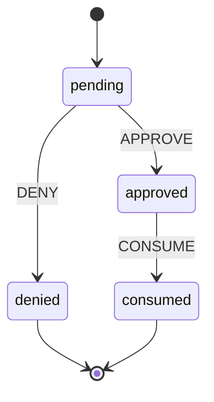

| Event   | From     | To       | Guard |
| ------- | -------- | -------- | ----- |
| APPROVE | pending  | approved | —     |
| DENY    | pending  | denied   | —     |
| CONSUME | approved | consumed | —     |

## agent_registrations.status

Registrations await a claim decision, then consumption with retry rollback when
token minting fails.

Source:
[`packages/worker/src/agent-registration/agent-registration-state.ts`](../../packages/worker/src/agent-registration/agent-registration-state.ts)

States: pending, claimed, denied, consumed

Final states: denied

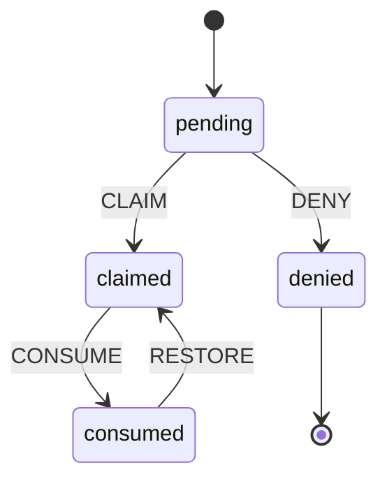

| Event   | From     | To       | Guard |
| ------- | -------- | -------- | ----- |
| CLAIM   | pending  | claimed  | —     |
| DENY    | pending  | denied   | —     |
| CONSUME | claimed  | consumed | —     |
| RESTORE | consumed | claimed  | —     |

## invites.status

Pending invitations close through acceptance, revocation, recipient decline or
expiry.

Source:
[`packages/worker/src/orgs/invite-state.ts`](../../packages/worker/src/orgs/invite-state.ts)

States: pending, accepted, revoked, expired

Final states: accepted, revoked, expired

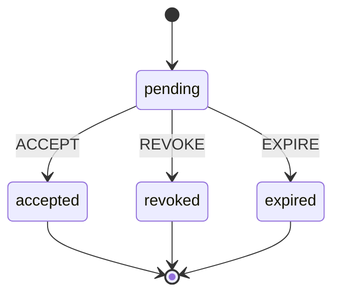

| Event  | From    | To       | Guard |
| ------ | ------- | -------- | ----- |
| ACCEPT | pending | accepted | —     |
| REVOKE | pending | revoked  | —     |
| EXPIRE | pending | expired  | —     |

## newsletter_signups.status

A public newsletter sign-up joins the list only after its emailed link is
confirmed, and can leave and rejoin afterwards.

Source:
[`packages/worker/src/newsletter/signup-state.ts`](../../packages/worker/src/newsletter/signup-state.ts)

States: pending, confirmed, unsubscribed

Final states: None

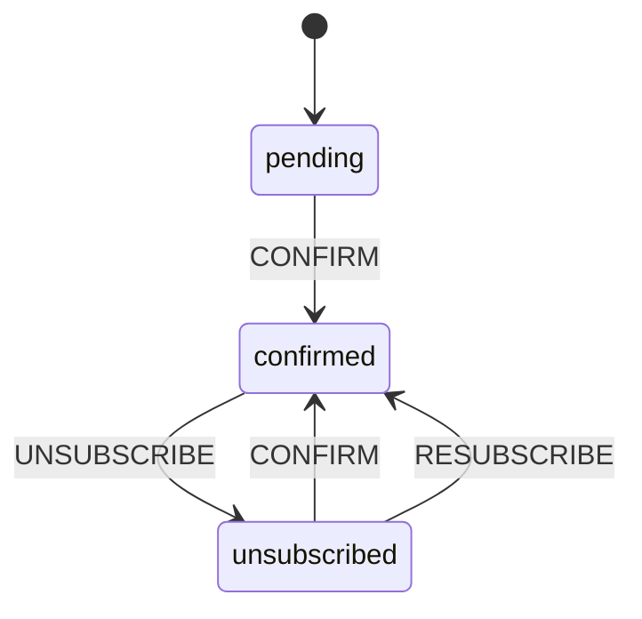

| Event       | From         | To           | Guard |
| ----------- | ------------ | ------------ | ----- |
| CONFIRM     | pending      | confirmed    | —     |
| UNSUBSCRIBE | confirmed    | unsubscribed | —     |
| CONFIRM     | unsubscribed | confirmed    | —     |
| RESUBSCRIBE | unsubscribed | confirmed    | —     |

## publish_builds.status

Builds upload, seal and commit or reject; a committed build may be finalized
again or rejected by a later verification.

Source:
[`packages/worker/src/publish-offload/publish-build-state.ts`](../../packages/worker/src/publish-offload/publish-build-state.ts)

States: uploading, sealed, committed, rejected

Final states: rejected

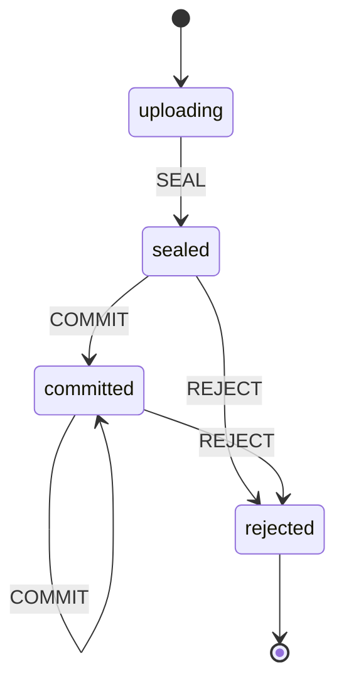

| Event  | From      | To        | Guard |
| ------ | --------- | --------- | ----- |
| SEAL   | uploading | sealed    | —     |
| COMMIT | sealed    | committed | —     |
| REJECT | sealed    | rejected  | —     |
| COMMIT | committed | committed | —     |
| REJECT | committed | rejected  | —     |

## dead_letter_messages.status

Messages park, claim or reclaim replay, and return to parked on release;
successful replay deletes the row.

Source:
[`packages/worker/src/dead-letter/dead-letter-message-state.ts`](../../packages/worker/src/dead-letter/dead-letter-message-state.ts)

States: parked, replaying

Final states: None

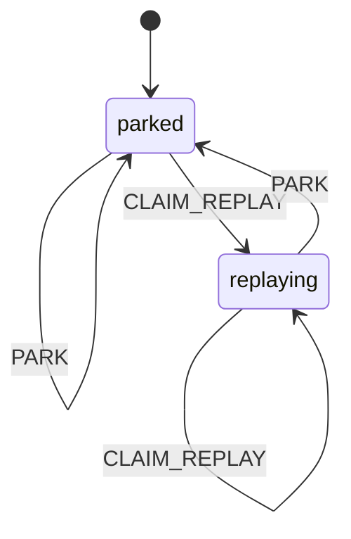

| Event        | From      | To        | Guard |
| ------------ | --------- | --------- | ----- |
| PARK         | parked    | parked    | —     |
| CLAIM_REPLAY | parked    | replaying | —     |
| PARK         | replaying | parked    | —     |
| CLAIM_REPLAY | replaying | replaying | —     |

## package_approval_requests.status

Pending package approvals resolve by owner approval or supersession by another
publish.

Source:
[`packages/worker/src/package-capabilities/package-approval-state.ts`](../../packages/worker/src/package-capabilities/package-approval-state.ts)

States: pending, approved, superseded

Final states: approved, superseded

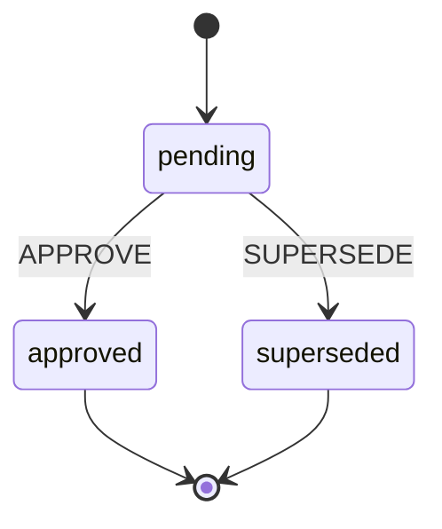

| Event     | From    | To         | Guard |
| --------- | ------- | ---------- | ----- |
| APPROVE   | pending | approved   | —     |
| SUPERSEDE | pending | superseded | —     |

## org_plan_transfers.status

Transfers begin at checkout or retry, acquire or reclaim an applying lease, and
complete or cancel; applying can release back to checkout or retry. Rows or
initial responses may enter directly in another listed state.

Source:
[`packages/worker/src/billing/plan-transfer-state.ts`](../../packages/worker/src/billing/plan-transfer-state.ts)

States: pending_checkout, applying, needs_retry, completed, canceled

Final states: completed, canceled

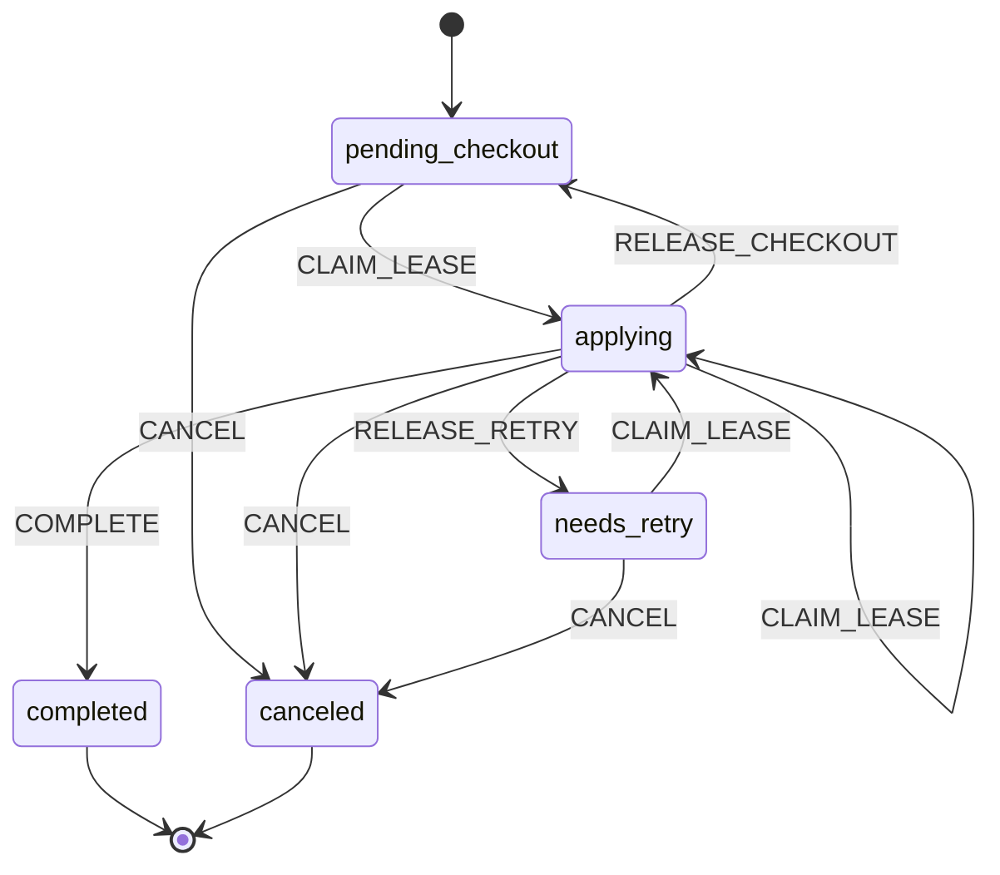

| Event            | From             | To               | Guard |
| ---------------- | ---------------- | ---------------- | ----- |
| CLAIM_LEASE      | pending_checkout | applying         | —     |
| CANCEL           | pending_checkout | canceled         | —     |
| CLAIM_LEASE      | applying         | applying         | —     |
| RELEASE_CHECKOUT | applying         | pending_checkout | —     |
| RELEASE_RETRY    | applying         | needs_retry      | —     |
| COMPLETE         | applying         | completed        | —     |
| CANCEL           | applying         | canceled         | —     |
| CLAIM_LEASE      | needs_retry      | applying         | —     |
| CANCEL           | needs_retry      | canceled         | —     |

## package_codemod_runs.status

Codemod runs heartbeat, finish, fail or abandon; failed and abandoned runs
resume, while a repeated completed continuation may complete again or fail.

Source:
[`packages/worker/src/package-codemods/package-codemod-run-state.ts`](../../packages/worker/src/package-codemods/package-codemod-run-state.ts)

States: running, completed, failed, abandoned

Final states: None

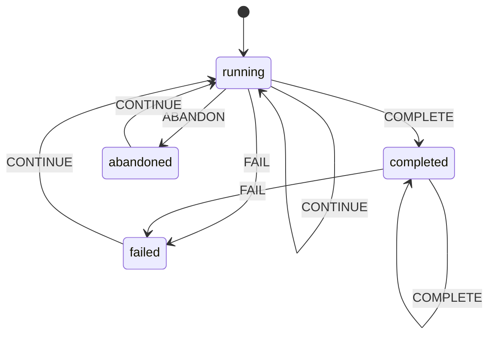

| Event    | From      | To        | Guard |
| -------- | --------- | --------- | ----- |
| CONTINUE | running   | running   | —     |
| COMPLETE | running   | completed | —     |
| FAIL     | running   | failed    | —     |
| ABANDON  | running   | abandoned | —     |
| COMPLETE | completed | completed | —     |
| FAIL     | completed | failed    | —     |
| CONTINUE | failed    | running   | —     |
| CONTINUE | abandoned | running   | —     |

## dr_paced_restore_drill_runs.status

A leased restore drill remains running until its sources finish and the
aggregate passes or fails.

Source:
[`packages/worker/src/dr/d1-paced-restore-drill-run-state.ts`](../../packages/worker/src/dr/d1-paced-restore-drill-run-state.ts)

States: running, passed, failed

Final states: passed, failed

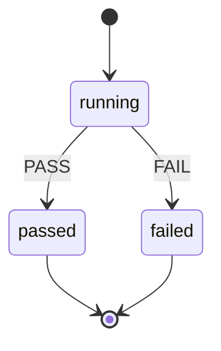

| Event | From    | To     | Guard |
| ----- | ------- | ------ | ----- |
| PASS  | running | passed | —     |
| FAIL  | running | failed | —     |

## package_owner_error_spike.status

Owners trigger pending delivery, become alerted after success, and rearm after
health, inactivity or abandoned delivery; immediate delivery may persist alerted
directly from ok.

Source:
[`packages/worker/src/usage/package-owner-spike-state.ts`](../../packages/worker/src/usage/package-owner-spike-state.ts)

States: ok, pending, alerted

Final states: None

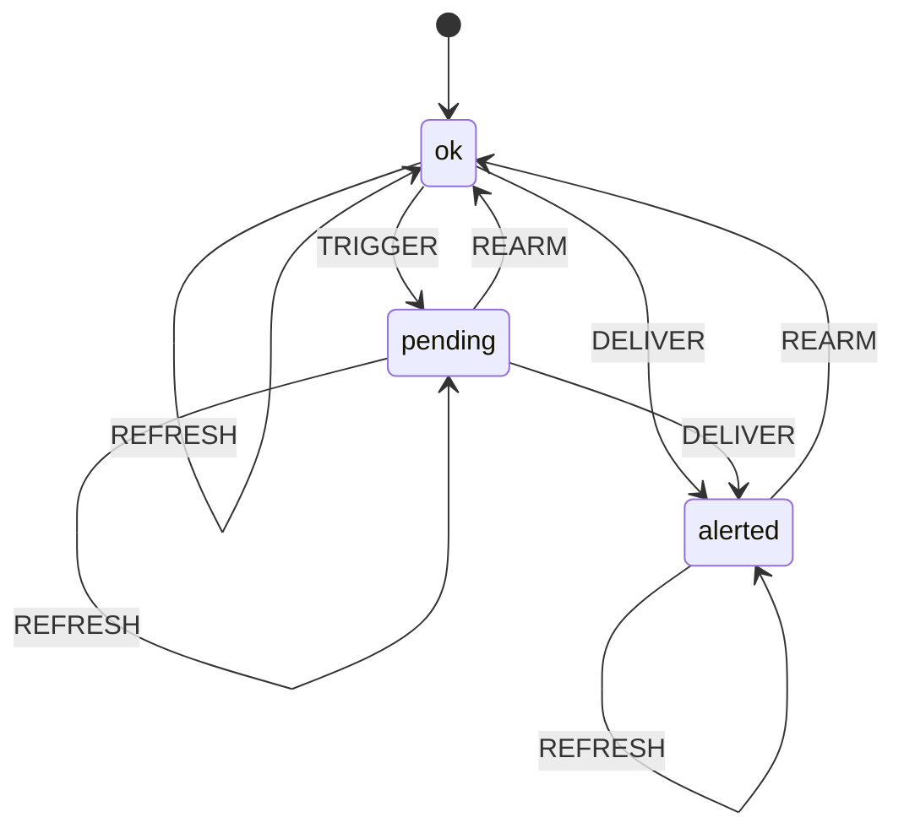

| Event   | From    | To      | Guard |
| ------- | ------- | ------- | ----- |
| REFRESH | ok      | ok      | —     |
| TRIGGER | ok      | pending | —     |
| DELIVER | ok      | alerted | —     |
| REFRESH | pending | pending | —     |
| REARM   | pending | ok      | —     |
| DELIVER | pending | alerted | —     |
| REFRESH | alerted | alerted | —     |
| REARM   | alerted | ok      | —     |

## admin_account_deletion_approvals.lifecycle

Approvals expire or are consumed for deletion, with consumption rolled back on
failure and expiry assessed on the next read.

Source:
[`packages/worker/universal/account-deletion-approval-state.ts`](../../packages/worker/universal/account-deletion-approval-state.ts)

States: pending, consumed, expired

Final states: expired

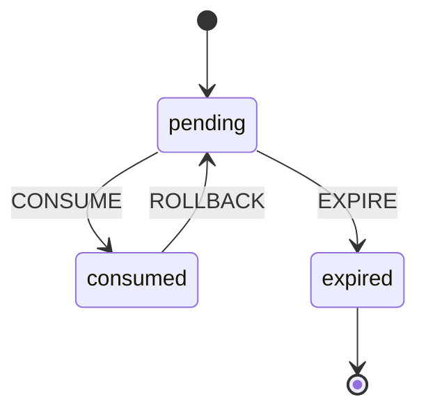

| Event    | From     | To       | Guard |
| -------- | -------- | -------- | ----- |
| CONSUME  | pending  | consumed | —     |
| EXPIRE   | pending  | expired  | —     |
| ROLLBACK | consumed | pending  | —     |

## community_reports.status

Open community reports resolve or dismiss once.

Source:
[`packages/worker/src/community/community-report-state.ts`](../../packages/worker/src/community/community-report-state.ts)

States: open, resolved, dismissed

Final states: resolved, dismissed

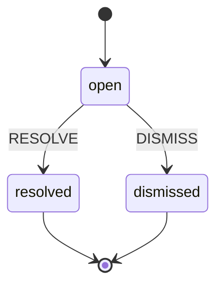

| Event   | From | To        | Guard |
| ------- | ---- | --------- | ----- |
| RESOLVE | open | resolved  | —     |
| DISMISS | open | dismissed | —     |

## credential_inventory_runs.status

Inventory scans advance a cursor while scanning and complete at the last page.

Source:
[`packages/worker/src/credentials/credential-inventory-run-state.ts`](../../packages/worker/src/credentials/credential-inventory-run-state.ts)

States: scanning, complete

Final states: complete

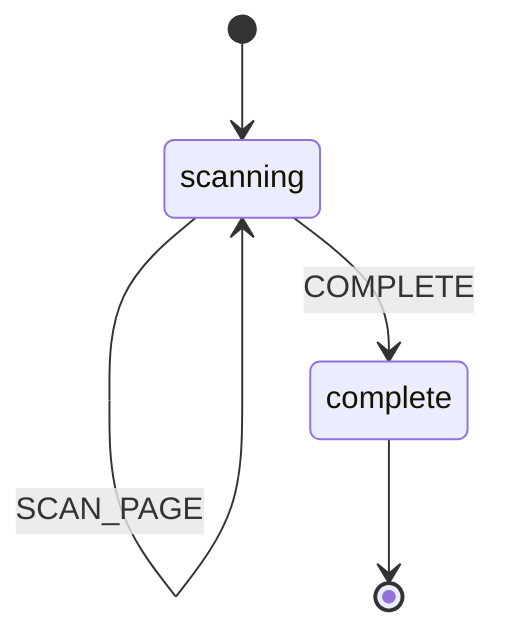

| Event     | From     | To       | Guard |
| --------- | -------- | -------- | ----- |
| SCAN_PAGE | scanning | scanning | —     |
| COMPLETE  | scanning | complete | —     |

## dr_paced_restore_drill_sources.status

Per-source progress setters can start, restart or refinalize any source; the
coordinator normally skips completed sources.

Source:
[`packages/worker/src/dr/d1-paced-restore-drill-source-state.ts`](../../packages/worker/src/dr/d1-paced-restore-drill-source-state.ts)

States: pending, running, passed, failed

Final states: None

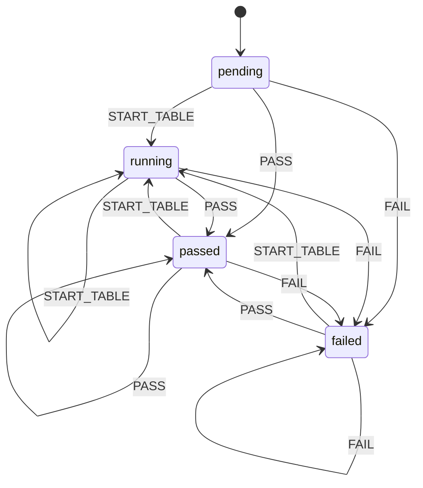

| Event       | From    | To      | Guard |
| ----------- | ------- | ------- | ----- |
| START_TABLE | pending | running | —     |
| PASS        | pending | passed  | —     |
| FAIL        | pending | failed  | —     |
| START_TABLE | running | running | —     |
| PASS        | running | passed  | —     |
| FAIL        | running | failed  | —     |
| START_TABLE | passed  | running | —     |
| PASS        | passed  | passed  | —     |
| FAIL        | passed  | failed  | —     |
| START_TABLE | failed  | running | —     |
| PASS        | failed  | passed  | —     |
| FAIL        | failed  | failed  | —     |

## email_inbound_dedupe_pointer.state

Dedupe windows start pending, tombstone on message deletion, and reset after
expiry; repeat tombstones are idempotent.

Source:
[`packages/worker/src/email/inbound-dedupe-pointer-state.ts`](../../packages/worker/src/email/inbound-dedupe-pointer-state.ts)

States: pending, rejected

Final states: None

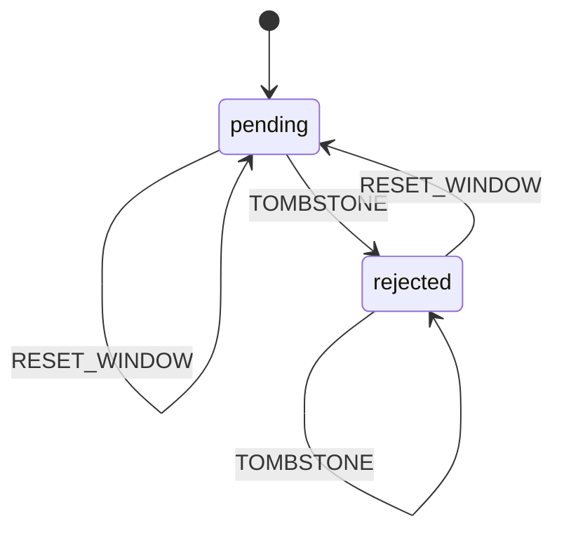

| Event        | From     | To       | Guard |
| ------------ | -------- | -------- | ----- |
| RESET_WINDOW | pending  | pending  | —     |
| TOMBSTONE    | pending  | rejected | —     |
| RESET_WINDOW | rejected | pending  | —     |
| TOMBSTONE    | rejected | rejected | —     |

## email_inbound_delivery.state

Inbound deliveries acquire storage or cleanup leases, release or reclaim them,
finalize receipt, or reject; missing stored messages permit refinalization.

Source:
[`packages/worker/src/email/inbound-delivery-state.ts`](../../packages/worker/src/email/inbound-delivery-state.ts)

States: pending, storing, cleaning, received, rejected, orphan-cleaned

Final states: rejected

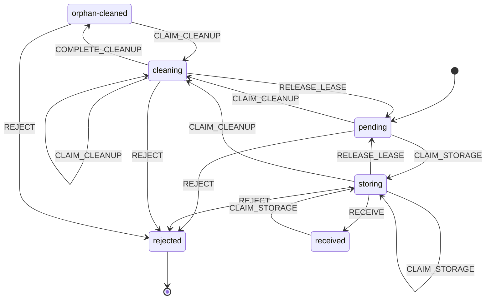

| Event            | From           | To             | Guard |
| ---------------- | -------------- | -------------- | ----- |
| CLAIM_STORAGE    | pending        | storing        | —     |
| CLAIM_CLEANUP    | pending        | cleaning       | —     |
| REJECT           | pending        | rejected       | —     |
| CLAIM_STORAGE    | storing        | storing        | —     |
| RELEASE_LEASE    | storing        | pending        | —     |
| RECEIVE          | storing        | received       | —     |
| CLAIM_CLEANUP    | storing        | cleaning       | —     |
| REJECT           | storing        | rejected       | —     |
| CLAIM_CLEANUP    | cleaning       | cleaning       | —     |
| RELEASE_LEASE    | cleaning       | pending        | —     |
| COMPLETE_CLEANUP | cleaning       | orphan-cleaned | —     |
| REJECT           | cleaning       | rejected       | —     |
| CLAIM_STORAGE    | received       | storing        | —     |
| CLAIM_CLEANUP    | orphan-cleaned | cleaning       | —     |
| REJECT           | orphan-cleaned | rejected       | —     |

## email_inbound_subscription_effect.state

Subscription delivery claims or reclaims processing, completes or retries to
dead-letter, and refinalization resets the effect to pending.

Source:
[`packages/worker/src/email/inbound-subscription-effect-state.ts`](../../packages/worker/src/email/inbound-subscription-effect-state.ts)

States: pending, processing, complete, dead-letter

Final states: None

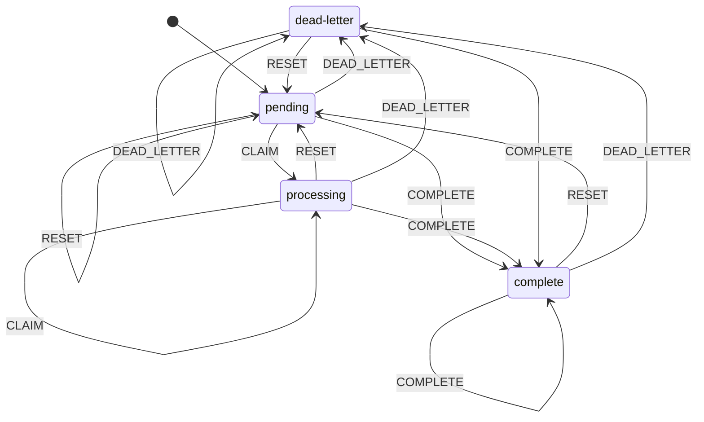

| Event       | From        | To          | Guard |
| ----------- | ----------- | ----------- | ----- |
| RESET       | pending     | pending     | —     |
| CLAIM       | pending     | processing  | —     |
| COMPLETE    | pending     | complete    | —     |
| DEAD_LETTER | pending     | dead-letter | —     |
| CLAIM       | processing  | processing  | —     |
| RESET       | processing  | pending     | —     |
| COMPLETE    | processing  | complete    | —     |
| DEAD_LETTER | processing  | dead-letter | —     |
| RESET       | complete    | pending     | —     |
| COMPLETE    | complete    | complete    | —     |
| DEAD_LETTER | complete    | dead-letter | —     |
| RESET       | dead-letter | pending     | —     |
| COMPLETE    | dead-letter | complete    | —     |
| DEAD_LETTER | dead-letter | dead-letter | —     |

## enablements.state

Enablements start on, pause or rewrite a pause cause, resume after access
recovers, and turn off permanently.

Source:
[`packages/worker/src/enablements/enablement-state.ts`](../../packages/worker/src/enablements/enablement-state.ts)

States: on, paused, off

Final states: off

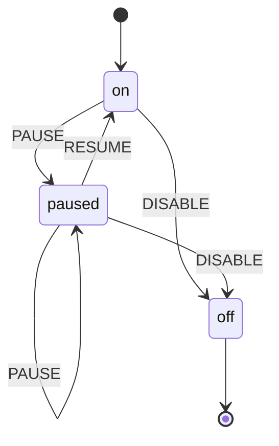

| Event   | From   | To     | Guard |
| ------- | ------ | ------ | ----- |
| PAUSE   | on     | paused | —     |
| DISABLE | on     | off    | —     |
| PAUSE   | paused | paused | —     |
| RESUME  | paused | on     | —     |
| DISABLE | paused | off    | —     |

## referrals.status

Pending referrals reject fraud or reward qualifying invoices; incomplete reward
delivery may retry, but rejected referrals cannot be rewarded.

Source:
[`packages/worker/src/entitlements/referral-state.ts`](../../packages/worker/src/entitlements/referral-state.ts)

States: pending, rewarded, rejected

Final states: rejected

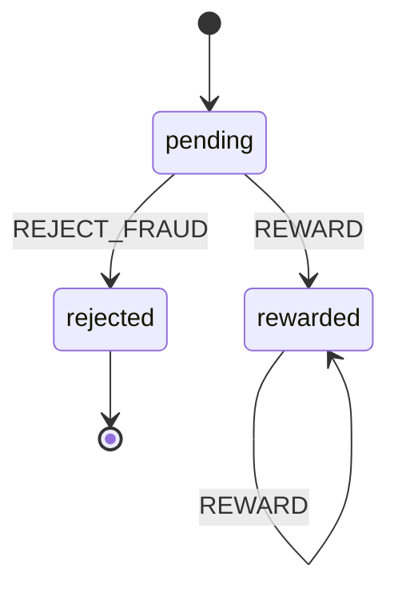

| Event        | From     | To       | Guard |
| ------------ | -------- | -------- | ----- |
| REJECT_FRAUD | pending  | rejected | —     |
| REWARD       | pending  | rewarded | —     |
| REWARD       | rewarded | rewarded | —     |

## execution_context_queued.lifecycle

Queued rows enter a starting handoff that always releases its cancellation
fence, then retry or leave the queue after dispatch, cancellation, failure or
expiry.

Source:
[`packages/worker/src/execution-contexts/queued-run-state.ts`](../../packages/worker/src/execution-contexts/queued-run-state.ts)

States: queued, starting, finished, cancelled, expired

Final states: finished, cancelled, expired

```mermaid
stateDiagram-v2
    [*] --> queued
    queued --> starting: START_HANDOFF
    queued --> finished: FINISH
    queued --> cancelled: CANCEL
    queued --> expired: EXPIRE
    starting --> queued: RELEASE_HANDOFF
    starting --> finished: FINISH
    starting --> expired: EXPIRE
    finished --> [*]
    cancelled --> [*]
    expired --> [*]
```

| Event           | From     | To        | Guard |
| --------------- | -------- | --------- | ----- |
| START_HANDOFF   | queued   | starting  | —     |
| FINISH          | queued   | finished  | —     |
| CANCEL          | queued   | cancelled | —     |
| EXPIRE          | queued   | expired   | —     |
| RELEASE_HANDOFF | starting | queued    | —     |
| FINISH          | starting | finished  | —     |
| EXPIRE          | starting | expired   | —     |

## execution_context_runs.state

Dispatch offers commit or abort and rejected offers can retry; committed runs
finish once, while the existing offer-failure setter can still abort or reject
any nonfinal row.

Source:
[`packages/worker/src/execution-contexts/run-dispatch-state.ts`](../../packages/worker/src/execution-contexts/run-dispatch-state.ts)

States: dispatched, committed, succeeded, failed, cancelled, lost, rejected,
aborted

Final states: succeeded, failed, cancelled, lost

```mermaid
stateDiagram-v2
    [*] --> dispatched
    dispatched --> committed: COMMIT
    dispatched --> aborted: ABORT
    dispatched --> rejected: REJECT
    committed --> succeeded: SUCCEED
    committed --> failed: FAIL
    committed --> cancelled: CANCEL
    committed --> lost: LOSE
    committed --> aborted: ABORT
    committed --> rejected: REJECT
    rejected --> dispatched: OFFER
    rejected --> rejected: REJECT
    rejected --> aborted: ABORT
    aborted --> dispatched: OFFER
    aborted --> rejected: REJECT
    aborted --> aborted: ABORT
    succeeded --> [*]
    failed --> [*]
    cancelled --> [*]
    lost --> [*]
```

| Event   | From       | To         | Guard |
| ------- | ---------- | ---------- | ----- |
| COMMIT  | dispatched | committed  | —     |
| ABORT   | dispatched | aborted    | —     |
| REJECT  | dispatched | rejected   | —     |
| SUCCEED | committed  | succeeded  | —     |
| FAIL    | committed  | failed     | —     |
| CANCEL  | committed  | cancelled  | —     |
| LOSE    | committed  | lost       | —     |
| ABORT   | committed  | aborted    | —     |
| REJECT  | committed  | rejected   | —     |
| OFFER   | rejected   | dispatched | —     |
| REJECT  | rejected   | rejected   | —     |
| ABORT   | rejected   | aborted    | —     |
| OFFER   | aborted    | dispatched | —     |
| REJECT  | aborted    | rejected   | —     |
| ABORT   | aborted    | aborted    | —     |

## follows.status

Active follows pause when delivery access fails and resume after a creator
reauthorizes them.

Source:
[`packages/worker/src/follow/follow-state.ts`](../../packages/worker/src/follow/follow-state.ts)

States: active, paused

Final states: None

```mermaid
stateDiagram-v2
    [*] --> active
    active --> paused: PAUSE
    paused --> active: REAUTHORIZE
```

| Event       | From   | To     | Guard |
| ----------- | ------ | ------ | ----- |
| PAUSE       | active | paused | —     |
| REAUTHORIZE | paused | active | —     |

## user_email_claims.status

Email addresses can be claimed, released and reclaimed; either state may be
inserted. Rows or initial responses may enter directly in another listed state.

Source:
[`packages/worker/src/identity/email-claim-state.ts`](../../packages/worker/src/identity/email-claim-state.ts)

States: claimed, released

Final states: None

```mermaid
stateDiagram-v2
    [*] --> claimed
    claimed --> released: RELEASE
    released --> claimed: CLAIM
```

| Event   | From     | To       | Guard |
| ------- | -------- | -------- | ----- |
| RELEASE | claimed  | released | —     |
| CLAIM   | released | claimed  | —     |

## org_invite_links.status

An active invite link can be explicitly revoked; expiry and exhaustion are
derived eligibility conditions.

Source:
[`packages/worker/src/orgs/invite-link-state.ts`](../../packages/worker/src/orgs/invite-link-state.ts)

States: active, revoked

Final states: revoked

```mermaid
stateDiagram-v2
    [*] --> active
    active --> revoked: REVOKE
    revoked --> [*]
```

| Event  | From   | To      | Guard |
| ------ | ------ | ------- | ----- |
| REVOKE | active | revoked | —     |

## platform_feedback.status

Feedback triages or closes, closed feedback reopens to triaged, and review edits
may preserve status.

Source:
[`packages/worker/src/platform-feedback/platform-feedback-state.ts`](../../packages/worker/src/platform-feedback/platform-feedback-state.ts)

States: open, triaged, resolved, dismissed

Final states: None

```mermaid
stateDiagram-v2
    [*] --> open
    open --> open: REVIEW_OPEN
    open --> triaged: TRIAGE
    open --> resolved: RESOLVE
    open --> dismissed: DISMISS
    triaged --> triaged: TRIAGE
    triaged --> resolved: RESOLVE
    triaged --> dismissed: DISMISS
    resolved --> resolved: RESOLVE
    resolved --> triaged: TRIAGE
    dismissed --> dismissed: DISMISS
    dismissed --> triaged: TRIAGE
```

| Event       | From      | To        | Guard |
| ----------- | --------- | --------- | ----- |
| REVIEW_OPEN | open      | open      | —     |
| TRIAGE      | open      | triaged   | —     |
| RESOLVE     | open      | resolved  | —     |
| DISMISS     | open      | dismissed | —     |
| TRIAGE      | triaged   | triaged   | —     |
| RESOLVE     | triaged   | resolved  | —     |
| DISMISS     | triaged   | dismissed | —     |
| RESOLVE     | resolved  | resolved  | —     |
| TRIAGE      | resolved  | triaged   | —     |
| DISMISS     | dismissed | dismissed | —     |
| TRIAGE      | dismissed | triaged   | —     |

## package_invocation_ledger.status

Invocation claims heartbeat or reclaim an in-progress attempt and atomically
persist its completed or failed response.

Source:
[`packages/worker/src/run-records/package-invocation-state.ts`](../../packages/worker/src/run-records/package-invocation-state.ts)

States: in_progress, completed, failed

Final states: completed, failed

```mermaid
stateDiagram-v2
    [*] --> in_progress
    in_progress --> in_progress: CLAIM
    in_progress --> completed: COMPLETE
    in_progress --> failed: FAIL
    completed --> [*]
    failed --> [*]
```

| Event    | From        | To          | Guard |
| -------- | ----------- | ----------- | ----- |
| CLAIM    | in_progress | in_progress | —     |
| COMPLETE | in_progress | completed   | —     |
| FAIL     | in_progress | failed      | —     |

## guest_purge.batch

Lists expired unclaimed guests, then deletes each account before its guest row
and announces only after both deletes; a failed guest is counted and the batch
moves on, the batch ends by deleting expired unclaimed guest rows whose account
is already gone, and a failed listing fails the lane.

Source:
[`packages/worker/src/guest/guest-purge-state.ts`](../../packages/worker/src/guest/guest-purge-state.ts)

States: listing, advancing, deleting_account, deleting_guest_row, announcing,
sweeping_orphaned_guest_rows, completed, list_failed

Final states: completed, list_failed

```mermaid
stateDiagram-v2
    [*] --> listing
    listing --> advancing: xstate.done.actor listExpiredGuests
    listing --> list_failed: xstate.error.actor listExpiredGuests
    advancing --> deleting_account: always [Has next guest]
    advancing --> sweeping_orphaned_guest_rows: always [Otherwise (Has next guest)]
    deleting_account --> deleting_guest_row: xstate.done.actor deleteGuestAccount
    deleting_account --> advancing: xstate.error.actor deleteGuestAccount
    deleting_guest_row --> announcing: xstate.done.actor deleteGuestRow
    deleting_guest_row --> advancing: xstate.error.actor deleteGuestRow
    announcing --> advancing: xstate.done.actor announceGuestPurged
    announcing --> advancing: xstate.error.actor announceGuestPurged
    sweeping_orphaned_guest_rows --> completed: xstate.done.actor deleteOrphanedGuestRows
    sweeping_orphaned_guest_rows --> completed: xstate.error.actor deleteOrphanedGuestRows
    completed --> [*]
    list_failed --> [*]
```

| Event                                      | From                         | To                           | Guard                      |
| ------------------------------------------ | ---------------------------- | ---------------------------- | -------------------------- |
| xstate.done.actor listExpiredGuests        | listing                      | advancing                    | —                          |
| xstate.error.actor listExpiredGuests       | listing                      | list_failed                  | —                          |
| always                                     | advancing                    | deleting_account             | Has next guest             |
| always                                     | advancing                    | sweeping_orphaned_guest_rows | Otherwise (Has next guest) |
| xstate.done.actor deleteGuestAccount       | deleting_account             | deleting_guest_row           | —                          |
| xstate.error.actor deleteGuestAccount      | deleting_account             | advancing                    | —                          |
| xstate.done.actor deleteGuestRow           | deleting_guest_row           | announcing                   | —                          |
| xstate.error.actor deleteGuestRow          | deleting_guest_row           | advancing                    | —                          |
| xstate.done.actor announceGuestPurged      | announcing                   | advancing                    | —                          |
| xstate.error.actor announceGuestPurged     | announcing                   | advancing                    | —                          |
| xstate.done.actor deleteOrphanedGuestRows  | sweeping_orphaned_guest_rows | completed                    | —                          |
| xstate.error.actor deleteOrphanedGuestRows | sweeping_orphaned_guest_rows | completed                    | —                          |

## scheduled_lane.run

Leased lanes acquire a lease or skip on overlap; the lane then runs, D1 lock
contention settles without a report, other failures are reported, and a held
lease is released before any outcome settles.

Source:
[`packages/worker/src/scheduled/scheduled-lane-run-state.ts`](../../packages/worker/src/scheduled/scheduled-lane-run-state.ts)

States: deciding, acquiring_lease, running, reporting_failure, releasing_lease,
completed, skipped_overlap, lock_contention, failed, report_failed

Final states: completed, skipped_overlap, lock_contention, failed, report_failed

```mermaid
stateDiagram-v2
    [*] --> deciding
    deciding --> acquiring_lease: always [Is leased lane]
    deciding --> running: always [Otherwise (Is leased lane)]
    acquiring_lease --> running: xstate.done.actor acquireLease [Lease acquired]
    acquiring_lease --> skipped_overlap: xstate.done.actor acquireLease [Otherwise (Lease acquired)]
    acquiring_lease --> lock_contention: xstate.error.actor acquireLease [Is d1 lock contention]
    acquiring_lease --> reporting_failure: xstate.error.actor acquireLease [Otherwise (Is d1 lock contention)]
    running --> releasing_lease: xstate.done.actor runLane [Holds lease]
    running --> completed: xstate.done.actor runLane [Otherwise (Holds lease)]
    running --> releasing_lease: xstate.error.actor runLane [Is d1 lock contention && Holds lease]
    running --> lock_contention: xstate.error.actor runLane [Is d1 lock contention && Otherwise (Holds lease)]
    running --> reporting_failure: xstate.error.actor runLane [Otherwise (Is d1 lock contention)]
    reporting_failure --> releasing_lease: xstate.done.actor reportFailure [Holds lease]
    reporting_failure --> failed: xstate.done.actor reportFailure [Otherwise (Holds lease)]
    reporting_failure --> releasing_lease: xstate.error.actor reportFailure [Holds lease]
    reporting_failure --> report_failed: xstate.error.actor reportFailure [Otherwise (Holds lease)]
    releasing_lease --> completed: xstate.done.actor releaseLease [Settled completed]
    releasing_lease --> lock_contention: xstate.done.actor releaseLease [Otherwise (Settled completed) && Settled lock contention]
    releasing_lease --> report_failed: xstate.done.actor releaseLease [Otherwise (Settled completed) && Otherwise (Settled lock contention) && Settled report failed]
    releasing_lease --> failed: xstate.done.actor releaseLease [Otherwise (Settled completed) && Otherwise (Settled lock contention) && Otherwise (Settled report failed)]
    releasing_lease --> completed: xstate.error.actor releaseLease [Settled completed]
    releasing_lease --> lock_contention: xstate.error.actor releaseLease [Otherwise (Settled completed) && Settled lock contention]
    releasing_lease --> report_failed: xstate.error.actor releaseLease [Otherwise (Settled completed) && Otherwise (Settled lock contention) && Settled report failed]
    releasing_lease --> failed: xstate.error.actor releaseLease [Otherwise (Settled completed) && Otherwise (Settled lock contention) && Otherwise (Settled report failed)]
    completed --> [*]
    skipped_overlap --> [*]
    lock_contention --> [*]
    failed --> [*]
    report_failed --> [*]
```

| Event                            | From              | To                | Guard                                                                                                     |
| -------------------------------- | ----------------- | ----------------- | --------------------------------------------------------------------------------------------------------- |
| always                           | deciding          | acquiring_lease   | Is leased lane                                                                                            |
| always                           | deciding          | running           | Otherwise (Is leased lane)                                                                                |
| xstate.done.actor acquireLease   | acquiring_lease   | running           | Lease acquired                                                                                            |
| xstate.done.actor acquireLease   | acquiring_lease   | skipped_overlap   | Otherwise (Lease acquired)                                                                                |
| xstate.error.actor acquireLease  | acquiring_lease   | lock_contention   | Is d1 lock contention                                                                                     |
| xstate.error.actor acquireLease  | acquiring_lease   | reporting_failure | Otherwise (Is d1 lock contention)                                                                         |
| xstate.done.actor runLane        | running           | releasing_lease   | Holds lease                                                                                               |
| xstate.done.actor runLane        | running           | completed         | Otherwise (Holds lease)                                                                                   |
| xstate.error.actor runLane       | running           | releasing_lease   | Is d1 lock contention && Holds lease                                                                      |
| xstate.error.actor runLane       | running           | lock_contention   | Is d1 lock contention && Otherwise (Holds lease)                                                          |
| xstate.error.actor runLane       | running           | reporting_failure | Otherwise (Is d1 lock contention)                                                                         |
| xstate.done.actor reportFailure  | reporting_failure | releasing_lease   | Holds lease                                                                                               |
| xstate.done.actor reportFailure  | reporting_failure | failed            | Otherwise (Holds lease)                                                                                   |
| xstate.error.actor reportFailure | reporting_failure | releasing_lease   | Holds lease                                                                                               |
| xstate.error.actor reportFailure | reporting_failure | report_failed     | Otherwise (Holds lease)                                                                                   |
| xstate.done.actor releaseLease   | releasing_lease   | completed         | Settled completed                                                                                         |
| xstate.done.actor releaseLease   | releasing_lease   | lock_contention   | Otherwise (Settled completed) && Settled lock contention                                                  |
| xstate.done.actor releaseLease   | releasing_lease   | report_failed     | Otherwise (Settled completed) && Otherwise (Settled lock contention) && Settled report failed             |
| xstate.done.actor releaseLease   | releasing_lease   | failed            | Otherwise (Settled completed) && Otherwise (Settled lock contention) && Otherwise (Settled report failed) |
| xstate.error.actor releaseLease  | releasing_lease   | completed         | Settled completed                                                                                         |
| xstate.error.actor releaseLease  | releasing_lease   | lock_contention   | Otherwise (Settled completed) && Settled lock contention                                                  |
| xstate.error.actor releaseLease  | releasing_lease   | report_failed     | Otherwise (Settled completed) && Otherwise (Settled lock contention) && Settled report failed             |
| xstate.error.actor releaseLease  | releasing_lease   | failed            | Otherwise (Settled completed) && Otherwise (Settled lock contention) && Otherwise (Settled report failed) |

## org_audit_outbox.delivery

Re-reads the live outbox payload, inserts it into AUDIT_DB, emits only for a new
insert, and clears the outbox row last; any failure leaves the row for a later
drain.

Source:
[`packages/worker/src/orgs/org-audit-outbox-state.ts`](../../packages/worker/src/orgs/org-audit-outbox-state.ts)

States: reading_live, inserting, emitting, clearing, delivered, already_cleared,
failed

Final states: delivered, already_cleared, failed

```mermaid
stateDiagram-v2
    [*] --> reading_live
    reading_live --> already_cleared: xstate.done.actor readLivePayload [Outbox row gone]
    reading_live --> inserting: xstate.done.actor readLivePayload [Otherwise (Outbox row gone)]
    reading_live --> failed: xstate.error.actor readLivePayload
    inserting --> emitting: xstate.done.actor insertAuditRow [Audit row inserted]
    inserting --> clearing: xstate.done.actor insertAuditRow [Otherwise (Audit row inserted)]
    inserting --> failed: xstate.error.actor insertAuditRow
    emitting --> clearing: xstate.done.actor emitResourceChange
    emitting --> clearing: xstate.error.actor emitResourceChange
    clearing --> delivered: xstate.done.actor clearOutboxRow
    clearing --> failed: xstate.error.actor clearOutboxRow
    delivered --> [*]
    already_cleared --> [*]
    failed --> [*]
```

| Event                                 | From         | To              | Guard                          |
| ------------------------------------- | ------------ | --------------- | ------------------------------ |
| xstate.done.actor readLivePayload     | reading_live | already_cleared | Outbox row gone                |
| xstate.done.actor readLivePayload     | reading_live | inserting       | Otherwise (Outbox row gone)    |
| xstate.error.actor readLivePayload    | reading_live | failed          | —                              |
| xstate.done.actor insertAuditRow      | inserting    | emitting        | Audit row inserted             |
| xstate.done.actor insertAuditRow      | inserting    | clearing        | Otherwise (Audit row inserted) |
| xstate.error.actor insertAuditRow     | inserting    | failed          | —                              |
| xstate.done.actor emitResourceChange  | emitting     | clearing        | —                              |
| xstate.error.actor emitResourceChange | emitting     | clearing        | —                              |
| xstate.done.actor clearOutboxRow      | clearing     | delivered       | —                              |
| xstate.error.actor clearOutboxRow     | clearing     | failed          | —                              |

## org_audit_outbox.drain

Skips without AUDIT_DB; otherwise lists batches after a cursor while the budget
lasts, delivers each row in order, counts malformed or undelivered rows as
errors, and reports the remaining queue.

Source:
[`packages/worker/src/orgs/org-audit-outbox-state.ts`](../../packages/worker/src/orgs/org-audit-outbox-state.ts)

States: deciding, checking_batch_budget, listing, checking_row_budget,
delivering, advancing, batch_finished, counting, drained, skipped, drain_failed

Final states: drained, skipped, drain_failed

```mermaid
stateDiagram-v2
    [*] --> deciding
    deciding --> checking_batch_budget: always [Has audit db]
    deciding --> skipped: always [Otherwise (Has audit db)]
    checking_batch_budget --> listing: xstate.done.actor readClock [Within budget]
    checking_batch_budget --> counting: xstate.done.actor readClock [Otherwise (Within budget)]
    checking_batch_budget --> drain_failed: xstate.error.actor readClock
    listing --> counting: xstate.done.actor listBatch [Batch empty]
    listing --> checking_row_budget: xstate.done.actor listBatch [Otherwise (Batch empty)]
    listing --> drain_failed: xstate.error.actor listBatch
    checking_row_budget --> delivering: xstate.done.actor readClock [Within budget]
    checking_row_budget --> batch_finished: xstate.done.actor readClock [Otherwise (Within budget)]
    checking_row_budget --> drain_failed: xstate.error.actor readClock
    delivering --> advancing: xstate.done.actor deliverRow [Row delivered]
    delivering --> advancing: xstate.done.actor deliverRow [Otherwise (Row delivered) && Row payload invalid]
    delivering --> advancing: xstate.done.actor deliverRow [Otherwise (Row delivered) && Otherwise (Row payload invalid)]
    delivering --> drain_failed: xstate.error.actor deliverRow
    advancing --> checking_row_budget: always [Has next row]
    advancing --> batch_finished: always [Otherwise (Has next row)]
    batch_finished --> checking_batch_budget: always [Batch was full]
    batch_finished --> counting: always [Otherwise (Batch was full)]
    counting --> drained: xstate.done.actor countRemaining
    counting --> drain_failed: xstate.error.actor countRemaining
    drained --> [*]
    skipped --> [*]
    drain_failed --> [*]
```

| Event                             | From                  | To                    | Guard                                                        |
| --------------------------------- | --------------------- | --------------------- | ------------------------------------------------------------ |
| always                            | deciding              | checking_batch_budget | Has audit db                                                 |
| always                            | deciding              | skipped               | Otherwise (Has audit db)                                     |
| xstate.done.actor readClock       | checking_batch_budget | listing               | Within budget                                                |
| xstate.done.actor readClock       | checking_batch_budget | counting              | Otherwise (Within budget)                                    |
| xstate.error.actor readClock      | checking_batch_budget | drain_failed          | —                                                            |
| xstate.done.actor listBatch       | listing               | counting              | Batch empty                                                  |
| xstate.done.actor listBatch       | listing               | checking_row_budget   | Otherwise (Batch empty)                                      |
| xstate.error.actor listBatch      | listing               | drain_failed          | —                                                            |
| xstate.done.actor readClock       | checking_row_budget   | delivering            | Within budget                                                |
| xstate.done.actor readClock       | checking_row_budget   | batch_finished        | Otherwise (Within budget)                                    |
| xstate.error.actor readClock      | checking_row_budget   | drain_failed          | —                                                            |
| xstate.done.actor deliverRow      | delivering            | advancing             | Row delivered                                                |
| xstate.done.actor deliverRow      | delivering            | advancing             | Otherwise (Row delivered) && Row payload invalid             |
| xstate.done.actor deliverRow      | delivering            | advancing             | Otherwise (Row delivered) && Otherwise (Row payload invalid) |
| xstate.error.actor deliverRow     | delivering            | drain_failed          | —                                                            |
| always                            | advancing             | checking_row_budget   | Has next row                                                 |
| always                            | advancing             | batch_finished        | Otherwise (Has next row)                                     |
| always                            | batch_finished        | checking_batch_budget | Batch was full                                               |
| always                            | batch_finished        | counting              | Otherwise (Batch was full)                                   |
| xstate.done.actor countRemaining  | counting              | drained               | —                                                            |
| xstate.error.actor countRemaining | counting              | drain_failed          | —                                                            |

## soft_delete_purge.batch

Lists candidates, previews dry-run ones, and for each live one checks the
budget, claims it, runs the org, legacy-user or user hard purge, and records
success, a purge webhook failure audit, or a failure audit before moving on; a
failed listing or failure audit fails the run.

Source:
[`packages/worker/src/orgs/soft-delete-purge-state.ts`](../../packages/worker/src/orgs/soft-delete-purge-state.ts)

States: listing, advancing, checking_budget, claiming, purging_org,
finishing_legacy_user, purging_user, recording_failure,
recording_webhook_failure, completed, run_failed

Final states: completed, run_failed

```mermaid
stateDiagram-v2
    [*] --> listing
    listing --> advancing: xstate.done.actor listCandidates
    listing --> run_failed: xstate.error.actor listCandidates
    advancing --> completed: always [Otherwise (Has next candidate)]
    advancing --> advancing: always [Has next candidate && Is preview candidate]
    advancing --> checking_budget: always [Has next candidate && Otherwise (Is preview candidate)]
    checking_budget --> completed: xstate.done.actor readClock [Budget exceeded]
    checking_budget --> claiming: xstate.done.actor readClock [Otherwise (Budget exceeded)]
    checking_budget --> run_failed: xstate.error.actor readClock
    claiming --> advancing: xstate.done.actor claimCandidate [Claim refused]
    claiming --> purging_org: xstate.done.actor claimCandidate [Otherwise (Claim refused) && Is org]
    claiming --> recording_failure: xstate.done.actor claimCandidate [Otherwise (Claim refused) && Otherwise (Is org) && Missing db user id]
    claiming --> finishing_legacy_user: xstate.done.actor claimCandidate [Otherwise (Claim refused) && Otherwise (Is org) && Otherwise (Missing db user id) && Is legacy user]
    claiming --> purging_user: xstate.done.actor claimCandidate [Otherwise (Claim refused) && Otherwise (Is org) && Otherwise (Missing db user id) && Otherwise (Is legacy user)]
    claiming --> recording_failure: xstate.error.actor claimCandidate
    purging_org --> advancing: xstate.done.actor purgeOrg
    purging_org --> recording_webhook_failure: xstate.error.actor purgeOrg [Is webhook failure]
    purging_org --> recording_failure: xstate.error.actor purgeOrg [Otherwise (Is webhook failure)]
    finishing_legacy_user --> advancing: xstate.done.actor finishLegacyUser
    finishing_legacy_user --> recording_webhook_failure: xstate.error.actor finishLegacyUser [Is webhook failure]
    finishing_legacy_user --> recording_failure: xstate.error.actor finishLegacyUser [Otherwise (Is webhook failure)]
    purging_user --> advancing: xstate.done.actor purgeUser
    purging_user --> recording_webhook_failure: xstate.error.actor purgeUser [Is webhook failure]
    purging_user --> recording_failure: xstate.error.actor purgeUser [Otherwise (Is webhook failure)]
    recording_failure --> advancing: xstate.done.actor recordFailure
    recording_failure --> run_failed: xstate.error.actor recordFailure
    recording_webhook_failure --> advancing: xstate.done.actor recordWebhookFailure
    recording_webhook_failure --> run_failed: xstate.error.actor recordWebhookFailure
    completed --> [*]
    run_failed --> [*]
```

| Event                                   | From                      | To                        | Guard                                                                                                           |
| --------------------------------------- | ------------------------- | ------------------------- | --------------------------------------------------------------------------------------------------------------- |
| xstate.done.actor listCandidates        | listing                   | advancing                 | —                                                                                                               |
| xstate.error.actor listCandidates       | listing                   | run_failed                | —                                                                                                               |
| always                                  | advancing                 | completed                 | Otherwise (Has next candidate)                                                                                  |
| always                                  | advancing                 | advancing                 | Has next candidate && Is preview candidate                                                                      |
| always                                  | advancing                 | checking_budget           | Has next candidate && Otherwise (Is preview candidate)                                                          |
| xstate.done.actor readClock             | checking_budget           | completed                 | Budget exceeded                                                                                                 |
| xstate.done.actor readClock             | checking_budget           | claiming                  | Otherwise (Budget exceeded)                                                                                     |
| xstate.error.actor readClock            | checking_budget           | run_failed                | —                                                                                                               |
| xstate.done.actor claimCandidate        | claiming                  | advancing                 | Claim refused                                                                                                   |
| xstate.done.actor claimCandidate        | claiming                  | purging_org               | Otherwise (Claim refused) && Is org                                                                             |
| xstate.done.actor claimCandidate        | claiming                  | recording_failure         | Otherwise (Claim refused) && Otherwise (Is org) && Missing db user id                                           |
| xstate.done.actor claimCandidate        | claiming                  | finishing_legacy_user     | Otherwise (Claim refused) && Otherwise (Is org) && Otherwise (Missing db user id) && Is legacy user             |
| xstate.done.actor claimCandidate        | claiming                  | purging_user              | Otherwise (Claim refused) && Otherwise (Is org) && Otherwise (Missing db user id) && Otherwise (Is legacy user) |
| xstate.error.actor claimCandidate       | claiming                  | recording_failure         | —                                                                                                               |
| xstate.done.actor purgeOrg              | purging_org               | advancing                 | —                                                                                                               |
| xstate.error.actor purgeOrg             | purging_org               | recording_webhook_failure | Is webhook failure                                                                                              |
| xstate.error.actor purgeOrg             | purging_org               | recording_failure         | Otherwise (Is webhook failure)                                                                                  |
| xstate.done.actor finishLegacyUser      | finishing_legacy_user     | advancing                 | —                                                                                                               |
| xstate.error.actor finishLegacyUser     | finishing_legacy_user     | recording_webhook_failure | Is webhook failure                                                                                              |
| xstate.error.actor finishLegacyUser     | finishing_legacy_user     | recording_failure         | Otherwise (Is webhook failure)                                                                                  |
| xstate.done.actor purgeUser             | purging_user              | advancing                 | —                                                                                                               |
| xstate.error.actor purgeUser            | purging_user              | recording_webhook_failure | Is webhook failure                                                                                              |
| xstate.error.actor purgeUser            | purging_user              | recording_failure         | Otherwise (Is webhook failure)                                                                                  |
| xstate.done.actor recordFailure         | recording_failure         | advancing                 | —                                                                                                               |
| xstate.error.actor recordFailure        | recording_failure         | run_failed                | —                                                                                                               |
| xstate.done.actor recordWebhookFailure  | recording_webhook_failure | advancing                 | —                                                                                                               |
| xstate.error.actor recordWebhookFailure | recording_webhook_failure | run_failed                | —                                                                                                               |

## org_hard_purge.team_org

Refuses personal orgs, then wipes pinned connections, deletes out-of-band
storage, posts the purge webhook, deletes D1 rows and the org row, and records
org.purged; a failed webhook or any other failed step stops the purge for a
later retry.

Source:
[`packages/worker/src/orgs/hard-purge-state.ts`](../../packages/worker/src/orgs/hard-purge-state.ts)

States: checking_relation, wiping_pinned_connections, purging_out_of_band,
posting_purge_webhook, deleting_org_data, auditing_org_purged, purged,
blocked_live_person, purges_with_person, webhook_failed, failed

Final states: purged, blocked_live_person, purges_with_person, webhook_failed,
failed

```mermaid
stateDiagram-v2
    [*] --> checking_relation
    checking_relation --> blocked_live_person: xstate.done.actor readPersonalOrgRelation [Owned by live person]
    checking_relation --> purges_with_person: xstate.done.actor readPersonalOrgRelation [Otherwise (Owned by live person) && Owned by soft deleted person]
    checking_relation --> wiping_pinned_connections: xstate.done.actor readPersonalOrgRelation [Otherwise (Owned by live person) && Otherwise (Owned by soft deleted person)]
    checking_relation --> failed: xstate.error.actor readPersonalOrgRelation
    wiping_pinned_connections --> purging_out_of_band: xstate.done.actor wipePinnedConnections
    wiping_pinned_connections --> failed: xstate.error.actor wipePinnedConnections
    purging_out_of_band --> posting_purge_webhook: xstate.done.actor purgeOutOfBandSurfaces
    purging_out_of_band --> failed: xstate.error.actor purgeOutOfBandSurfaces
    posting_purge_webhook --> deleting_org_data: xstate.done.actor postPurgeWebhook
    posting_purge_webhook --> webhook_failed: xstate.error.actor postPurgeWebhook [Is webhook failure]
    posting_purge_webhook --> failed: xstate.error.actor postPurgeWebhook [Otherwise (Is webhook failure)]
    deleting_org_data --> auditing_org_purged: xstate.done.actor deleteOrgData
    deleting_org_data --> failed: xstate.error.actor deleteOrgData
    auditing_org_purged --> purged: xstate.done.actor auditOrgPurged
    auditing_org_purged --> failed: xstate.error.actor auditOrgPurged
    purged --> [*]
    blocked_live_person --> [*]
    purges_with_person --> [*]
    webhook_failed --> [*]
    failed --> [*]
```

| Event                                      | From                      | To                        | Guard                                                                        |
| ------------------------------------------ | ------------------------- | ------------------------- | ---------------------------------------------------------------------------- |
| xstate.done.actor readPersonalOrgRelation  | checking_relation         | blocked_live_person       | Owned by live person                                                         |
| xstate.done.actor readPersonalOrgRelation  | checking_relation         | purges_with_person        | Otherwise (Owned by live person) && Owned by soft deleted person             |
| xstate.done.actor readPersonalOrgRelation  | checking_relation         | wiping_pinned_connections | Otherwise (Owned by live person) && Otherwise (Owned by soft deleted person) |
| xstate.error.actor readPersonalOrgRelation | checking_relation         | failed                    | —                                                                            |
| xstate.done.actor wipePinnedConnections    | wiping_pinned_connections | purging_out_of_band       | —                                                                            |
| xstate.error.actor wipePinnedConnections   | wiping_pinned_connections | failed                    | —                                                                            |
| xstate.done.actor purgeOutOfBandSurfaces   | purging_out_of_band       | posting_purge_webhook     | —                                                                            |
| xstate.error.actor purgeOutOfBandSurfaces  | purging_out_of_band       | failed                    | —                                                                            |
| xstate.done.actor postPurgeWebhook         | posting_purge_webhook     | deleting_org_data         | —                                                                            |
| xstate.error.actor postPurgeWebhook        | posting_purge_webhook     | webhook_failed            | Is webhook failure                                                           |
| xstate.error.actor postPurgeWebhook        | posting_purge_webhook     | failed                    | Otherwise (Is webhook failure)                                               |
| xstate.done.actor deleteOrgData            | deleting_org_data         | auditing_org_purged       | —                                                                            |
| xstate.error.actor deleteOrgData           | deleting_org_data         | failed                    | —                                                                            |
| xstate.done.actor auditOrgPurged           | auditing_org_purged       | purged                    | —                                                                            |
| xstate.error.actor auditOrgPurged          | auditing_org_purged       | failed                    | —                                                                            |

## org_hard_purge.person

Reads the person (a legacy retry also checks it is still a fenced,
non-soft-deleted row and tombstones its personal org), then wipes pinned
connections, redacts audit actors, deletes the account (posting the person and
personal org purge webhooks after Stripe and before its row deletes; a failed
webhook keeps both halves), deletes the personal org rows, verifies a legacy row
is gone, and records user.purged.

Source:
[`packages/worker/src/orgs/hard-purge-state.ts`](../../packages/worker/src/orgs/hard-purge-state.ts)

States: reading_person, tombstoning_personal_org, resolving_personal_org,
wiping_pinned_connections, redacting_audit_actors, deleting_account,
deleting_personal_org_data, auditing_personal_org_purged, verifying_row_removed,
auditing_user_purged, purged, already_gone, not_pending, row_not_removed,
webhook_failed, failed

Final states: purged, already_gone, not_pending, row_not_removed,
webhook_failed, failed

```mermaid
stateDiagram-v2
    [*] --> reading_person
    reading_person --> resolving_personal_org: xstate.done.actor readPerson [Otherwise (Is legacy)]
    reading_person --> already_gone: xstate.done.actor readPerson [Is legacy && Person missing]
    reading_person --> not_pending: xstate.done.actor readPerson [Is legacy && Otherwise (Person missing) && Person id mismatch]
    reading_person --> not_pending: xstate.done.actor readPerson [Is legacy && Otherwise (Person missing) && Otherwise (Person id mismatch) && Person soft deleted]
    reading_person --> not_pending: xstate.done.actor readPerson [Is legacy && Otherwise (Person missing) && Otherwise (Person id mismatch) && Otherwise (Person soft deleted) && Person not fenced]
    reading_person --> tombstoning_personal_org: xstate.done.actor readPerson [Is legacy && Otherwise (Person missing) && Otherwise (Person id mismatch) && Otherwise (Person soft deleted) && Otherwise (Person not fenced)]
    reading_person --> failed: xstate.error.actor readPerson
    tombstoning_personal_org --> resolving_personal_org: xstate.done.actor tombstonePersonalOrg
    tombstoning_personal_org --> failed: xstate.error.actor tombstonePersonalOrg
    resolving_personal_org --> redacting_audit_actors: xstate.done.actor resolveSoftDeletedOrg [No soft deleted personal org]
    resolving_personal_org --> wiping_pinned_connections: xstate.done.actor resolveSoftDeletedOrg [Otherwise (No soft deleted personal org)]
    resolving_personal_org --> failed: xstate.error.actor resolveSoftDeletedOrg
    wiping_pinned_connections --> redacting_audit_actors: xstate.done.actor wipePinnedConnections
    wiping_pinned_connections --> failed: xstate.error.actor wipePinnedConnections
    redacting_audit_actors --> deleting_account: xstate.done.actor redactAuditActors
    redacting_audit_actors --> failed: xstate.error.actor redactAuditActors
    deleting_account --> deleting_personal_org_data: xstate.done.actor deleteAccount [Has personal org]
    deleting_account --> verifying_row_removed: xstate.done.actor deleteAccount [Otherwise (Has personal org) && Legacy row may remain]
    deleting_account --> auditing_user_purged: xstate.done.actor deleteAccount [Otherwise (Has personal org) && Otherwise (Legacy row may remain)]
    deleting_account --> webhook_failed: xstate.error.actor deleteAccount [Is webhook failure]
    deleting_account --> failed: xstate.error.actor deleteAccount [Otherwise (Is webhook failure)]
    deleting_personal_org_data --> auditing_personal_org_purged: xstate.done.actor deleteOrgData
    deleting_personal_org_data --> failed: xstate.error.actor deleteOrgData
    auditing_personal_org_purged --> verifying_row_removed: xstate.done.actor auditOrgPurged [Legacy row may remain]
    auditing_personal_org_purged --> auditing_user_purged: xstate.done.actor auditOrgPurged [Otherwise (Legacy row may remain)]
    auditing_personal_org_purged --> failed: xstate.error.actor auditOrgPurged
    verifying_row_removed --> row_not_removed: xstate.done.actor readUserRowPresent [User row remains]
    verifying_row_removed --> auditing_user_purged: xstate.done.actor readUserRowPresent [Otherwise (User row remains)]
    verifying_row_removed --> failed: xstate.error.actor readUserRowPresent
    auditing_user_purged --> purged: xstate.done.actor auditUserPurged
    auditing_user_purged --> failed: xstate.error.actor auditUserPurged
    purged --> [*]
    already_gone --> [*]
    not_pending --> [*]
    row_not_removed --> [*]
    webhook_failed --> [*]
    failed --> [*]
```

| Event                                    | From                         | To                           | Guard                                                                                                                                         |
| ---------------------------------------- | ---------------------------- | ---------------------------- | --------------------------------------------------------------------------------------------------------------------------------------------- |
| xstate.done.actor readPerson             | reading_person               | resolving_personal_org       | Otherwise (Is legacy)                                                                                                                         |
| xstate.done.actor readPerson             | reading_person               | already_gone                 | Is legacy && Person missing                                                                                                                   |
| xstate.done.actor readPerson             | reading_person               | not_pending                  | Is legacy && Otherwise (Person missing) && Person id mismatch                                                                                 |
| xstate.done.actor readPerson             | reading_person               | not_pending                  | Is legacy && Otherwise (Person missing) && Otherwise (Person id mismatch) && Person soft deleted                                              |
| xstate.done.actor readPerson             | reading_person               | not_pending                  | Is legacy && Otherwise (Person missing) && Otherwise (Person id mismatch) && Otherwise (Person soft deleted) && Person not fenced             |
| xstate.done.actor readPerson             | reading_person               | tombstoning_personal_org     | Is legacy && Otherwise (Person missing) && Otherwise (Person id mismatch) && Otherwise (Person soft deleted) && Otherwise (Person not fenced) |
| xstate.error.actor readPerson            | reading_person               | failed                       | —                                                                                                                                             |
| xstate.done.actor tombstonePersonalOrg   | tombstoning_personal_org     | resolving_personal_org       | —                                                                                                                                             |
| xstate.error.actor tombstonePersonalOrg  | tombstoning_personal_org     | failed                       | —                                                                                                                                             |
| xstate.done.actor resolveSoftDeletedOrg  | resolving_personal_org       | redacting_audit_actors       | No soft deleted personal org                                                                                                                  |
| xstate.done.actor resolveSoftDeletedOrg  | resolving_personal_org       | wiping_pinned_connections    | Otherwise (No soft deleted personal org)                                                                                                      |
| xstate.error.actor resolveSoftDeletedOrg | resolving_personal_org       | failed                       | —                                                                                                                                             |
| xstate.done.actor wipePinnedConnections  | wiping_pinned_connections    | redacting_audit_actors       | —                                                                                                                                             |
| xstate.error.actor wipePinnedConnections | wiping_pinned_connections    | failed                       | —                                                                                                                                             |
| xstate.done.actor redactAuditActors      | redacting_audit_actors       | deleting_account             | —                                                                                                                                             |
| xstate.error.actor redactAuditActors     | redacting_audit_actors       | failed                       | —                                                                                                                                             |
| xstate.done.actor deleteAccount          | deleting_account             | deleting_personal_org_data   | Has personal org                                                                                                                              |
| xstate.done.actor deleteAccount          | deleting_account             | verifying_row_removed        | Otherwise (Has personal org) && Legacy row may remain                                                                                         |
| xstate.done.actor deleteAccount          | deleting_account             | auditing_user_purged         | Otherwise (Has personal org) && Otherwise (Legacy row may remain)                                                                             |
| xstate.error.actor deleteAccount         | deleting_account             | webhook_failed               | Is webhook failure                                                                                                                            |
| xstate.error.actor deleteAccount         | deleting_account             | failed                       | Otherwise (Is webhook failure)                                                                                                                |
| xstate.done.actor deleteOrgData          | deleting_personal_org_data   | auditing_personal_org_purged | —                                                                                                                                             |
| xstate.error.actor deleteOrgData         | deleting_personal_org_data   | failed                       | —                                                                                                                                             |
| xstate.done.actor auditOrgPurged         | auditing_personal_org_purged | verifying_row_removed        | Legacy row may remain                                                                                                                         |
| xstate.done.actor auditOrgPurged         | auditing_personal_org_purged | auditing_user_purged         | Otherwise (Legacy row may remain)                                                                                                             |
| xstate.error.actor auditOrgPurged        | auditing_personal_org_purged | failed                       | —                                                                                                                                             |
| xstate.done.actor readUserRowPresent     | verifying_row_removed        | row_not_removed              | User row remains                                                                                                                              |
| xstate.done.actor readUserRowPresent     | verifying_row_removed        | auditing_user_purged         | Otherwise (User row remains)                                                                                                                  |
| xstate.error.actor readUserRowPresent    | verifying_row_removed        | failed                       | —                                                                                                                                             |
| xstate.done.actor auditUserPurged        | auditing_user_purged         | purged                       | —                                                                                                                                             |
| xstate.error.actor auditUserPurged       | auditing_user_purged         | failed                       | —                                                                                                                                             |

## oauth_purge.run

Loads the stored continuation, runs its next grant or token phase, then saves
the advanced continuation; a failed load, phase or save ends the run without
saving.

Source:
[`packages/worker/src/oauth-purge-state.ts`](../../packages/worker/src/oauth-purge-state.ts)

States: loading_continuation, purging_grants, purging_tokens,
saving_continuation, saved, failed

Final states: saved, failed

```mermaid
stateDiagram-v2
    [*] --> loading_continuation
    loading_continuation --> purging_grants: xstate.done.actor loadContinuation [Resumes grant phase]
    loading_continuation --> purging_tokens: xstate.done.actor loadContinuation [Otherwise (Resumes grant phase)]
    loading_continuation --> failed: xstate.error.actor loadContinuation
    purging_grants --> saving_continuation: xstate.done.actor purgeGrantPhase
    purging_grants --> failed: xstate.error.actor purgeGrantPhase
    purging_tokens --> saving_continuation: xstate.done.actor purgeTokenPhase
    purging_tokens --> failed: xstate.error.actor purgeTokenPhase
    saving_continuation --> saved: xstate.done.actor saveContinuation
    saving_continuation --> failed: xstate.error.actor saveContinuation
    saved --> [*]
    failed --> [*]
```

| Event                               | From                 | To                  | Guard                           |
| ----------------------------------- | -------------------- | ------------------- | ------------------------------- |
| xstate.done.actor loadContinuation  | loading_continuation | purging_grants      | Resumes grant phase             |
| xstate.done.actor loadContinuation  | loading_continuation | purging_tokens      | Otherwise (Resumes grant phase) |
| xstate.error.actor loadContinuation | loading_continuation | failed              | —                               |
| xstate.done.actor purgeGrantPhase   | purging_grants       | saving_continuation | —                               |
| xstate.error.actor purgeGrantPhase  | purging_grants       | failed              | —                               |
| xstate.done.actor purgeTokenPhase   | purging_tokens       | saving_continuation | —                               |
| xstate.error.actor purgeTokenPhase  | purging_tokens       | failed              | —                               |
| xstate.done.actor saveContinuation  | saving_continuation  | saved               | —                               |
| xstate.error.actor saveContinuation | saving_continuation  | failed              | —                               |

## oauth_purge.coordinator

Idle until a run is requested; a running coordinator queues later requests and
starts the next queued run after the current one succeeds or fails.

Source:
[`packages/worker/src/oauth-purge-state.ts`](../../packages/worker/src/oauth-purge-state.ts)

States: idle, running

Final states: None

```mermaid
stateDiagram-v2
    [*] --> idle
    idle --> running: RUN
    running --> running: RUN
    running --> running: xstate.done.actor purgeRun [Has queued run]
    running --> idle: xstate.done.actor purgeRun [Otherwise (Has queued run)]
    running --> running: xstate.error.actor purgeRun [Has queued run]
    running --> idle: xstate.error.actor purgeRun [Otherwise (Has queued run)]
```

| Event                       | From    | To      | Guard                      |
| --------------------------- | ------- | ------- | -------------------------- |
| RUN                         | idle    | running | —                          |
| RUN                         | running | running | —                          |
| xstate.done.actor purgeRun  | running | running | Has queued run             |
| xstate.done.actor purgeRun  | running | idle    | Otherwise (Has queued run) |
| xstate.error.actor purgeRun | running | running | Has queued run             |
| xstate.error.actor purgeRun | running | idle    | Otherwise (Has queued run) |

## component_probe.status

Consecutive failure and recovery thresholds move a component between operational
and down.

Source:
[`packages/status/incident-state.ts`](../../packages/status/incident-state.ts)

States: operational, down

Final states: None

```mermaid
stateDiagram-v2
    [*] --> operational
    operational --> down: OPEN_INCIDENT
    down --> operational: RESOLVE_INCIDENT
```

| Event            | From        | To          | Guard |
| ---------------- | ----------- | ----------- | ----- |
| OPEN_INCIDENT    | operational | down        | —     |
| RESOLVE_INCIDENT | down        | operational | —     |

## host_background_command.state

Background commands exit, time out, kill or fail; a spawn error can finish a
command already stopped by timeout or kill.

Source:
[`packages/cli/src/execution-context/host-command-state.ts`](../../packages/cli/src/execution-context/host-command-state.ts)

States: running, exited, killed, timed_out, failed

Final states: exited, failed

```mermaid
stateDiagram-v2
    [*] --> running
    running --> timed_out: TIMEOUT
    running --> failed: SPAWN_ERROR
    running --> exited: EXIT
    running --> killed: KILL
    killed --> failed: SPAWN_ERROR
    timed_out --> failed: SPAWN_ERROR
    exited --> [*]
    failed --> [*]
```

| Event       | From      | To        | Guard |
| ----------- | --------- | --------- | ----- |
| TIMEOUT     | running   | timed_out | —     |
| SPAWN_ERROR | running   | failed    | —     |
| EXIT        | running   | exited    | —     |
| KILL        | running   | killed    | —     |
| SPAWN_ERROR | killed    | failed    | —     |
| SPAWN_ERROR | timed_out | failed    | —     |

## backup_export_controller.kind

The owned export controller polls pending exports and restarts lost exports
until complete, preserving its bounded retry and polling rules. Rows or initial
responses may enter directly in another listed state.

Source:
[`packages/backup-control-plane/backup-export-state.ts`](../../packages/backup-control-plane/backup-export-state.ts)

States: complete, pending, lost

Final states: complete

```mermaid
stateDiagram-v2
    [*] --> pending
    pending --> pending: EXPORT_PENDING
    pending --> complete: EXPORT_READY
    pending --> lost: EXPORT_LOST
    lost --> pending: EXPORT_PENDING
    lost --> complete: EXPORT_READY
    lost --> lost: EXPORT_LOST
    complete --> [*]
```

| Event          | From    | To       | Guard |
| -------------- | ------- | -------- | ----- |
| EXPORT_PENDING | pending | pending  | —     |
| EXPORT_READY   | pending | complete | —     |
| EXPORT_LOST    | pending | lost     | —     |
| EXPORT_PENDING | lost    | pending  | —     |
| EXPORT_READY   | lost    | complete | —     |
| EXPORT_LOST    | lost    | lost     | —     |

## UI flows

## ui.submission_gate

A synchronous submission fence covers validation, mutation and reconciliation
without duplicating Query feedback.

Source:
[`packages/worker/client/routes/submission-gate-state.ts`](../../packages/worker/client/routes/submission-gate-state.ts)

States: idle, running

Final states: None

```mermaid
stateDiagram-v2
    [*] --> idle
    idle --> running: SUBMIT
    running --> idle: SETTLED
```

| Event   | From    | To      | Guard |
| ------- | ------- | ------- | ----- |
| SUBMIT  | idle    | running | —     |
| SETTLED | running | idle    | —     |

## admin_codemods.ui_run

Paged execution owns its progress and terminal feedback; a requested stop is
fenced until the current step and history reconciliation finish.

Source:
[`packages/worker/client/routes/admin-codemod-run-state.ts`](../../packages/worker/client/routes/admin-codemod-run-state.ts)

States: idle, running, stopping, complete, error

Final states: None

```mermaid
stateDiagram-v2
    [*] --> idle
    idle --> running: SUBMIT
    running --> running: PROGRESS
    running --> stopping: STOP
    running --> complete: RESPONSE_OK [Current request]
    running --> error: RESPONSE_ERROR [Current request]
    stopping --> stopping: PROGRESS
    stopping --> complete: RESPONSE_OK [Current request]
    stopping --> error: RESPONSE_ERROR [Current request]
    complete --> running: SUBMIT
    error --> running: SUBMIT
```

| Event          | From     | To       | Guard           |
| -------------- | -------- | -------- | --------------- |
| SUBMIT         | idle     | running  | —               |
| PROGRESS       | running  | running  | —               |
| STOP           | running  | stopping | —               |
| RESPONSE_OK    | running  | complete | Current request |
| RESPONSE_ERROR | running  | error    | Current request |
| PROGRESS       | stopping | stopping | —               |
| RESPONSE_OK    | stopping | complete | Current request |
| RESPONSE_ERROR | stopping | error    | Current request |
| SUBMIT         | complete | running  | —               |
| SUBMIT         | error    | running  | —               |

## avatar.ui_crop

Decoded previews exist only while editing or preparing; decode failures cannot
be applied and preparation failures can be retried.

Source:
[`packages/worker/client/routes/avatar-crop-state.ts`](../../packages/worker/client/routes/avatar-crop-state.ts)

States: decoding, ready, applying, decode_error, prepare_error

Final states: None

```mermaid
stateDiagram-v2
    [*] --> decoding
    decoding --> decoding: DECODE
    decoding --> ready: DECODE_OK [Current request]
    decoding --> decode_error: DECODE_ERROR [Current request]
    ready --> decoding: DECODE
    ready --> applying: APPLY
    applying --> decoding: DECODE
    applying --> prepare_error: PREPARE_ERROR [Current request]
    decode_error --> decoding: DECODE
    prepare_error --> decoding: DECODE
    prepare_error --> applying: APPLY
```

| Event         | From          | To            | Guard           |
| ------------- | ------------- | ------------- | --------------- |
| DECODE        | decoding      | decoding      | —               |
| DECODE_OK     | decoding      | ready         | Current request |
| DECODE_ERROR  | decoding      | decode_error  | Current request |
| DECODE        | ready         | decoding      | —               |
| APPLY         | ready         | applying      | —               |
| DECODE        | applying      | decoding      | —               |
| PREPARE_ERROR | applying      | prepare_error | Current request |
| DECODE        | decode_error  | decoding      | —               |
| DECODE        | prepare_error | decoding      | —               |
| APPLY         | prepare_error | applying      | —               |

## clipboard.ui_feedback

One clipboard write owns feedback until success or failure; its transient label
resets after the feedback interval.

Source:
[`packages/worker/client/routes/clipboard-feedback-state.ts`](../../packages/worker/client/routes/clipboard-feedback-state.ts)

States: idle, copying, copied, error

Final states: None

```mermaid
stateDiagram-v2
    [*] --> idle
    idle --> copying: COPY
    copying --> copied: RESPONSE_OK [Current request]
    copying --> error: RESPONSE_ERROR [Current request]
    copied --> copying: COPY
    copied --> idle: RESET
    error --> copying: COPY
    error --> idle: RESET
```

| Event          | From    | To      | Guard           |
| -------------- | ------- | ------- | --------------- |
| COPY           | idle    | copying | —               |
| RESPONSE_OK    | copying | copied  | Current request |
| RESPONSE_ERROR | copying | error   | Current request |
| COPY           | copied  | copying | —               |
| RESET          | copied  | idle    | —               |
| COPY           | error   | copying | —               |
| RESET          | error   | idle    | —               |

## connect_oauth.device_poll

A device session polls with transient retries until provider completion or
expiry; an already committed late approval remains authoritative after the local
deadline.

Source:
[`packages/worker/client/routes/connect-oauth-device-state.ts`](../../packages/worker/client/routes/connect-oauth-device-state.ts)

States: idle, starting, polling, error, success

Final states: None

```mermaid
stateDiagram-v2
    [*] --> idle
    idle --> starting: START
    idle --> idle: RESET
    starting --> polling: SESSION_OK [Current request]
    starting --> error: RESPONSE_ERROR [Current request]
    starting --> idle: RESET
    polling --> polling: POLL_PENDING [Current request]
    polling --> polling: TICK
    polling --> error: RESPONSE_ERROR [Current request]
    polling --> success: RESPONSE_OK [Current request]
    polling --> idle: RESET
    error --> success: RESPONSE_OK [Current request]
    error --> idle: RESET
    success --> idle: RESET
```

| Event          | From     | To       | Guard           |
| -------------- | -------- | -------- | --------------- |
| START          | idle     | starting | —               |
| RESET          | idle     | idle     | —               |
| SESSION_OK     | starting | polling  | Current request |
| RESPONSE_ERROR | starting | error    | Current request |
| RESET          | starting | idle     | —               |
| POLL_PENDING   | polling  | polling  | Current request |
| TICK           | polling  | polling  | —               |
| RESPONSE_ERROR | polling  | error    | Current request |
| RESPONSE_OK    | polling  | success  | Current request |
| RESET          | polling  | idle     | —               |
| RESPONSE_OK    | error    | success  | Current request |
| RESET          | error    | idle     | —               |
| RESET          | success  | idle     | —               |

## connect_oauth.step

Client setup advances to browser or device authorization, callbacks can repair
credentials, and only success carries a saved-token receipt.

Source:
[`packages/worker/client/routes/connect-oauth-state.ts`](../../packages/worker/client/routes/connect-oauth-state.ts)

States: setup, connect, device, callback, success

Final states: None

```mermaid
stateDiagram-v2
    [*] --> setup
    setup --> setup: EDIT
    setup --> setup: SETUP
    setup --> connect: CONNECT
    setup --> callback: CALLBACK
    connect --> connect: EDIT
    connect --> setup: SETUP
    connect --> connect: CONNECT
    connect --> device: DEVICE
    connect --> callback: CALLBACK
    device --> device: EDIT
    device --> connect: CONNECT
    device --> device: DEVICE
    device --> success: CREDENTIALS_SAVED
    callback --> callback: EDIT
    callback --> setup: SETUP
    callback --> connect: CONNECT
    callback --> callback: CALLBACK
    callback --> success: CREDENTIALS_SAVED
    success --> success: EDIT
    success --> setup: SETUP
    success --> success: CREDENTIALS_SAVED
```

| Event             | From     | To       | Guard |
| ----------------- | -------- | -------- | ----- |
| EDIT              | setup    | setup    | —     |
| SETUP             | setup    | setup    | —     |
| CONNECT           | setup    | connect  | —     |
| CALLBACK          | setup    | callback | —     |
| EDIT              | connect  | connect  | —     |
| SETUP             | connect  | setup    | —     |
| CONNECT           | connect  | connect  | —     |
| DEVICE            | connect  | device   | —     |
| CALLBACK          | connect  | callback | —     |
| EDIT              | device   | device   | —     |
| CONNECT           | device   | connect  | —     |
| DEVICE            | device   | device   | —     |
| CREDENTIALS_SAVED | device   | success  | —     |
| EDIT              | callback | callback | —     |
| SETUP             | callback | setup    | —     |
| CONNECT           | callback | connect  | —     |
| CALLBACK          | callback | callback | —     |
| CREDENTIALS_SAVED | callback | success  | —     |
| EDIT              | success  | success  | —     |
| SETUP             | success  | setup    | —     |
| CREDENTIALS_SAVED | success  | success  | —     |

## connect_oauth.operation

One setup or authorize request fences submission independently of the displayed
OAuth step and its feedback.

Source:
[`packages/worker/client/routes/connect-oauth-state.ts`](../../packages/worker/client/routes/connect-oauth-state.ts)

States: idle, submitting

Final states: None

```mermaid
stateDiagram-v2
    [*] --> idle
    idle --> submitting: SUBMIT
    submitting --> idle: SETTLED [Current request]
```

| Event   | From       | To         | Guard           |
| ------- | ---------- | ---------- | --------------- |
| SUBMIT  | idle       | submitting | —               |
| SETTLED | submitting | idle       | Current request |

## desktop.setup_operation

Bridge actions fence user input through reconciliation; only a failed operation
carries an error and retry clears it.

Source:
[`packages/worker/client/routes/desktop-setup-operation-state.ts`](../../packages/worker/client/routes/desktop-setup-operation-state.ts)

States: idle, running, error

Final states: None

```mermaid
stateDiagram-v2
    [*] --> idle
    idle --> running: SUBMIT
    running --> idle: RESPONSE_OK [Current request]
    running --> error: RESPONSE_ERROR [Current request]
    error --> running: SUBMIT
    error --> idle: DISMISS
```

| Event          | From    | To      | Guard           |
| -------------- | ------- | ------- | --------------- |
| SUBMIT         | idle    | running | —               |
| RESPONSE_OK    | running | idle    | Current request |
| RESPONSE_ERROR | running | error   | Current request |
| SUBMIT         | error   | running | —               |
| DISMISS        | error   | idle    | —               |

## desktop.setup_step

The resumable setup wizard registers a personal machine before optional team
attachment and permits explicit reset or forget.

Source:
[`packages/worker/universal/desktop-setup-step-state.ts`](../../packages/worker/universal/desktop-setup-step-state.ts)

States: overview, register, attach, done, forget

Final states: None

```mermaid
stateDiagram-v2
    [*] --> overview
    overview --> register: REGISTER
    overview --> attach: ATTACH
    overview --> done: COMPLETE
    overview --> forget: FORGET
    register --> attach: ATTACH
    register --> done: COMPLETE
    register --> forget: FORGET
    register --> overview: RESET
    attach --> done: COMPLETE
    attach --> forget: FORGET
    attach --> overview: RESET
    done --> forget: FORGET
    done --> overview: RESET
    forget --> overview: RESET
```

| Event    | From     | To       | Guard |
| -------- | -------- | -------- | ----- |
| REGISTER | overview | register | —     |
| ATTACH   | overview | attach   | —     |
| COMPLETE | overview | done     | —     |
| FORGET   | overview | forget   | —     |
| ATTACH   | register | attach   | —     |
| COMPLETE | register | done     | —     |
| FORGET   | register | forget   | —     |
| RESET    | register | overview | —     |
| COMPLETE | attach   | done     | —     |
| FORGET   | attach   | forget   | —     |
| RESET    | attach   | overview | —     |
| FORGET   | done     | forget   | —     |
| RESET    | done     | overview | —     |
| RESET    | forget   | overview | —     |

## email_verification.feedback

Resending and checking email verification are exclusive requests; each retry
clears the previous feedback.

Source:
[`packages/worker/client/routes/email-verification-state.ts`](../../packages/worker/client/routes/email-verification-state.ts)

States: idle, sending, checking, success, error

Final states: None

```mermaid
stateDiagram-v2
    [*] --> idle
    idle --> sending: RESEND
    idle --> checking: CHECK
    sending --> success: RESPONSE_OK [Current request]
    sending --> error: RESPONSE_ERROR [Current request]
    sending --> idle: CANCEL
    checking --> success: RESPONSE_OK [Current request]
    checking --> error: RESPONSE_ERROR [Current request]
    checking --> idle: CANCEL
    success --> sending: RESEND
    success --> checking: CHECK
    error --> sending: RESEND
    error --> checking: CHECK
```

| Event          | From     | To       | Guard           |
| -------------- | -------- | -------- | --------------- |
| RESEND         | idle     | sending  | —               |
| CHECK          | idle     | checking | —               |
| RESPONSE_OK    | sending  | success  | Current request |
| RESPONSE_ERROR | sending  | error    | Current request |
| CANCEL         | sending  | idle     | —               |
| RESPONSE_OK    | checking | success  | Current request |
| RESPONSE_ERROR | checking | error    | Current request |
| CANCEL         | checking | idle     | —               |
| RESEND         | success  | sending  | —               |
| CHECK          | success  | checking | —               |
| RESEND         | error    | sending  | —               |
| CHECK          | error    | checking | —               |

## landing_testimonials.pointer

One pointer owns a pending gesture until horizontal drag, browser scroll handoff
or release; another pointer cannot steal an active gesture.

Source:
[`packages/worker/client/routes/landing-pointer-state.ts`](../../packages/worker/client/routes/landing-pointer-state.ts)

States: idle, pending, drag, scroll

Final states: None

```mermaid
stateDiagram-v2
    [*] --> idle
    idle --> pending: POINTER_DOWN
    pending --> pending: SAMPLE [Current request]
    pending --> drag: DRAG [Current request]
    pending --> scroll: SCROLL [Current request]
    pending --> idle: RELEASE [Current request]
    drag --> drag: SAMPLE [Current request]
    drag --> drag: MOVE [Current request]
    drag --> idle: RELEASE [Current request]
    scroll --> idle: RELEASE [Current request]
```

| Event        | From    | To      | Guard           |
| ------------ | ------- | ------- | --------------- |
| POINTER_DOWN | idle    | pending | —               |
| SAMPLE       | pending | pending | Current request |
| DRAG         | pending | drag    | Current request |
| SCROLL       | pending | scroll  | Current request |
| RELEASE      | pending | idle    | Current request |
| SAMPLE       | drag    | drag    | Current request |
| MOVE         | drag    | drag    | Current request |
| RELEASE      | drag    | idle    | Current request |
| RELEASE      | scroll  | idle    | Current request |

## login.form

Password, provider and passkey sign-in share one submission fence, retryable
errors and username-confirmation feedback.

Source:
[`packages/worker/client/routes/login-state.ts`](../../packages/worker/client/routes/login-state.ts)

States: idle, confirming, submitting, success, error

Final states: None

```mermaid
stateDiagram-v2
    [*] --> idle
    idle --> submitting: SUBMIT
    idle --> confirming: CONFIRM_USERNAME
    idle --> error: VALIDATION_ERROR
    confirming --> submitting: SUBMIT
    confirming --> confirming: CONFIRM_USERNAME
    confirming --> error: VALIDATION_ERROR
    confirming --> idle: RESET
    submitting --> error: RESPONSE_ERROR [Current request]
    submitting --> success: RESPONSE_OK [Current request]
    submitting --> idle: CANCEL
    success --> submitting: SUBMIT
    success --> error: VALIDATION_ERROR
    success --> idle: RESET
    error --> submitting: SUBMIT
    error --> confirming: CONFIRM_USERNAME
    error --> error: VALIDATION_ERROR
    error --> idle: RESET
```

| Event            | From       | To         | Guard           |
| ---------------- | ---------- | ---------- | --------------- |
| SUBMIT           | idle       | submitting | —               |
| CONFIRM_USERNAME | idle       | confirming | —               |
| VALIDATION_ERROR | idle       | error      | —               |
| SUBMIT           | confirming | submitting | —               |
| CONFIRM_USERNAME | confirming | confirming | —               |
| VALIDATION_ERROR | confirming | error      | —               |
| RESET            | confirming | idle       | —               |
| RESPONSE_ERROR   | submitting | error      | Current request |
| RESPONSE_OK      | submitting | success    | Current request |
| CANCEL           | submitting | idle       | —               |
| SUBMIT           | success    | submitting | —               |
| VALIDATION_ERROR | success    | error      | —               |
| RESET            | success    | idle       | —               |
| SUBMIT           | error      | submitting | —               |
| CONFIRM_USERNAME | error      | confirming | —               |
| VALIDATION_ERROR | error      | error      | —               |
| RESET            | error      | idle       | —               |

## oauth_consent.interaction

Sign-in and consent decisions are mutually exclusive; cached navigation can
release sign-in or redirect fences without replaying a decision.

Source:
[`packages/worker/client/routes/oauth-consent-state.ts`](../../packages/worker/client/routes/oauth-consent-state.ts)

States: idle, signing_in, deciding, error, redirecting, guest, reset_complete

Final states: guest, reset_complete

```mermaid
stateDiagram-v2
    [*] --> idle
    idle --> signing_in: SIGN_IN
    idle --> deciding: DECIDE
    signing_in --> error: RESPONSE_ERROR [Current request]
    signing_in --> idle: RESET
    deciding --> error: RESPONSE_ERROR [Current request]
    deciding --> redirecting: REDIRECT [Current request]
    deciding --> guest: GUEST_CREATED [Current request]
    deciding --> reset_complete: CLIENT_RESET [Current request]
    deciding --> idle: RESET
    error --> signing_in: SIGN_IN
    error --> deciding: DECIDE
    redirecting --> idle: RESET
    guest --> [*]
    reset_complete --> [*]
```

| Event          | From        | To             | Guard           |
| -------------- | ----------- | -------------- | --------------- |
| SIGN_IN        | idle        | signing_in     | —               |
| DECIDE         | idle        | deciding       | —               |
| RESPONSE_ERROR | signing_in  | error          | Current request |
| RESET          | signing_in  | idle           | —               |
| RESPONSE_ERROR | deciding    | error          | Current request |
| REDIRECT       | deciding    | redirecting    | Current request |
| GUEST_CREATED  | deciding    | guest          | Current request |
| CLIENT_RESET   | deciding    | reset_complete | Current request |
| RESET          | deciding    | idle           | —               |
| SIGN_IN        | error       | signing_in     | —               |
| DECIDE         | error       | deciding       | —               |
| RESET          | redirecting | idle           | —               |

## passkey.registration_ui

A registration owns options and its browser ceremony through server
confirmation; other passkey mutations retain native Query state.

Source:
[`packages/worker/client/routes/passkey-ceremony-state.ts`](../../packages/worker/client/routes/passkey-ceremony-state.ts)

States: idle, requesting, ceremony

Final states: None

```mermaid
stateDiagram-v2
    [*] --> idle
    idle --> requesting: SUBMIT
    requesting --> ceremony: OPTIONS_OK [Current request]
    requesting --> idle: SETTLED [Current request]
    ceremony --> idle: SETTLED [Current request]
```

| Event      | From       | To         | Guard           |
| ---------- | ---------- | ---------- | --------------- |
| SUBMIT     | idle       | requesting | —               |
| OPTIONS_OK | requesting | ceremony   | Current request |
| SETTLED    | requesting | idle       | Current request |
| SETTLED    | ceremony   | idle       | Current request |

## password_reset.form

Password reset requests and confirmations submit once, display their result and
clear old feedback on retry.

Source:
[`packages/worker/client/routes/password-reset-state.ts`](../../packages/worker/client/routes/password-reset-state.ts)

States: idle, submitting, success, error

Final states: None

```mermaid
stateDiagram-v2
    [*] --> idle
    idle --> submitting: SUBMIT
    idle --> error: VALIDATION_ERROR
    submitting --> success: RESPONSE_OK [Current request]
    submitting --> error: RESPONSE_ERROR [Current request]
    success --> submitting: SUBMIT
    success --> error: VALIDATION_ERROR
    error --> submitting: SUBMIT
    error --> error: VALIDATION_ERROR
```

| Event            | From       | To         | Guard           |
| ---------------- | ---------- | ---------- | --------------- |
| SUBMIT           | idle       | submitting | —               |
| VALIDATION_ERROR | idle       | error      | —               |
| RESPONSE_OK      | submitting | success    | Current request |
| RESPONSE_ERROR   | submitting | error      | Current request |
| SUBMIT           | success    | submitting | —               |
| VALIDATION_ERROR | success    | error      | —               |
| SUBMIT           | error      | submitting | —               |
| VALIDATION_ERROR | error      | error      | —               |

## package_publish.ui_checks

Checks are scoped to the selected commit; changing or clearing that commit
releases the old result before starting a new attempt.

Source:
[`packages/worker/client/routes/publish-commit-check-state.ts`](../../packages/worker/client/routes/publish-commit-check-state.ts)

States: idle, running, passed, failed, unavailable

Final states: None

```mermaid
stateDiagram-v2
    [*] --> idle
    idle --> idle: CLEAR_COMMIT
    idle --> running: CHECK_COMMIT
    running --> idle: CLEAR_COMMIT
    running --> running: CHECK_COMMIT
    running --> passed: CHECK_PASSED [Current request]
    running --> failed: CHECK_FAILED [Current request]
    running --> unavailable: CHECK_UNAVAILABLE [Current request]
    passed --> idle: CLEAR_COMMIT
    passed --> running: CHECK_COMMIT
    failed --> idle: CLEAR_COMMIT
    failed --> running: CHECK_COMMIT
    unavailable --> idle: CLEAR_COMMIT
    unavailable --> running: CHECK_COMMIT
```

| Event             | From        | To          | Guard           |
| ----------------- | ----------- | ----------- | --------------- |
| CLEAR_COMMIT      | idle        | idle        | —               |
| CHECK_COMMIT      | idle        | running     | —               |
| CLEAR_COMMIT      | running     | idle        | —               |
| CHECK_COMMIT      | running     | running     | —               |
| CHECK_PASSED      | running     | passed      | Current request |
| CHECK_FAILED      | running     | failed      | Current request |
| CHECK_UNAVAILABLE | running     | unavailable | Current request |
| CLEAR_COMMIT      | passed      | idle        | —               |
| CHECK_COMMIT      | passed      | running     | —               |
| CLEAR_COMMIT      | failed      | idle        | —               |
| CHECK_COMMIT      | failed      | running     | —               |
| CLEAR_COMMIT      | unavailable | idle        | —               |
| CHECK_COMMIT      | unavailable | running     | —               |

## two_factor_verify.form

Two-factor verification keeps a single in-flight request, clears failure
feedback on retry and stays busy while navigating on success.

Source:
[`packages/worker/client/routes/two-factor-verify-state.ts`](../../packages/worker/client/routes/two-factor-verify-state.ts)

States: idle, submitting, error

Final states: None

```mermaid
stateDiagram-v2
    [*] --> idle
    idle --> submitting: SUBMIT
    idle --> error: VALIDATION_ERROR
    submitting --> error: RESPONSE_ERROR [Current request]
    error --> submitting: SUBMIT
    error --> error: VALIDATION_ERROR
```

| Event            | From       | To         | Guard           |
| ---------------- | ---------- | ---------- | --------------- |
| SUBMIT           | idle       | submitting | —               |
| VALIDATION_ERROR | idle       | error      | —               |
| RESPONSE_ERROR   | submitting | error      | Current request |
| SUBMIT           | error      | submitting | —               |
| VALIDATION_ERROR | error      | error      | —               |

## ui.undoable_action

One deferred action can be undone or committed exactly once; replacements
serialize behind any previous settlement.

Source:
[`packages/worker/client/routes/undoable-action-state.ts`](../../packages/worker/client/routes/undoable-action-state.ts)

States: idle, waiting, committing, undoing

Final states: None

```mermaid
stateDiagram-v2
    [*] --> idle
    idle --> waiting: SCHEDULE
    waiting --> committing: COMMIT
    waiting --> undoing: UNDO
    committing --> idle: SETTLED
    undoing --> idle: SETTLED
```

| Event    | From       | To         | Guard |
| -------- | ---------- | ---------- | ----- |
| SCHEDULE | idle       | waiting    | —     |
| COMMIT   | waiting    | committing | —     |
| UNDO     | waiting    | undoing    | —     |
| SETTLED  | committing | idle       | —     |
| SETTLED  | undoing    | idle       | —     |

## username.availability_ui

Editing resets or checks a candidate; only the current check may publish a
result, and empty or invalid drafts cannot receive old results.

Source:
[`packages/worker/client/routes/username-availability-state.ts`](../../packages/worker/client/routes/username-availability-state.ts)

States: idle, checking, available, taken, reserved, invalid, unknown

Final states: None

```mermaid
stateDiagram-v2
    [*] --> idle
    idle --> idle: EDIT
    idle --> checking: CHECK
    idle --> invalid: INVALID_DRAFT
    checking --> idle: EDIT
    checking --> checking: CHECK
    checking --> invalid: INVALID_DRAFT
    checking --> available: RESPONSE_AVAILABLE [Current request]
    checking --> taken: RESPONSE_TAKEN [Current request]
    checking --> reserved: RESPONSE_RESERVED [Current request]
    checking --> invalid: RESPONSE_INVALID [Current request]
    checking --> unknown: RESPONSE_UNKNOWN [Current request]
    available --> idle: EDIT
    available --> checking: CHECK
    available --> invalid: INVALID_DRAFT
    taken --> idle: EDIT
    taken --> checking: CHECK
    taken --> invalid: INVALID_DRAFT
    reserved --> idle: EDIT
    reserved --> checking: CHECK
    reserved --> invalid: INVALID_DRAFT
    invalid --> idle: EDIT
    invalid --> checking: CHECK
    invalid --> invalid: INVALID_DRAFT
    unknown --> idle: EDIT
    unknown --> checking: CHECK
    unknown --> invalid: INVALID_DRAFT
```

| Event              | From      | To        | Guard           |
| ------------------ | --------- | --------- | --------------- |
| EDIT               | idle      | idle      | —               |
| CHECK              | idle      | checking  | —               |
| INVALID_DRAFT      | idle      | invalid   | —               |
| EDIT               | checking  | idle      | —               |
| CHECK              | checking  | checking  | —               |
| INVALID_DRAFT      | checking  | invalid   | —               |
| RESPONSE_AVAILABLE | checking  | available | Current request |
| RESPONSE_TAKEN     | checking  | taken     | Current request |
| RESPONSE_RESERVED  | checking  | reserved  | Current request |
| RESPONSE_INVALID   | checking  | invalid   | Current request |
| RESPONSE_UNKNOWN   | checking  | unknown   | Current request |
| EDIT               | available | idle      | —               |
| CHECK              | available | checking  | —               |
| INVALID_DRAFT      | available | invalid   | —               |
| EDIT               | taken     | idle      | —               |
| CHECK              | taken     | checking  | —               |
| INVALID_DRAFT      | taken     | invalid   | —               |
| EDIT               | reserved  | idle      | —               |
| CHECK              | reserved  | checking  | —               |
| INVALID_DRAFT      | reserved  | invalid   | —               |
| EDIT               | invalid   | idle      | —               |
| CHECK              | invalid   | checking  | —               |
| INVALID_DRAFT      | invalid   | invalid   | —               |
| EDIT               | unknown   | idle      | —               |
| CHECK              | unknown   | checking  | —               |
| INVALID_DRAFT      | unknown   | invalid   | —               |

## username_signup.form

A chosen username is confirmed before account creation, with failed submissions
retryable without losing the confirmed draft.

Source:
[`packages/worker/client/routes/username-signup-state.ts`](../../packages/worker/client/routes/username-signup-state.ts)

States: idle, confirming, submitting, error

Final states: None

```mermaid
stateDiagram-v2
    [*] --> idle
    idle --> confirming: CONFIRM_USERNAME
    idle --> error: VALIDATION_ERROR
    confirming --> confirming: CONFIRM_USERNAME
    confirming --> submitting: SUBMIT
    confirming --> error: VALIDATION_ERROR
    confirming --> idle: RESET
    submitting --> error: RESPONSE_ERROR [Current request]
    error --> confirming: CONFIRM_USERNAME
    error --> submitting: SUBMIT
    error --> error: VALIDATION_ERROR
    error --> idle: RESET
```

| Event            | From       | To         | Guard           |
| ---------------- | ---------- | ---------- | --------------- |
| CONFIRM_USERNAME | idle       | confirming | —               |
| VALIDATION_ERROR | idle       | error      | —               |
| CONFIRM_USERNAME | confirming | confirming | —               |
| SUBMIT           | confirming | submitting | —               |
| VALIDATION_ERROR | confirming | error      | —               |
| RESET            | confirming | idle       | —               |
| RESPONSE_ERROR   | submitting | error      | Current request |
| CONFIRM_USERNAME | error      | confirming | —               |
| SUBMIT           | error      | submitting | —               |
| VALIDATION_ERROR | error      | error      | —               |
| RESET            | error      | idle       | —               |

## desktop.update_readiness

Downloaded readiness survives failed checks; a new download resets installation
readiness until the app quits.

Source: [`packages/desktop/updates.cjs`](../../packages/desktop/updates.cjs)

States: waiting, downloaded, installing

Final states: None

```mermaid
stateDiagram-v2
    [*] --> waiting
    waiting --> downloaded: DOWNLOAD
    downloaded --> installing: INSTALL
    installing --> downloaded: DOWNLOAD
```

| Event    | From       | To         | Guard |
| -------- | ---------- | ---------- | ----- |
| DOWNLOAD | waiting    | downloaded | —     |
| INSTALL  | downloaded | installing | —     |
| DOWNLOAD | installing | downloaded | —     |

## desktop.update_check

One update check owns its promise through download and manual feedback,
independently of downloaded readiness.

Source: [`packages/desktop/updates.cjs`](../../packages/desktop/updates.cjs)

States: idle, checking

Final states: None

```mermaid
stateDiagram-v2
    [*] --> idle
    idle --> checking: CHECK
    checking --> idle: SETTLED
```

| Event   | From     | To       | Guard |
| ------- | -------- | -------- | ----- |
| CHECK   | idle     | checking | —     |
| SETTLED | checking | idle     | —     |

## desktop.machine_operation

Connection and daemon actions run exclusively; errors observed during an
operation remain notices until settlement.

Source: [`packages/desktop/execution.cjs`](../../packages/desktop/execution.cjs)

States: idle, running, error

Final states: None

```mermaid
stateDiagram-v2
    [*] --> idle
    idle --> running: START_OPERATION
    idle --> error: SET_ERROR
    running --> running: SET_ERROR
    running --> running: CLEAR_ERROR
    running --> error: SETTLED [Has notice]
    running --> idle: SETTLED [Otherwise (Has notice)]
    error --> running: START_OPERATION
    error --> error: SET_ERROR
    error --> idle: CLEAR_ERROR
```

| Event           | From    | To      | Guard                  |
| --------------- | ------- | ------- | ---------------------- |
| START_OPERATION | idle    | running | —                      |
| SET_ERROR       | idle    | error   | —                      |
| SET_ERROR       | running | running | —                      |
| CLEAR_ERROR     | running | running | —                      |
| SETTLED         | running | error   | Has notice             |
| SETTLED         | running | idle    | Otherwise (Has notice) |
| START_OPERATION | error   | running | —                      |
| SET_ERROR       | error   | error   | —                      |
| CLEAR_ERROR     | error   | idle    | —                      |

## Status enums (not state machines)

### runs.status

Runs normally finish with success or error, including finish without begin;
non-scheduled replace upserts accept any status, while scheduled ticks fence
terminal rewrites.

Source:
[`packages/worker/src/run-records/run-state.ts`](../../packages/worker/src/run-records/run-state.ts)

Values: running, success, error

### community_listings.status

Listings can be published, delisted or republished; status updates may repeat
the current value.

Source:
[`packages/worker/src/community/community-listing-state.ts`](../../packages/worker/src/community/community-listing-state.ts)

Values: active, delisted

### email_messages.processing_status

Email metadata inserts and timestamp-fenced partial updates accept all
processing statuses; normal outbound sends move stored to sent or failed.

Source:
[`packages/worker/src/email/email-processing-state.ts`](../../packages/worker/src/email/email-processing-state.ts)

Values: stored, sent, failed

### repo_sessions.status

Repo session storage accepts all status replacements; normal sessions publish or
discard, including repeated finalization.

Source:
[`packages/worker/src/repo/repo-session-state.ts`](../../packages/worker/src/repo/repo-session-state.ts)

Values: active, published, discarded

### user_usage_campaigns.lifecycle

Status enum for campaign phase. Ledger replacements preserve PascalCase stored
tags via the exported mapping; evaluator activation and cooling history gates
remain unchanged.

Source:
[`packages/worker/src/usage/usage-campaign-state.ts`](../../packages/worker/src/usage/usage-campaign-state.ts)

Values: verified_no_mcp, connected_no_package, packaged_single_client,
activated, cooling, limit_aware, paid

### mcp_memories.status

Memory insert and update APIs accept all status replacements, including archive,
restore and deletion; soft deletion remains separate.

Source:
[`packages/worker/src/mcp/memory/memory-state.ts`](../../packages/worker/src/mcp/memory/memory-state.ts)

Values: active, deleted, archived
