# Explicit state machines

<!-- Generated by tools/generate-state-machines.ts. Do not edit. -->

Every owned lifecycle/status column and multi-step UI flow is declared with
`defineStateMachine`. The graph is the source of truth for types, runtime
validation, SQL transition guards, and this agent-readable reference.

Framework-owned request state (such as TanStack Query mutations) is used
directly, not wrapped in another machine. UI forms derive busy state from the
mutation and keep validation and receipt feedback as atomic discriminated
values. App-owned interaction controllers reject illegal transitions
synchronously, including submissions arriving before React has rendered a
pending state.

## Adding a machine

Declare a dependency-light module next to the domain, export the machine and a
`StateOf<typeof machine>` type alias, and register its machine and source path
in the package's `state-machines.ts` registry. The tooling-only aggregate at
`tools/state-machines.ts` includes each package registry without adding runtime
dependencies between packages. Run `npm run state-machines:generate` and add
focused graph tests. Existing stored values and wire contracts stay unchanged.

Declare SQL guards with `machine.guard({ from: 'approved', to: 'consumed' })`.
The guard validates every source-to-target pair and returns a SQL literal list
of the explicit source states. Both fields accept a state or an array of states.
Hoist fixed guards to module-level constants; preserve operation-specific
sources (such as consumed-to-claimed rollback) rather than broadening
compare-and-set guards to every incoming edge. Use `sourcesOf` to discover graph
predecessors.

## oauth_device_authorizations.status

Device requests await a decision before an approved request can be consumed.

Source:
[`packages/worker/src/oauth-device/device-authorization-state.ts`](../../packages/worker/src/oauth-device/device-authorization-state.ts)

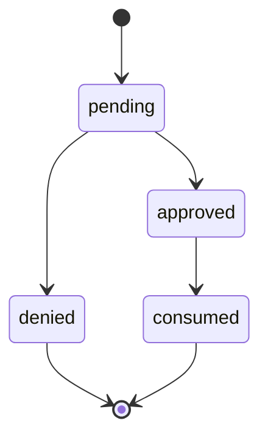

| State    | May transition to |
| -------- | ----------------- |
| pending  | approved, denied  |
| approved | consumed          |
| denied   | — (terminal)      |
| consumed | — (terminal)      |

## agent_registrations.status

Registrations await a claim decision, then consumption with retry rollback when
token minting fails.

Source:
[`packages/worker/src/agent-registration/agent-registration-state.ts`](../../packages/worker/src/agent-registration/agent-registration-state.ts)

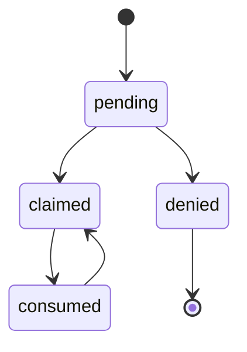

| State    | May transition to |
| -------- | ----------------- |
| pending  | claimed, denied   |
| claimed  | consumed          |
| denied   | — (terminal)      |
| consumed | claimed           |

## invites.status

Pending invitations close through acceptance, revocation, recipient decline or
expiry.

Source:
[`packages/worker/src/orgs/invite-state.ts`](../../packages/worker/src/orgs/invite-state.ts)

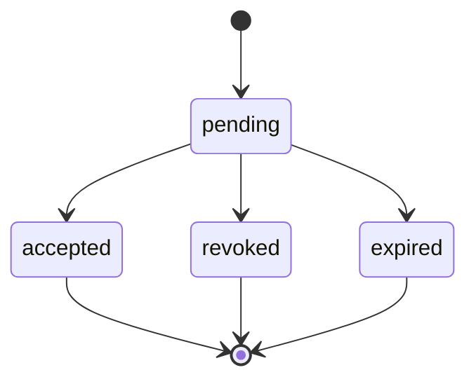

| State    | May transition to          |
| -------- | -------------------------- |
| pending  | accepted, revoked, expired |
| accepted | — (terminal)               |
| revoked  | — (terminal)               |
| expired  | — (terminal)               |

## publish_builds.status

Builds upload, seal and commit or reject; a committed build may be finalized
again or rejected by a later verification.

Source:
[`packages/worker/src/publish-offload/publish-build-state.ts`](../../packages/worker/src/publish-offload/publish-build-state.ts)

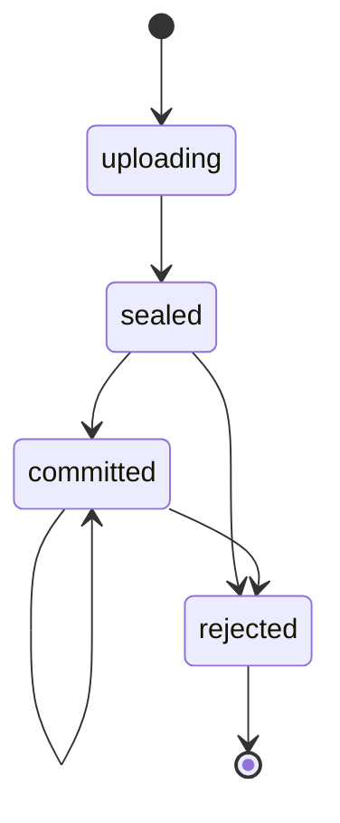

| State     | May transition to   |
| --------- | ------------------- |
| uploading | sealed              |
| sealed    | committed, rejected |
| committed | committed, rejected |
| rejected  | — (terminal)        |

## dead_letter_messages.status

Messages park, claim or reclaim replay, and return to parked on release;
successful replay deletes the row.

Source:
[`packages/worker/src/dead-letter/dead-letter-message-state.ts`](../../packages/worker/src/dead-letter/dead-letter-message-state.ts)

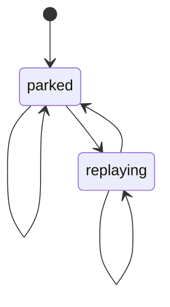

| State     | May transition to |
| --------- | ----------------- |
| parked    | parked, replaying |
| replaying | parked, replaying |

## package_approval_requests.status

Pending package approvals resolve by owner approval or supersession by another
publish.

Source:
[`packages/worker/src/package-capabilities/package-approval-state.ts`](../../packages/worker/src/package-capabilities/package-approval-state.ts)

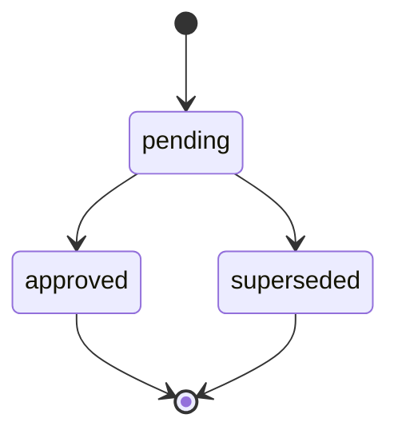

| State      | May transition to    |
| ---------- | -------------------- |
| pending    | approved, superseded |
| approved   | — (terminal)         |
| superseded | — (terminal)         |

## org_plan_transfers.status

Transfers begin at checkout or retry, acquire or reclaim an applying lease, and
complete or cancel; applying can release back to checkout or retry.

Source:
[`packages/worker/src/billing/plan-transfer-state.ts`](../../packages/worker/src/billing/plan-transfer-state.ts)

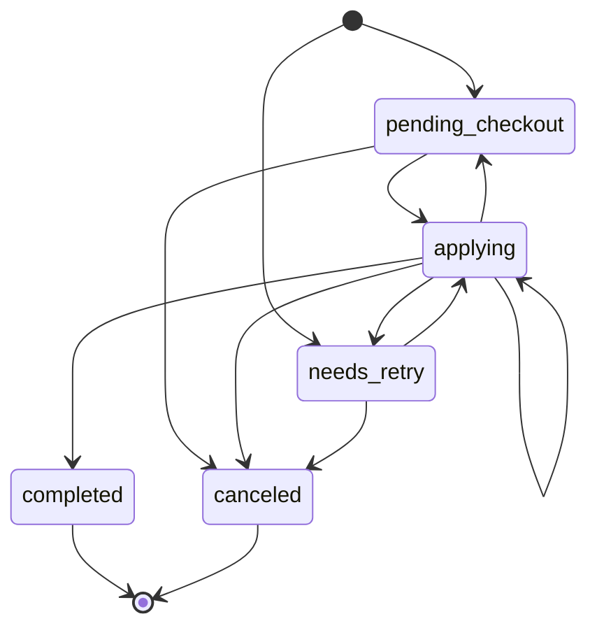

| State            | May transition to                                            |
| ---------------- | ------------------------------------------------------------ |
| pending_checkout | applying, canceled                                           |
| applying         | applying, pending_checkout, needs_retry, completed, canceled |
| needs_retry      | applying, canceled                                           |
| completed        | — (terminal)                                                 |
| canceled         | — (terminal)                                                 |

## package_codemod_runs.status

Codemod runs heartbeat, finish, fail or abandon; failed and abandoned runs
resume, while a repeated completed continuation may complete again or fail.

Source:
[`packages/worker/src/package-codemods/package-codemod-run-state.ts`](../../packages/worker/src/package-codemods/package-codemod-run-state.ts)

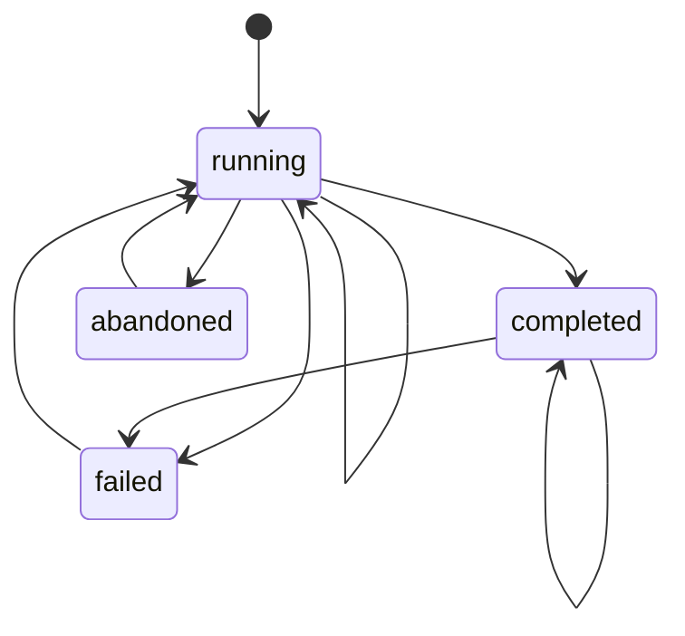

| State     | May transition to                     |
| --------- | ------------------------------------- |
| running   | running, completed, failed, abandoned |
| completed | completed, failed                     |
| failed    | running                               |
| abandoned | running                               |

## runs.status

Runs normally finish with success or error, including finish without begin;
non-scheduled replace upserts accept any status, while scheduled ticks fence
terminal rewrites.

Source:
[`packages/worker/src/run-records/run-state.ts`](../../packages/worker/src/run-records/run-state.ts)

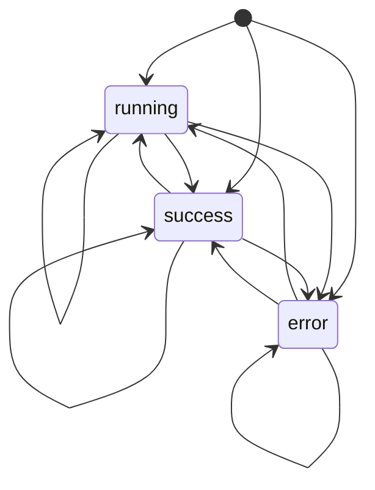

| State   | May transition to       |
| ------- | ----------------------- |
| running | running, success, error |
| success | running, success, error |
| error   | running, success, error |

## dr_paced_restore_drill_runs.status

A leased restore drill remains running until its sources finish and the
aggregate passes or fails.

Source:
[`packages/worker/src/dr/d1-paced-restore-drill-run-state.ts`](../../packages/worker/src/dr/d1-paced-restore-drill-run-state.ts)

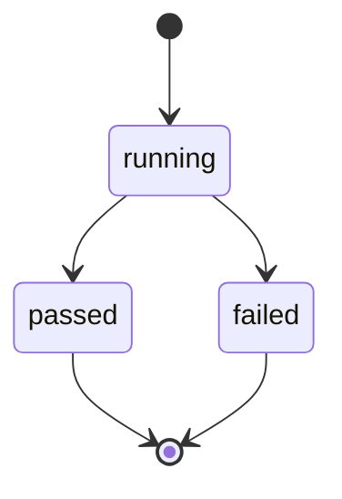

| State   | May transition to |
| ------- | ----------------- |
| running | passed, failed    |
| passed  | — (terminal)      |
| failed  | — (terminal)      |

## package_owner_error_spike.status

Owners trigger pending delivery, become alerted after success, and rearm after
health, inactivity or abandoned delivery; immediate delivery may persist alerted
directly from ok.

Source:
[`packages/worker/src/usage/package-owner-spike-state.ts`](../../packages/worker/src/usage/package-owner-spike-state.ts)

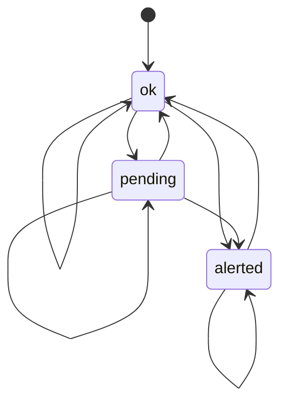

| State   | May transition to    |
| ------- | -------------------- |
| ok      | ok, pending, alerted |
| pending | pending, ok, alerted |
| alerted | alerted, ok          |

## admin_account_deletion_approvals.lifecycle

Approvals expire or are consumed for deletion, with consumption rolled back on
failure and expiry assessed on the next read.

Source:
[`packages/worker/universal/account-deletion-approval-state.ts`](../../packages/worker/universal/account-deletion-approval-state.ts)

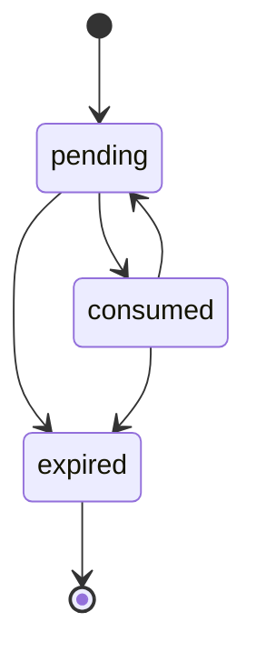

| State    | May transition to |
| -------- | ----------------- |
| pending  | consumed, expired |
| consumed | pending, expired  |
| expired  | — (terminal)      |

## community_listings.status

Listings can be published, delisted or republished; status updates may repeat
the current value.

Source:
[`packages/worker/src/community/community-listing-state.ts`](../../packages/worker/src/community/community-listing-state.ts)

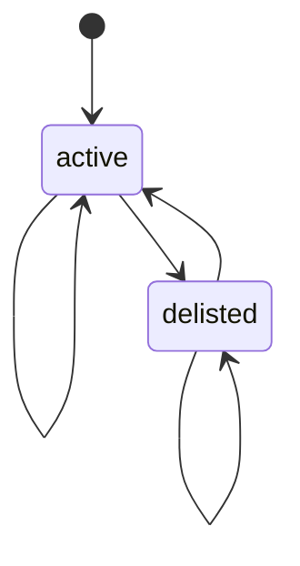

| State    | May transition to |
| -------- | ----------------- |
| active   | active, delisted  |
| delisted | active, delisted  |

## community_reports.status

Open community reports resolve or dismiss once.

Source:
[`packages/worker/src/community/community-report-state.ts`](../../packages/worker/src/community/community-report-state.ts)

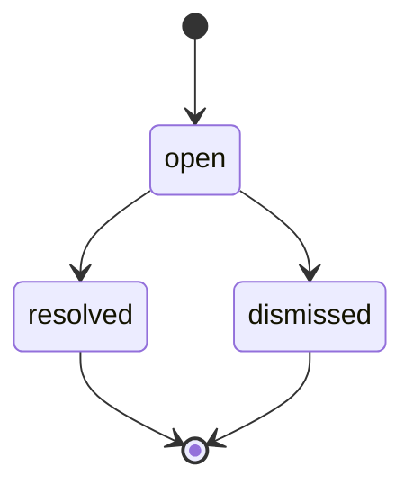

| State     | May transition to   |
| --------- | ------------------- |
| open      | resolved, dismissed |
| resolved  | — (terminal)        |
| dismissed | — (terminal)        |

## credential_inventory_runs.status

Inventory scans advance a cursor while scanning and complete at the last page.

Source:
[`packages/worker/src/credentials/credential-inventory-run-state.ts`](../../packages/worker/src/credentials/credential-inventory-run-state.ts)

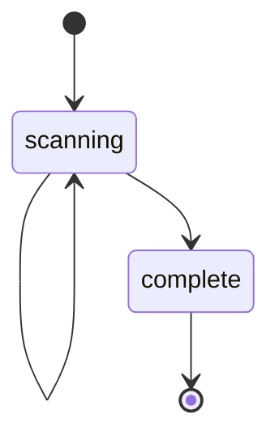

| State    | May transition to  |
| -------- | ------------------ |
| scanning | scanning, complete |
| complete | — (terminal)       |

## dr_paced_restore_drill_sources.status

Per-source progress setters can start, restart or refinalize any source; the
coordinator normally skips completed sources.

Source:
[`packages/worker/src/dr/d1-paced-restore-drill-source-state.ts`](../../packages/worker/src/dr/d1-paced-restore-drill-source-state.ts)

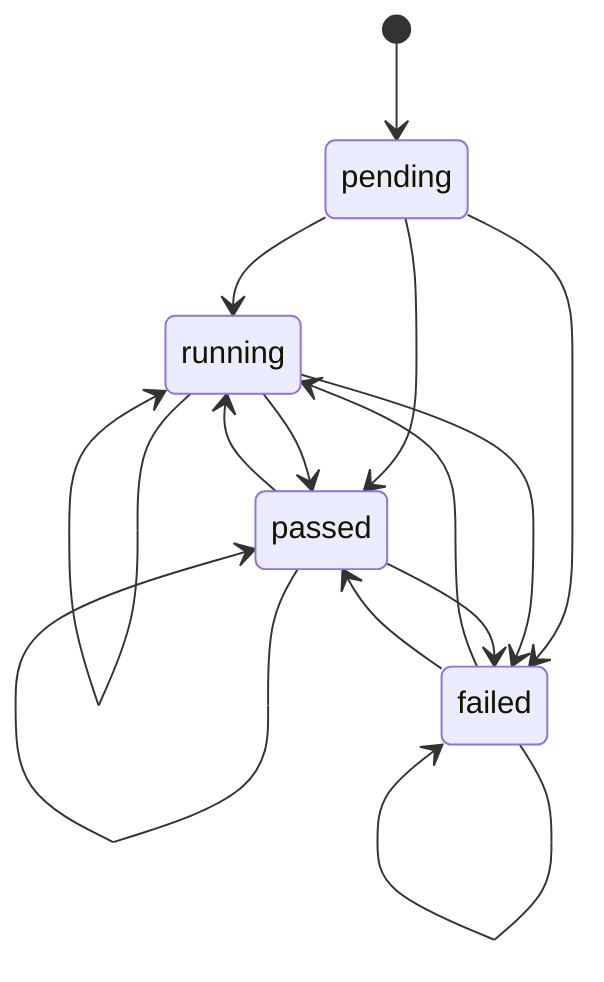

| State   | May transition to       |
| ------- | ----------------------- |
| pending | running, passed, failed |
| running | running, passed, failed |
| passed  | running, passed, failed |
| failed  | running, passed, failed |

## email_messages.processing_status

Email metadata inserts and timestamp-fenced partial updates accept all
processing statuses; normal outbound sends move stored to sent or failed.

Source:
[`packages/worker/src/email/email-processing-state.ts`](../../packages/worker/src/email/email-processing-state.ts)

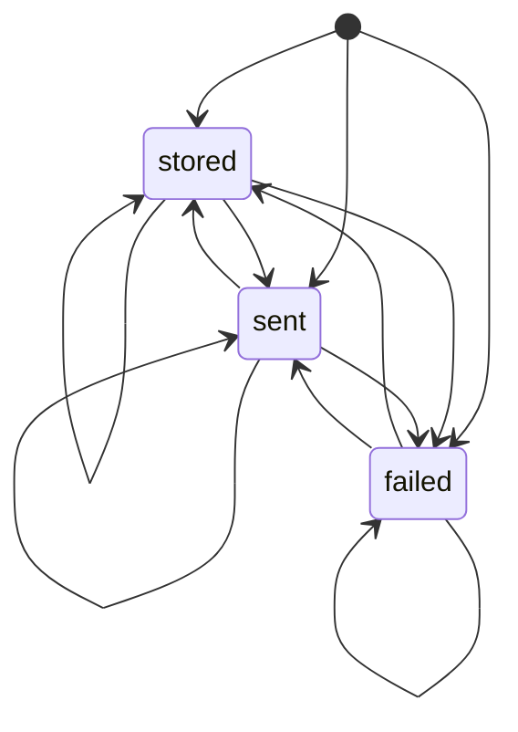

| State  | May transition to    |
| ------ | -------------------- |
| stored | stored, sent, failed |
| sent   | stored, sent, failed |
| failed | stored, sent, failed |

## email_inbound_dedupe_pointer.state

Dedupe windows start pending, tombstone on message deletion, and reset after
expiry; repeat tombstones are idempotent.

Source:
[`packages/worker/src/email/inbound-dedupe-pointer-state.ts`](../../packages/worker/src/email/inbound-dedupe-pointer-state.ts)

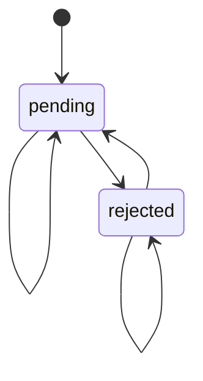

| State    | May transition to |
| -------- | ----------------- |
| pending  | pending, rejected |
| rejected | pending, rejected |

## email_inbound_delivery.state

Inbound deliveries acquire storage or cleanup leases, release or reclaim them,
finalize receipt, or reject; missing stored messages permit refinalization.

Source:
[`packages/worker/src/email/inbound-delivery-state.ts`](../../packages/worker/src/email/inbound-delivery-state.ts)

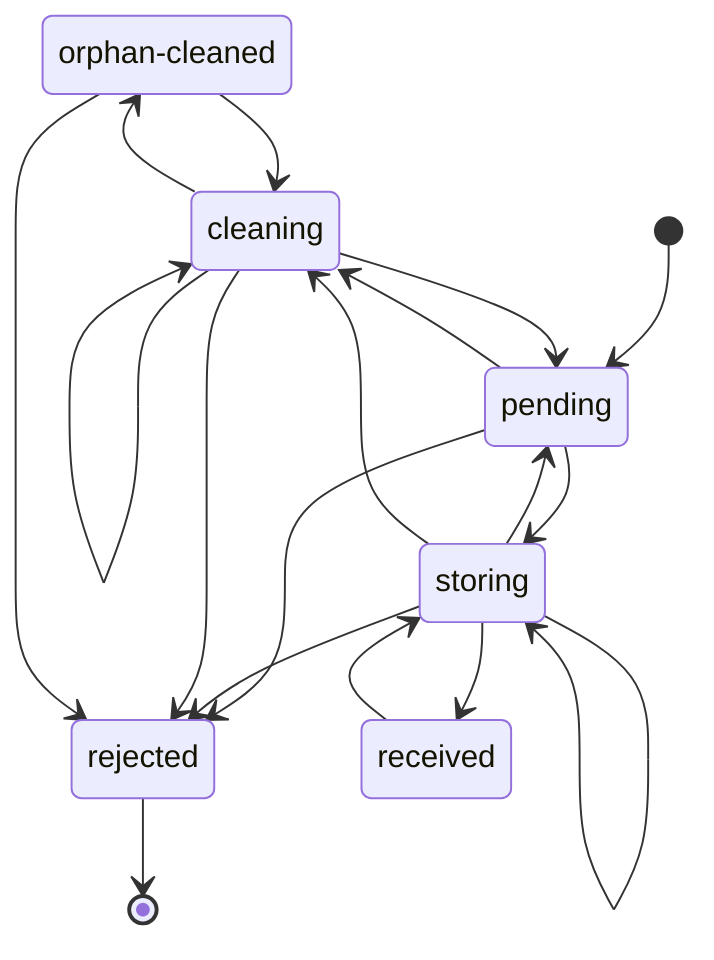

| State          | May transition to                              |
| -------------- | ---------------------------------------------- |
| pending        | storing, cleaning, rejected                    |
| storing        | storing, pending, received, cleaning, rejected |
| cleaning       | cleaning, pending, orphan-cleaned, rejected    |
| received       | storing                                        |
| rejected       | — (terminal)                                   |
| orphan-cleaned | cleaning, rejected                             |

## email_inbound_subscription_effect.state

Subscription delivery claims or reclaims processing, completes or retries to
dead-letter, and refinalization resets the effect to pending.

Source:
[`packages/worker/src/email/inbound-subscription-effect-state.ts`](../../packages/worker/src/email/inbound-subscription-effect-state.ts)

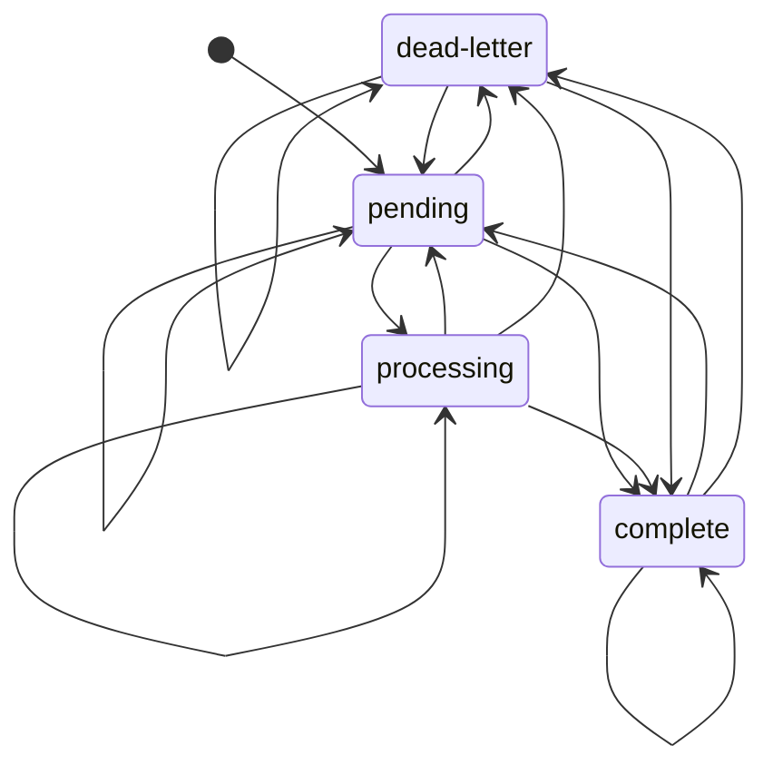

| State       | May transition to                          |
| ----------- | ------------------------------------------ |
| pending     | pending, processing, complete, dead-letter |
| processing  | processing, pending, complete, dead-letter |
| complete    | pending, complete, dead-letter             |
| dead-letter | pending, complete, dead-letter             |

## enablements.state

Enablements start on, pause or rewrite a pause cause, resume after access
recovers, and turn off permanently.

Source:
[`packages/worker/src/enablements/enablement-state.ts`](../../packages/worker/src/enablements/enablement-state.ts)

```mermaid
stateDiagram-v2
    [*] --> on
    on --> paused
    on --> off
    paused --> paused
    paused --> on
    paused --> off
    off --> [*]
```

| State  | May transition to |
| ------ | ----------------- |
| on     | paused, off       |
| paused | paused, on, off   |
| off    | — (terminal)      |

## referrals.status

Pending referrals reject fraud or reward qualifying invoices; incomplete reward
delivery may retry.

Source:
[`packages/worker/src/entitlements/referral-state.ts`](../../packages/worker/src/entitlements/referral-state.ts)

```mermaid
stateDiagram-v2
    [*] --> pending
    pending --> rejected
    pending --> rewarded
    rewarded --> rewarded
    rejected --> [*]
```

| State    | May transition to  |
| -------- | ------------------ |
| pending  | rejected, rewarded |
| rewarded | rewarded           |
| rejected | — (terminal)       |

## execution_context_queued.lifecycle

Queued rows enter a starting handoff that always releases its cancellation
fence, then retry or leave the queue after dispatch, cancellation, failure or
expiry.

Source:
[`packages/worker/src/execution-contexts/queued-run-state.ts`](../../packages/worker/src/execution-contexts/queued-run-state.ts)

```mermaid
stateDiagram-v2
    [*] --> queued
    queued --> starting
    queued --> finished
    queued --> cancelled
    queued --> expired
    starting --> queued
    starting --> finished
    starting --> expired
    finished --> [*]
    cancelled --> [*]
    expired --> [*]
```

| State     | May transition to                      |
| --------- | -------------------------------------- |
| queued    | starting, finished, cancelled, expired |
| starting  | queued, finished, expired              |
| finished  | — (terminal)                           |
| cancelled | — (terminal)                           |
| expired   | — (terminal)                           |

## execution_context_runs.state

Dispatch offers commit or abort and rejected offers can retry; committed runs
finish once, while the existing offer-failure setter can still abort or reject
any nonfinal row.

Source:
[`packages/worker/src/execution-contexts/run-dispatch-state.ts`](../../packages/worker/src/execution-contexts/run-dispatch-state.ts)

```mermaid
stateDiagram-v2
    [*] --> dispatched
    dispatched --> committed
    dispatched --> aborted
    dispatched --> rejected
    committed --> succeeded
    committed --> failed
    committed --> cancelled
    committed --> lost
    committed --> aborted
    committed --> rejected
    rejected --> dispatched
    rejected --> rejected
    rejected --> aborted
    aborted --> dispatched
    aborted --> rejected
    aborted --> aborted
    succeeded --> [*]
    failed --> [*]
    cancelled --> [*]
    lost --> [*]
```

| State      | May transition to                                     |
| ---------- | ----------------------------------------------------- |
| dispatched | committed, aborted, rejected                          |
| committed  | succeeded, failed, cancelled, lost, aborted, rejected |
| succeeded  | — (terminal)                                          |
| failed     | — (terminal)                                          |
| cancelled  | — (terminal)                                          |
| lost       | — (terminal)                                          |
| rejected   | dispatched, rejected, aborted                         |
| aborted    | dispatched, rejected, aborted                         |

## follows.status

Active follows pause when delivery access fails and resume after a creator
reauthorizes them.

Source:
[`packages/worker/src/follow/follow-state.ts`](../../packages/worker/src/follow/follow-state.ts)

```mermaid
stateDiagram-v2
    [*] --> active
    active --> paused
    paused --> active
```

| State  | May transition to |
| ------ | ----------------- |
| active | paused            |
| paused | active            |

## user_email_claims.status

Email addresses can be claimed, released and reclaimed; either state may be
inserted.

Source:
[`packages/worker/src/identity/email-claim-state.ts`](../../packages/worker/src/identity/email-claim-state.ts)

```mermaid
stateDiagram-v2
    [*] --> claimed
    [*] --> released
    claimed --> released
    released --> claimed
```

| State    | May transition to |
| -------- | ----------------- |
| claimed  | released          |
| released | claimed           |

## mcp_memories.status

Memory insert and update APIs accept all status replacements, including archive,
restore and deletion; soft deletion remains separate.

Source:
[`packages/worker/src/mcp/memory/memory-state.ts`](../../packages/worker/src/mcp/memory/memory-state.ts)

```mermaid
stateDiagram-v2
    [*] --> active
    [*] --> deleted
    [*] --> archived
    active --> active
    active --> deleted
    active --> archived
    deleted --> active
    deleted --> deleted
    deleted --> archived
    archived --> active
    archived --> deleted
    archived --> archived
```

| State    | May transition to         |
| -------- | ------------------------- |
| active   | active, deleted, archived |
| deleted  | active, deleted, archived |
| archived | active, deleted, archived |

## org_invite_links.status

An active invite link can be explicitly revoked; expiry and exhaustion are
derived eligibility conditions.

Source:
[`packages/worker/src/orgs/invite-link-state.ts`](../../packages/worker/src/orgs/invite-link-state.ts)

```mermaid
stateDiagram-v2
    [*] --> active
    active --> revoked
    revoked --> [*]
```

| State   | May transition to |
| ------- | ----------------- |
| active  | revoked           |
| revoked | — (terminal)      |

## platform_feedback.status

Feedback triages or closes, closed feedback reopens to triaged, and review edits
may preserve status.

Source:
[`packages/worker/src/platform-feedback/platform-feedback-state.ts`](../../packages/worker/src/platform-feedback/platform-feedback-state.ts)

```mermaid
stateDiagram-v2
    [*] --> open
    open --> open
    open --> triaged
    open --> resolved
    open --> dismissed
    triaged --> triaged
    triaged --> resolved
    triaged --> dismissed
    resolved --> resolved
    resolved --> triaged
    dismissed --> dismissed
    dismissed --> triaged
```

| State     | May transition to                  |
| --------- | ---------------------------------- |
| open      | open, triaged, resolved, dismissed |
| triaged   | triaged, resolved, dismissed       |
| resolved  | resolved, triaged                  |
| dismissed | dismissed, triaged                 |

## repo_sessions.status

Repo session storage accepts all status replacements; normal sessions publish or
discard, including repeated finalization.

Source:
[`packages/worker/src/repo/repo-session-state.ts`](../../packages/worker/src/repo/repo-session-state.ts)

```mermaid
stateDiagram-v2
    [*] --> active
    [*] --> published
    [*] --> discarded
    active --> active
    active --> published
    active --> discarded
    published --> active
    published --> published
    published --> discarded
    discarded --> active
    discarded --> published
    discarded --> discarded
```

| State     | May transition to            |
| --------- | ---------------------------- |
| active    | active, published, discarded |
| published | active, published, discarded |
| discarded | active, published, discarded |

## package_invocation_ledger.status

Invocation claims heartbeat or reclaim an in-progress attempt and atomically
persist its completed or failed response.

Source:
[`packages/worker/src/run-records/package-invocation-state.ts`](../../packages/worker/src/run-records/package-invocation-state.ts)

```mermaid
stateDiagram-v2
    [*] --> in_progress
    in_progress --> in_progress
    in_progress --> completed
    in_progress --> failed
    completed --> [*]
    failed --> [*]
```

| State       | May transition to              |
| ----------- | ------------------------------ |
| in_progress | in_progress, completed, failed |
| completed   | — (terminal)                   |
| failed      | — (terminal)                   |

## user_usage_campaigns.lifecycle

Ledger phase replacements preserve legacy PascalCase stored tags via the
exported mapping; evaluator activation and cooling history gates remain
unchanged.

Source:
[`packages/worker/src/usage/usage-campaign-state.ts`](../../packages/worker/src/usage/usage-campaign-state.ts)

```mermaid
stateDiagram-v2
    [*] --> verified_no_mcp
    [*] --> connected_no_package
    [*] --> packaged_single_client
    [*] --> activated
    [*] --> cooling
    [*] --> limit_aware
    [*] --> paid
    verified_no_mcp --> verified_no_mcp
    verified_no_mcp --> connected_no_package
    verified_no_mcp --> packaged_single_client
    verified_no_mcp --> activated
    verified_no_mcp --> cooling
    verified_no_mcp --> limit_aware
    verified_no_mcp --> paid
    connected_no_package --> verified_no_mcp
    connected_no_package --> connected_no_package
    connected_no_package --> packaged_single_client
    connected_no_package --> activated
    connected_no_package --> cooling
    connected_no_package --> limit_aware
    connected_no_package --> paid
    packaged_single_client --> verified_no_mcp
    packaged_single_client --> connected_no_package
    packaged_single_client --> packaged_single_client
    packaged_single_client --> activated
    packaged_single_client --> cooling
    packaged_single_client --> limit_aware
    packaged_single_client --> paid
    activated --> verified_no_mcp
    activated --> connected_no_package
    activated --> packaged_single_client
    activated --> activated
    activated --> cooling
    activated --> limit_aware
    activated --> paid
    cooling --> verified_no_mcp
    cooling --> connected_no_package
    cooling --> packaged_single_client
    cooling --> activated
    cooling --> cooling
    cooling --> limit_aware
    cooling --> paid
    limit_aware --> verified_no_mcp
    limit_aware --> connected_no_package
    limit_aware --> packaged_single_client
    limit_aware --> activated
    limit_aware --> cooling
    limit_aware --> limit_aware
    limit_aware --> paid
    paid --> verified_no_mcp
    paid --> connected_no_package
    paid --> packaged_single_client
    paid --> activated
    paid --> cooling
    paid --> limit_aware
    paid --> paid
```

| State                  | May transition to                                                                                    |
| ---------------------- | ---------------------------------------------------------------------------------------------------- |
| verified_no_mcp        | verified_no_mcp, connected_no_package, packaged_single_client, activated, cooling, limit_aware, paid |
| connected_no_package   | verified_no_mcp, connected_no_package, packaged_single_client, activated, cooling, limit_aware, paid |
| packaged_single_client | verified_no_mcp, connected_no_package, packaged_single_client, activated, cooling, limit_aware, paid |
| activated              | verified_no_mcp, connected_no_package, packaged_single_client, activated, cooling, limit_aware, paid |
| cooling                | verified_no_mcp, connected_no_package, packaged_single_client, activated, cooling, limit_aware, paid |
| limit_aware            | verified_no_mcp, connected_no_package, packaged_single_client, activated, cooling, limit_aware, paid |
| paid                   | verified_no_mcp, connected_no_package, packaged_single_client, activated, cooling, limit_aware, paid |

## component_probe.status

Consecutive failure and recovery thresholds move a component between operational
and down.

Source:
[`packages/status/incident-state.ts`](../../packages/status/incident-state.ts)

```mermaid
stateDiagram-v2
    [*] --> operational
    operational --> down
    down --> operational
```

| State       | May transition to |
| ----------- | ----------------- |
| operational | down              |
| down        | operational       |

## host_background_command.state

Background commands exit, time out, kill or fail; a spawn error can finish a
command already stopped by timeout or kill.

Source:
[`packages/cli/src/execution-context/host-command-state.ts`](../../packages/cli/src/execution-context/host-command-state.ts)

```mermaid
stateDiagram-v2
    [*] --> running
    running --> timed_out
    running --> failed
    running --> exited
    running --> killed
    killed --> failed
    timed_out --> failed
    exited --> [*]
    failed --> [*]
```

| State     | May transition to                 |
| --------- | --------------------------------- |
| running   | timed_out, failed, exited, killed |
| exited    | — (terminal)                      |
| killed    | failed                            |
| timed_out | failed                            |
| failed    | — (terminal)                      |

## backup_export_controller.kind

The owned export controller polls pending exports and restarts lost exports
until complete, preserving its bounded retry and polling rules.

Source:
[`packages/backup-control-plane/backup-export-state.ts`](../../packages/backup-control-plane/backup-export-state.ts)

```mermaid
stateDiagram-v2
    [*] --> complete
    [*] --> pending
    [*] --> lost
    pending --> pending
    pending --> complete
    pending --> lost
    lost --> pending
    lost --> complete
    lost --> lost
    complete --> [*]
```

| State    | May transition to       |
| -------- | ----------------------- |
| complete | — (terminal)            |
| pending  | pending, complete, lost |
| lost     | pending, complete, lost |

## UI flows

## admin_codemods.ui_run

Paged execution owns its progress and terminal feedback; a requested stop is
fenced until the current step and history reconciliation finish.

Source:
[`packages/worker/client/routes/admin-codemod-run-state.ts`](../../packages/worker/client/routes/admin-codemod-run-state.ts)

```mermaid
stateDiagram-v2
    [*] --> idle
    idle --> running
    running --> running
    running --> stopping
    running --> complete
    running --> error
    stopping --> stopping
    stopping --> complete
    stopping --> error
    complete --> running
    error --> running
```

| State    | May transition to                  |
| -------- | ---------------------------------- |
| idle     | running                            |
| running  | running, stopping, complete, error |
| stopping | stopping, complete, error          |
| complete | running                            |
| error    | running                            |

## avatar.ui_crop

Decoded previews exist only while editing or preparing; decode failures cannot
be applied and preparation failures can be retried.

Source:
[`packages/worker/client/routes/avatar-crop-state.ts`](../../packages/worker/client/routes/avatar-crop-state.ts)

```mermaid
stateDiagram-v2
    [*] --> decoding
    decoding --> decoding
    decoding --> ready
    decoding --> decode_error
    ready --> decoding
    ready --> applying
    applying --> decoding
    applying --> prepare_error
    decode_error --> decoding
    prepare_error --> decoding
    prepare_error --> applying
```

| State         | May transition to             |
| ------------- | ----------------------------- |
| decoding      | decoding, ready, decode_error |
| ready         | decoding, applying            |
| applying      | decoding, prepare_error       |
| decode_error  | decoding                      |
| prepare_error | decoding, applying            |

## clipboard.ui_feedback

One clipboard write owns feedback until success or failure; its transient label
resets after the feedback interval.

Source:
[`packages/worker/client/routes/clipboard-feedback-state.ts`](../../packages/worker/client/routes/clipboard-feedback-state.ts)

```mermaid
stateDiagram-v2
    [*] --> idle
    idle --> copying
    copying --> copied
    copying --> error
    copied --> copying
    copied --> idle
    error --> copying
    error --> idle
```

| State   | May transition to |
| ------- | ----------------- |
| idle    | copying           |
| copying | copied, error     |
| copied  | copying, idle     |
| error   | copying, idle     |

## connect_oauth.device_poll

A device session polls with transient retries until provider completion or
expiry; an already committed late approval remains authoritative after the local
deadline.

Source:
[`packages/worker/client/routes/connect-oauth-device-state.ts`](../../packages/worker/client/routes/connect-oauth-device-state.ts)

```mermaid
stateDiagram-v2
    [*] --> idle
    idle --> idle
    idle --> starting
    starting --> polling
    starting --> error
    starting --> idle
    polling --> polling
    polling --> error
    polling --> success
    polling --> idle
    error --> idle
    error --> success
    success --> idle
```

| State    | May transition to             |
| -------- | ----------------------------- |
| idle     | idle, starting                |
| starting | polling, error, idle          |
| polling  | polling, error, success, idle |
| error    | idle, success                 |
| success  | idle                          |

## connect_oauth.step

Client setup advances to browser or device authorization, callbacks can repair
credentials, and only success carries a saved-token receipt.

Source:
[`packages/worker/client/routes/connect-oauth-state.ts`](../../packages/worker/client/routes/connect-oauth-state.ts)

```mermaid
stateDiagram-v2
    [*] --> setup
    [*] --> connect
    setup --> setup
    setup --> connect
    setup --> callback
    connect --> connect
    connect --> setup
    connect --> device
    connect --> callback
    device --> device
    device --> connect
    device --> success
    callback --> callback
    callback --> setup
    callback --> connect
    callback --> success
    success --> success
    success --> setup
```

| State    | May transition to                 |
| -------- | --------------------------------- |
| setup    | setup, connect, callback          |
| connect  | connect, setup, device, callback  |
| device   | device, connect, success          |
| callback | callback, setup, connect, success |
| success  | success, setup                    |

## connect_oauth.operation

One setup or authorize request fences submission independently of the displayed
OAuth step and its feedback.

Source:
[`packages/worker/client/routes/connect-oauth-state.ts`](../../packages/worker/client/routes/connect-oauth-state.ts)

```mermaid
stateDiagram-v2
    [*] --> idle
    idle --> submitting
    submitting --> idle
```

| State      | May transition to |
| ---------- | ----------------- |
| idle       | submitting        |
| submitting | idle              |

## desktop.setup_operation

Bridge actions fence user input through reconciliation; only a failed operation
carries an error and retry clears it.

Source:
[`packages/worker/client/routes/desktop-setup-operation-state.ts`](../../packages/worker/client/routes/desktop-setup-operation-state.ts)

```mermaid
stateDiagram-v2
    [*] --> idle
    idle --> running
    running --> idle
    running --> error
    error --> idle
    error --> running
```

| State   | May transition to |
| ------- | ----------------- |
| idle    | running           |
| running | idle, error       |
| error   | idle, running     |

## desktop.setup_step

The resumable setup wizard registers a personal machine before optional team
attachment and permits explicit reset or forget.

Source:
[`packages/worker/universal/desktop-setup-step-state.ts`](../../packages/worker/universal/desktop-setup-step-state.ts)

```mermaid
stateDiagram-v2
    [*] --> overview
    overview --> overview
    overview --> register
    overview --> attach
    overview --> done
    overview --> forget
    register --> register
    register --> overview
    register --> attach
    register --> done
    register --> forget
    attach --> attach
    attach --> overview
    attach --> done
    attach --> forget
    done --> done
    done --> overview
    done --> forget
    forget --> forget
    forget --> overview
```

| State    | May transition to                        |
| -------- | ---------------------------------------- |
| overview | overview, register, attach, done, forget |
| register | register, overview, attach, done, forget |
| attach   | attach, overview, done, forget           |
| done     | done, overview, forget                   |
| forget   | forget, overview                         |

## email_verification.feedback

Resending and checking email verification are exclusive requests; each retry
clears the previous feedback.

Source:
[`packages/worker/client/routes/email-verification-state.ts`](../../packages/worker/client/routes/email-verification-state.ts)

```mermaid
stateDiagram-v2
    [*] --> idle
    idle --> sending
    idle --> checking
    sending --> idle
    sending --> success
    sending --> error
    checking --> idle
    checking --> success
    checking --> error
    success --> sending
    success --> checking
    error --> sending
    error --> checking
```

| State    | May transition to    |
| -------- | -------------------- |
| idle     | sending, checking    |
| sending  | idle, success, error |
| checking | idle, success, error |
| success  | sending, checking    |
| error    | sending, checking    |

## landing_testimonials.pointer

One pointer owns a pending gesture until horizontal drag, browser scroll handoff
or release; another pointer cannot steal an active gesture.

Source:
[`packages/worker/client/routes/landing-pointer-state.ts`](../../packages/worker/client/routes/landing-pointer-state.ts)

```mermaid
stateDiagram-v2
    [*] --> idle
    idle --> pending
    pending --> pending
    pending --> drag
    pending --> scroll
    pending --> idle
    drag --> drag
    drag --> idle
    scroll --> idle
```

| State   | May transition to           |
| ------- | --------------------------- |
| idle    | pending                     |
| pending | pending, drag, scroll, idle |
| drag    | drag, idle                  |
| scroll  | idle                        |

## login.form

Password, provider and passkey sign-in share one submission fence, retryable
errors and username-confirmation feedback.

Source:
[`packages/worker/client/routes/login-state.ts`](../../packages/worker/client/routes/login-state.ts)

```mermaid
stateDiagram-v2
    [*] --> idle
    idle --> idle
    idle --> confirming
    idle --> submitting
    idle --> error
    confirming --> idle
    confirming --> confirming
    confirming --> submitting
    confirming --> error
    submitting --> idle
    submitting --> success
    submitting --> error
    success --> idle
    success --> submitting
    success --> error
    error --> idle
    error --> confirming
    error --> submitting
    error --> error
```

| State      | May transition to                   |
| ---------- | ----------------------------------- |
| idle       | idle, confirming, submitting, error |
| confirming | idle, confirming, submitting, error |
| submitting | idle, success, error                |
| success    | idle, submitting, error             |
| error      | idle, confirming, submitting, error |

## oauth_consent.interaction

Sign-in and consent decisions are mutually exclusive; cached navigation can
release sign-in or redirect fences without replaying a decision.

Source:
[`packages/worker/client/routes/oauth-consent-state.ts`](../../packages/worker/client/routes/oauth-consent-state.ts)

```mermaid
stateDiagram-v2
    [*] --> idle
    idle --> signing_in
    idle --> deciding
    signing_in --> idle
    signing_in --> error
    deciding --> idle
    deciding --> error
    deciding --> guest
    deciding --> reset_complete
    deciding --> redirecting
    error --> signing_in
    error --> deciding
    redirecting --> idle
    guest --> [*]
    reset_complete --> [*]
```

| State          | May transition to                               |
| -------------- | ----------------------------------------------- |
| idle           | signing_in, deciding                            |
| signing_in     | idle, error                                     |
| deciding       | idle, error, guest, reset_complete, redirecting |
| error          | signing_in, deciding                            |
| redirecting    | idle                                            |
| guest          | — (terminal)                                    |
| reset_complete | — (terminal)                                    |

## passkey.registration_ui

A registration owns options and its browser ceremony through server
confirmation; other passkey mutations retain native Query state.

Source:
[`packages/worker/client/routes/passkey-ceremony-state.ts`](../../packages/worker/client/routes/passkey-ceremony-state.ts)

```mermaid
stateDiagram-v2
    [*] --> idle
    idle --> requesting
    requesting --> ceremony
    requesting --> idle
    ceremony --> idle
```

| State      | May transition to |
| ---------- | ----------------- |
| idle       | requesting        |
| requesting | ceremony, idle    |
| ceremony   | idle              |

## password_reset.form

Password reset requests and confirmations submit once, display their result and
clear old feedback on retry.

Source:
[`packages/worker/client/routes/password-reset-state.ts`](../../packages/worker/client/routes/password-reset-state.ts)

```mermaid
stateDiagram-v2
    [*] --> idle
    idle --> submitting
    idle --> error
    submitting --> success
    submitting --> error
    success --> submitting
    success --> error
    error --> submitting
    error --> error
```

| State      | May transition to |
| ---------- | ----------------- |
| idle       | submitting, error |
| submitting | success, error    |
| success    | submitting, error |
| error      | submitting, error |

## package_publish.ui_checks

Checks are scoped to the selected commit; changing or clearing that commit
releases the old result before starting a new attempt.

Source:
[`packages/worker/client/routes/publish-commit-check-state.ts`](../../packages/worker/client/routes/publish-commit-check-state.ts)

```mermaid
stateDiagram-v2
    [*] --> idle
    [*] --> running
    idle --> idle
    idle --> running
    running --> idle
    running --> running
    running --> passed
    running --> failed
    running --> unavailable
    passed --> idle
    passed --> running
    failed --> idle
    failed --> running
    unavailable --> idle
    unavailable --> running
```

| State       | May transition to                          |
| ----------- | ------------------------------------------ |
| idle        | idle, running                              |
| running     | idle, running, passed, failed, unavailable |
| passed      | idle, running                              |
| failed      | idle, running                              |
| unavailable | idle, running                              |

## two_factor_verify.form

Two-factor verification keeps a single in-flight request, clears failure
feedback on retry and stays busy while navigating on success.

Source:
[`packages/worker/client/routes/two-factor-verify-state.ts`](../../packages/worker/client/routes/two-factor-verify-state.ts)

```mermaid
stateDiagram-v2
    [*] --> idle
    idle --> submitting
    idle --> error
    submitting --> error
    error --> submitting
    error --> error
```

| State      | May transition to |
| ---------- | ----------------- |
| idle       | submitting, error |
| submitting | error             |
| error      | submitting, error |

## ui.undoable_action

One deferred action can be undone or committed exactly once; replacements
serialize behind any previous settlement.

Source:
[`packages/worker/client/routes/undoable-action-state.ts`](../../packages/worker/client/routes/undoable-action-state.ts)

```mermaid
stateDiagram-v2
    [*] --> idle
    idle --> waiting
    waiting --> committing
    waiting --> undoing
    committing --> idle
    undoing --> idle
```

| State      | May transition to   |
| ---------- | ------------------- |
| idle       | waiting             |
| waiting    | committing, undoing |
| committing | idle                |
| undoing    | idle                |

## username.availability_ui

Editing resets or checks a candidate; only the current check may publish a
result, and empty or invalid drafts cannot receive old results.

Source:
[`packages/worker/client/routes/username-availability-state.ts`](../../packages/worker/client/routes/username-availability-state.ts)

```mermaid
stateDiagram-v2
    [*] --> idle
    idle --> idle
    idle --> checking
    idle --> invalid
    checking --> idle
    checking --> checking
    checking --> available
    checking --> taken
    checking --> reserved
    checking --> invalid
    checking --> unknown
    available --> idle
    available --> checking
    available --> invalid
    taken --> idle
    taken --> checking
    taken --> invalid
    reserved --> idle
    reserved --> checking
    reserved --> invalid
    invalid --> idle
    invalid --> checking
    invalid --> invalid
    unknown --> idle
    unknown --> checking
    unknown --> invalid
```

| State     | May transition to                                            |
| --------- | ------------------------------------------------------------ |
| idle      | idle, checking, invalid                                      |
| checking  | idle, checking, available, taken, reserved, invalid, unknown |
| available | idle, checking, invalid                                      |
| taken     | idle, checking, invalid                                      |
| reserved  | idle, checking, invalid                                      |
| invalid   | idle, checking, invalid                                      |
| unknown   | idle, checking, invalid                                      |

## username_signup.form

A chosen username is confirmed before account creation, with failed submissions
retryable without losing the confirmed draft.

Source:
[`packages/worker/client/routes/username-signup-state.ts`](../../packages/worker/client/routes/username-signup-state.ts)

```mermaid
stateDiagram-v2
    [*] --> idle
    idle --> idle
    idle --> confirming
    idle --> error
    confirming --> idle
    confirming --> confirming
    confirming --> submitting
    confirming --> error
    submitting --> error
    error --> idle
    error --> confirming
    error --> submitting
    error --> error
```

| State      | May transition to                   |
| ---------- | ----------------------------------- |
| idle       | idle, confirming, error             |
| confirming | idle, confirming, submitting, error |
| submitting | error                               |
| error      | idle, confirming, submitting, error |

## desktop.update_readiness

Downloaded readiness survives later failed checks; installation is fenced until
the app quits.

Source: [`packages/desktop/updates.cjs`](../../packages/desktop/updates.cjs)

```mermaid
stateDiagram-v2
    [*] --> waiting
    waiting --> downloaded
    downloaded --> downloaded
    downloaded --> installing
    installing --> downloaded
    installing --> installing
```

| State      | May transition to      |
| ---------- | ---------------------- |
| waiting    | downloaded             |
| downloaded | downloaded, installing |
| installing | downloaded, installing |

## desktop.update_check

One update check owns its promise through download and manual feedback,
independently of downloaded readiness.

Source: [`packages/desktop/updates.cjs`](../../packages/desktop/updates.cjs)

```mermaid
stateDiagram-v2
    [*] --> idle
    idle --> checking
    checking --> idle
```

| State    | May transition to |
| -------- | ----------------- |
| idle     | checking          |
| checking | idle              |

## desktop.machine_operation

Connection and daemon actions run exclusively; a retry clears earlier errors
while OS runner observations remain external.

Source: [`packages/desktop/execution.cjs`](../../packages/desktop/execution.cjs)

```mermaid
stateDiagram-v2
    [*] --> idle
    idle --> running
    idle --> error
    running --> idle
    running --> running
    running --> error
    error --> idle
    error --> running
    error --> error
```

| State   | May transition to    |
| ------- | -------------------- |
| idle    | running, error       |
| running | idle, running, error |
| error   | idle, running, error |
