# Explicit state machines

<!-- Generated by tools/generate-state-machines.ts. Do not edit. -->

Every lifecycle/status column and multi-step UI flow is declared with
`defineStateMachine`. The graph is the source of truth for types, runtime
validation, SQL transition guards, and this agent-readable reference.

## Adding a machine

Declare a dependency-light module next to the domain, export the machine and a
`StateOf<typeof machine>` type alias, and register its machine and source path
in the package's `state-machines.ts` registry. The tooling-only aggregate at
`tools/state-machines.ts` includes each package registry without adding runtime
dependencies between packages. Run `npm run state-machines:generate` and add
focused graph tests. Existing stored values and wire contracts stay unchanged.

Declare SQL guards with `machine.guard({ from: 'approved', to: 'consumed' })`.
The guard validates every source-to-target pair and returns a SQL literal list
of the explicit source states. Both fields accept a state or an array of states.
Hoist fixed guards to module-level constants; preserve operation-specific
sources (such as consumed-to-claimed rollback) rather than broadening
compare-and-set guards to every incoming edge. Use `sourcesOf` to discover graph
predecessors.

## oauth_device_authorizations.status

Device requests await a decision before an approved request can be consumed.

Source:
[`packages/worker/src/oauth-device/device-authorization-state.ts`](../../packages/worker/src/oauth-device/device-authorization-state.ts)

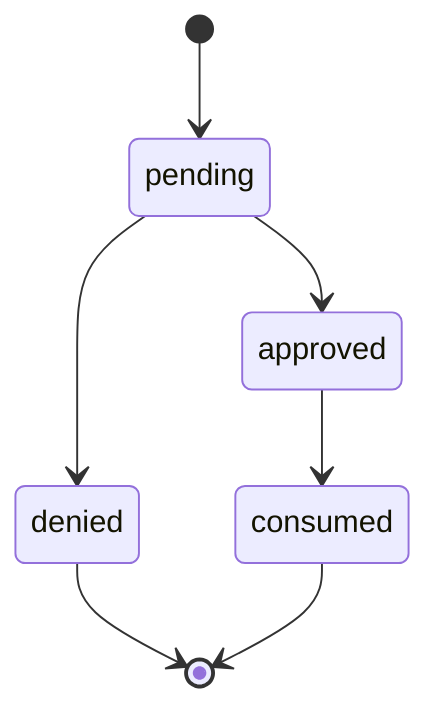

| State    | May transition to |
| -------- | ----------------- |
| pending  | approved, denied  |
| approved | consumed          |
| denied   | — (terminal)      |
| consumed | — (terminal)      |

## agent_registrations.status

Registrations await a claim decision, then consumption with retry rollback when
token minting fails.

Source:
[`packages/worker/src/agent-registration/agent-registration-state.ts`](../../packages/worker/src/agent-registration/agent-registration-state.ts)

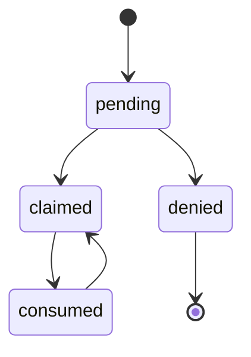

| State    | May transition to |
| -------- | ----------------- |
| pending  | claimed, denied   |
| claimed  | consumed          |
| denied   | — (terminal)      |
| consumed | claimed           |

## invites.status

Pending invitations close through acceptance, revocation, recipient decline or
expiry.

Source:
[`packages/worker/src/orgs/invite-state.ts`](../../packages/worker/src/orgs/invite-state.ts)

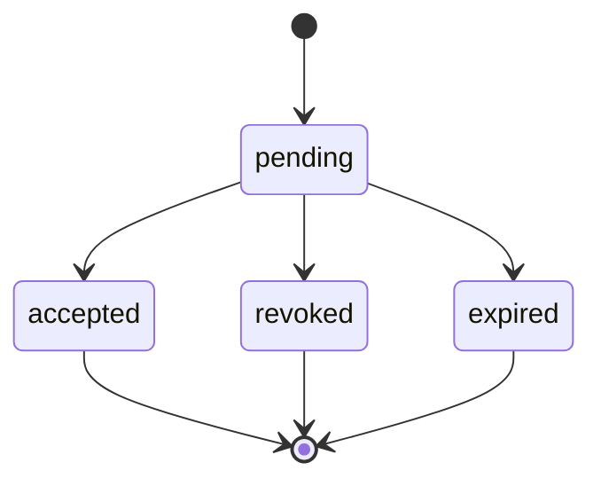

| State    | May transition to          |
| -------- | -------------------------- |
| pending  | accepted, revoked, expired |
| accepted | — (terminal)               |
| revoked  | — (terminal)               |
| expired  | — (terminal)               |

## publish_builds.status

Builds upload, seal and commit or reject; a committed build may be finalized
again or rejected by a later verification.

Source:
[`packages/worker/src/publish-offload/publish-build-state.ts`](../../packages/worker/src/publish-offload/publish-build-state.ts)

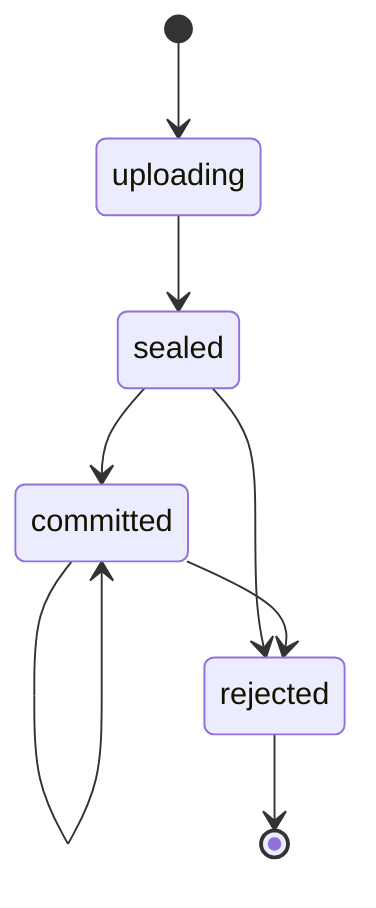

| State     | May transition to   |
| --------- | ------------------- |
| uploading | sealed              |
| sealed    | committed, rejected |
| committed | committed, rejected |
| rejected  | — (terminal)        |

## dead_letter_messages.status

Messages park, claim or reclaim replay, and return to parked on release;
successful replay deletes the row.

Source:
[`packages/worker/src/dead-letter/dead-letter-message-state.ts`](../../packages/worker/src/dead-letter/dead-letter-message-state.ts)

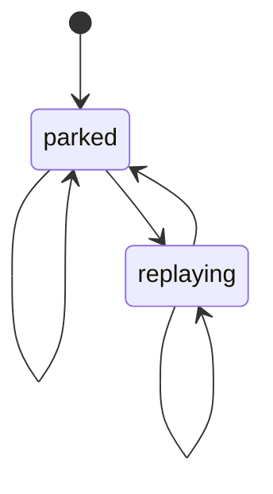

| State     | May transition to |
| --------- | ----------------- |
| parked    | parked, replaying |
| replaying | parked, replaying |

## package_approval_requests.status

Pending package approvals resolve by owner approval or supersession by another
publish.

Source:
[`packages/worker/src/package-capabilities/package-approval-state.ts`](../../packages/worker/src/package-capabilities/package-approval-state.ts)

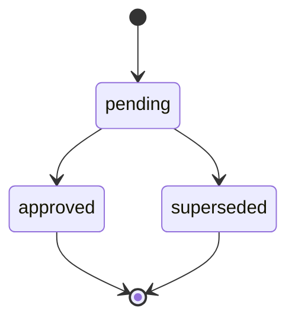

| State      | May transition to    |
| ---------- | -------------------- |
| pending    | approved, superseded |
| approved   | — (terminal)         |
| superseded | — (terminal)         |

## org_plan_transfers.status

Transfers begin at checkout or retry, acquire or reclaim an applying lease, and
complete or cancel; applying can release back to checkout or retry.

Source:
[`packages/worker/src/billing/plan-transfer-state.ts`](../../packages/worker/src/billing/plan-transfer-state.ts)

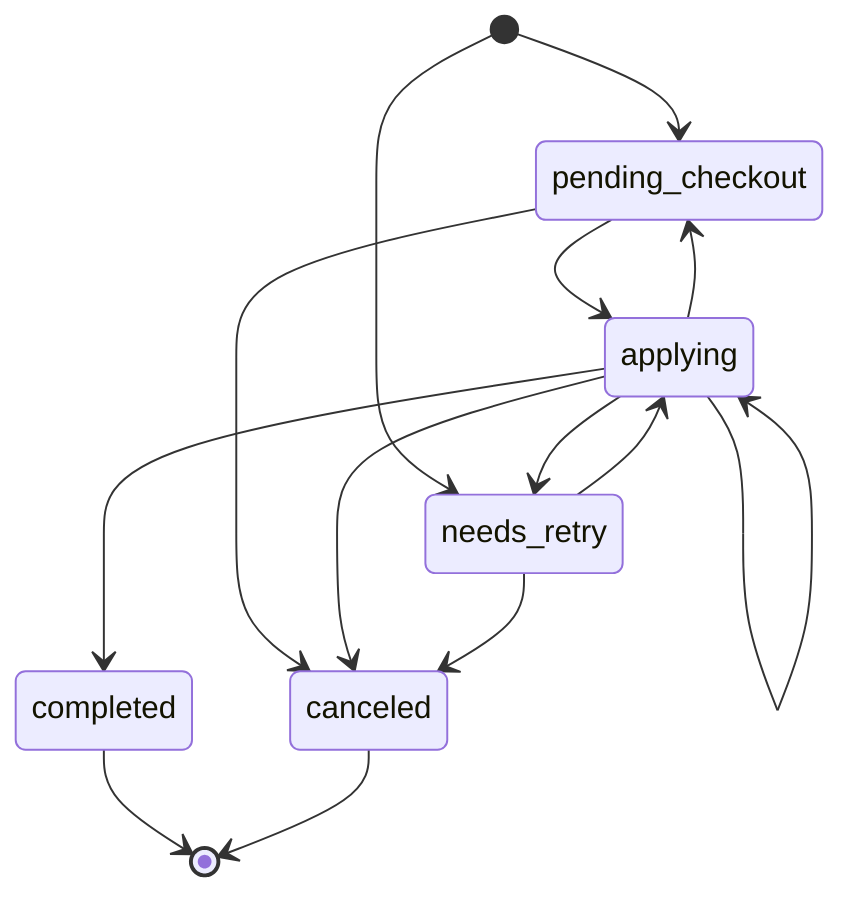

| State            | May transition to                                            |
| ---------------- | ------------------------------------------------------------ |
| pending_checkout | applying, canceled                                           |
| applying         | applying, pending_checkout, needs_retry, completed, canceled |
| needs_retry      | applying, canceled                                           |
| completed        | — (terminal)                                                 |
| canceled         | — (terminal)                                                 |

## package_codemod_runs.status

Codemod runs heartbeat, finish, fail or abandon; failed and abandoned runs
resume, while a repeated completed continuation may complete again or fail.

Source:
[`packages/worker/src/package-codemods/package-codemod-run-state.ts`](../../packages/worker/src/package-codemods/package-codemod-run-state.ts)

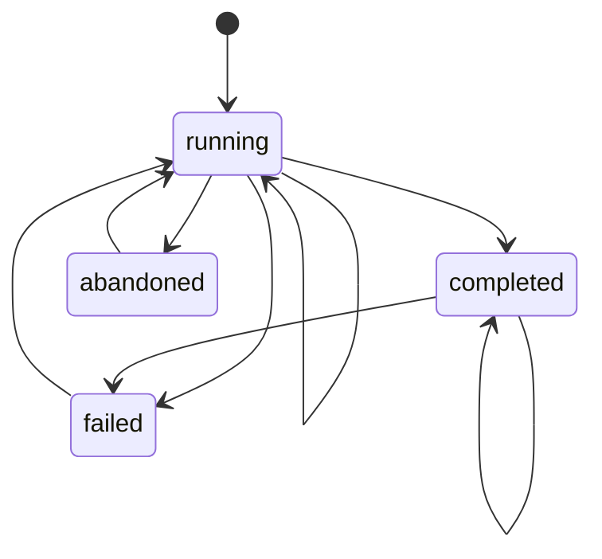

| State     | May transition to                     |
| --------- | ------------------------------------- |
| running   | running, completed, failed, abandoned |
| completed | completed, failed                     |
| failed    | running                               |
| abandoned | running                               |

## runs.status

Runs normally finish with success or error, including finish without begin;
non-scheduled replace upserts accept any status, while scheduled ticks fence
terminal rewrites.

Source:
[`packages/worker/src/run-records/run-state.ts`](../../packages/worker/src/run-records/run-state.ts)

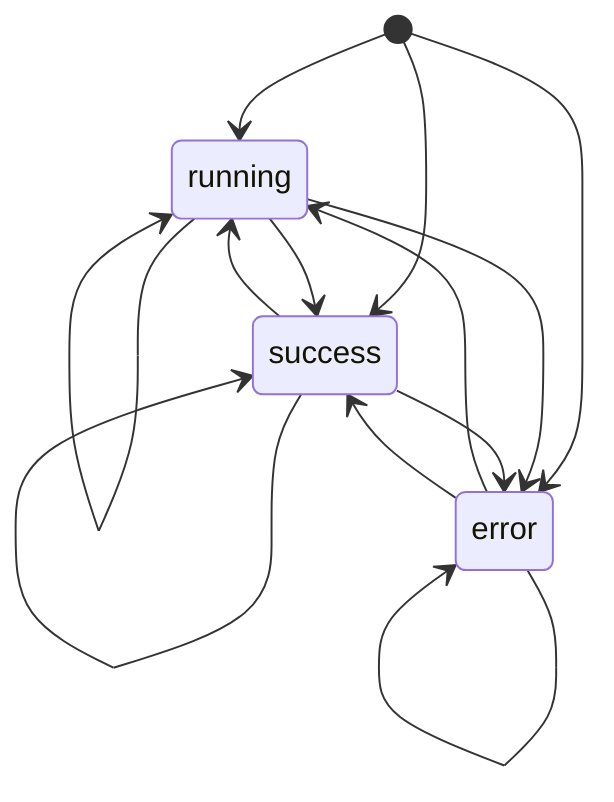

| State   | May transition to       |
| ------- | ----------------------- |
| running | running, success, error |
| success | running, success, error |
| error   | running, success, error |

## dr_paced_restore_drill_runs.status

A leased restore drill remains running until its sources finish and the
aggregate passes or fails.

Source:
[`packages/worker/src/dr/d1-paced-restore-drill-run-state.ts`](../../packages/worker/src/dr/d1-paced-restore-drill-run-state.ts)

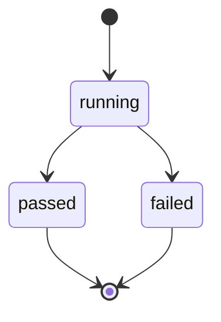

| State   | May transition to |
| ------- | ----------------- |
| running | passed, failed    |
| passed  | — (terminal)      |
| failed  | — (terminal)      |

## package_owner_error_spike.status

Owners trigger pending delivery, become alerted after success, and rearm after
health, inactivity or abandoned delivery; immediate delivery may persist alerted
directly from ok.

Source:
[`packages/worker/src/usage/package-owner-spike-state.ts`](../../packages/worker/src/usage/package-owner-spike-state.ts)

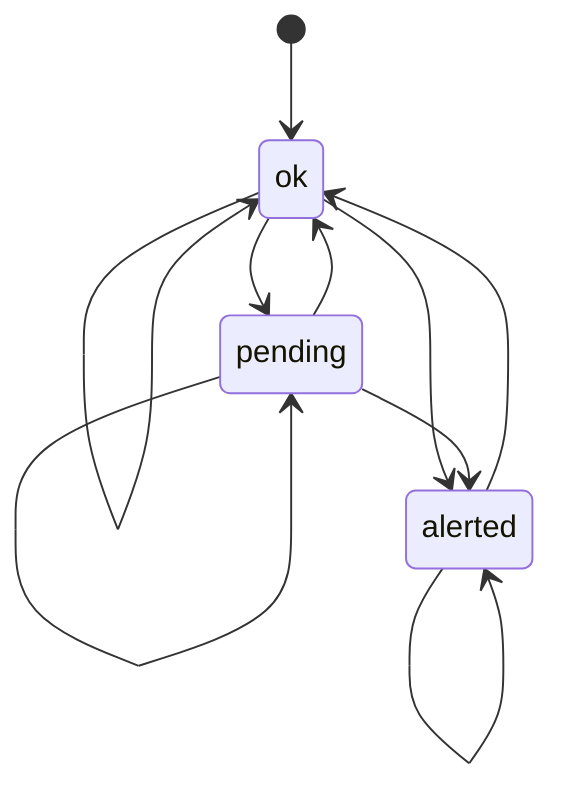

| State   | May transition to    |
| ------- | -------------------- |
| ok      | ok, pending, alerted |
| pending | pending, ok, alerted |
| alerted | alerted, ok          |

## component_probe.status

Consecutive failure and recovery thresholds move a component between operational
and down.

Source:
[`packages/status/incident-state.ts`](../../packages/status/incident-state.ts)

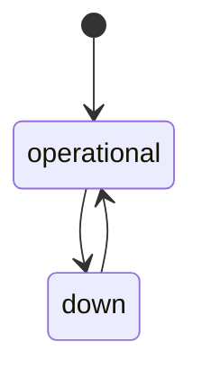

| State       | May transition to |
| ----------- | ----------------- |
| operational | down              |
| down        | operational       |
