# Explicit state machines

<!-- Generated by tools/generate-state-machines.ts. Do not edit. -->

Owned lifecycles are migrating incrementally from legacy transition tables to
event-driven XState machines. Unconstrained replacement fields are status enums,
not state machines. Stored values and wire contracts remain unchanged.

Framework-owned request state (such as TanStack Query mutations) is used
directly, not wrapped in another machine. UI forms derive busy state from the
mutation and keep validation and receipt feedback as atomic discriminated
values. App-owned interaction controllers reject illegal transitions
synchronously, including submissions arriving before React has rendered a
pending state.

## Adding a machine

Declare a flat XState machine next to the domain, with named operation events
and genuinely terminal states marked `type: 'final'`. Export the machine and a
`LifecycleStateOf<typeof machine>` alias, and register its machine and source
path in the package's `state-machines.ts` registry. The tooling-only aggregate
at `tools/state-machines.ts` includes each package registry without adding
runtime dependencies between packages. Run `npm run state-machines:generate` and
add focused graph tests. Existing stored values and wire contracts stay
unchanged.

Use `nextState(machine, from, event)` for guard-aware transition validation and
`sqlSourcesOf(machine, eventType)` for SQL compare-and-set source lists. Sources
are structural: retain operation-specific SQL conditions alongside the list.
State-only helpers use static machine context unless explicit context is
supplied; machines with context initializers require explicit context.
`canHandle` probes with a type-only event; payload-dependent guards require
`nextState` with the full event. Legacy helpers remain available until their
callers migrate.

Use `defineStatusEnum` for fields accepting arbitrary status replacement and
register them separately in `statusEnums`; they have no transition graph.

## oauth_device_authorizations.status

Device requests await a decision before an approved request can be consumed.

Source:
[`packages/worker/src/oauth-device/device-authorization-state.ts`](../../packages/worker/src/oauth-device/device-authorization-state.ts)

States: pending, approved, denied, consumed

Final states: denied, consumed

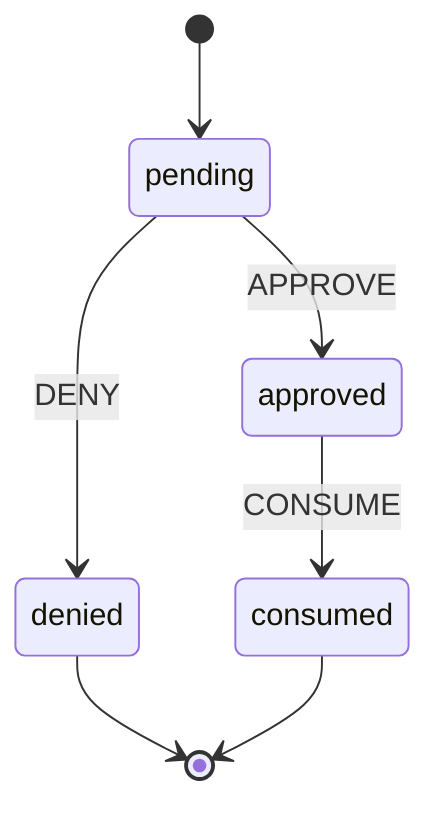

| Event   | From     | To       | Guard |
| ------- | -------- | -------- | ----- |
| APPROVE | pending  | approved | —     |
| DENY    | pending  | denied   | —     |
| CONSUME | approved | consumed | —     |

## agent_registrations.status

Registrations await a claim decision, then consumption with retry rollback when
token minting fails.

Source:
[`packages/worker/src/agent-registration/agent-registration-state.ts`](../../packages/worker/src/agent-registration/agent-registration-state.ts)

States: pending, claimed, denied, consumed

Final states: denied

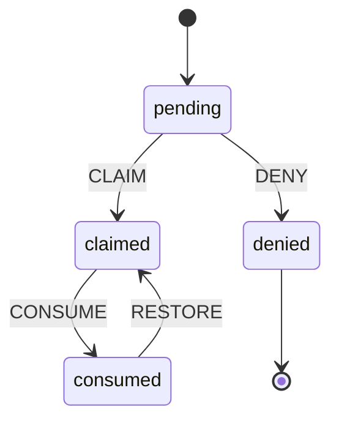

| Event   | From     | To       | Guard |
| ------- | -------- | -------- | ----- |
| CLAIM   | pending  | claimed  | —     |
| DENY    | pending  | denied   | —     |
| CONSUME | claimed  | consumed | —     |
| RESTORE | consumed | claimed  | —     |

## invites.status

Pending invitations close through acceptance, revocation, recipient decline or
expiry.

Source:
[`packages/worker/src/orgs/invite-state.ts`](../../packages/worker/src/orgs/invite-state.ts)

States: pending, accepted, revoked, expired

Final states: accepted, revoked, expired

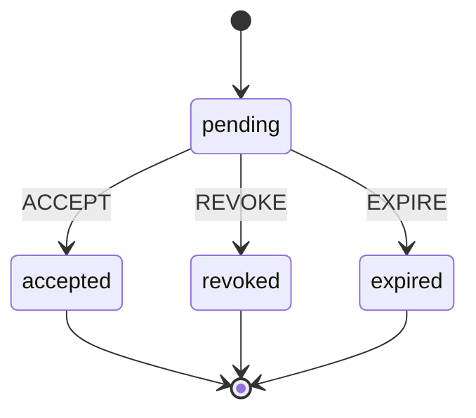

| Event  | From    | To       | Guard |
| ------ | ------- | -------- | ----- |
| ACCEPT | pending | accepted | —     |
| REVOKE | pending | revoked  | —     |
| EXPIRE | pending | expired  | —     |

## publish_builds.status

Builds upload, seal and commit or reject; a committed build may be finalized
again or rejected by a later verification.

Source:
[`packages/worker/src/publish-offload/publish-build-state.ts`](../../packages/worker/src/publish-offload/publish-build-state.ts)

States: uploading, sealed, committed, rejected

Final states: rejected

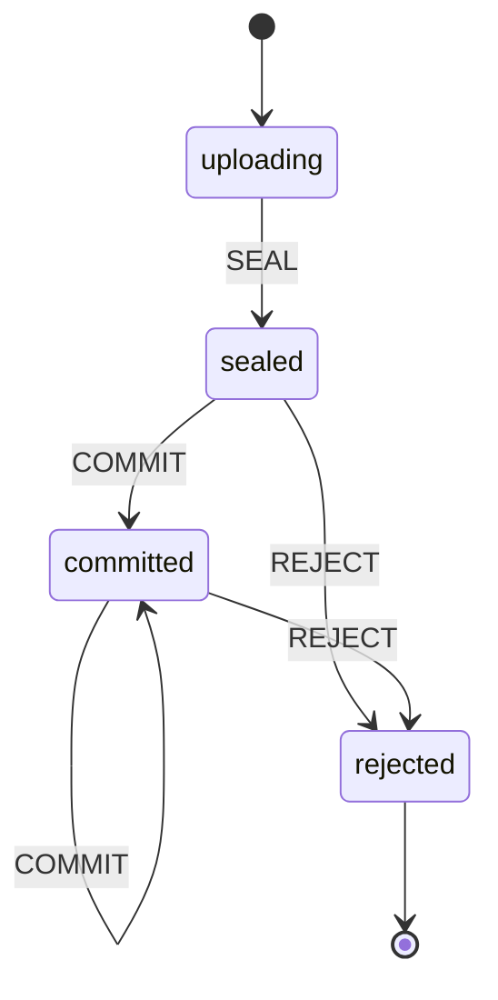

| Event  | From      | To        | Guard |
| ------ | --------- | --------- | ----- |
| SEAL   | uploading | sealed    | —     |
| COMMIT | sealed    | committed | —     |
| REJECT | sealed    | rejected  | —     |
| COMMIT | committed | committed | —     |
| REJECT | committed | rejected  | —     |

## dead_letter_messages.status

Messages park, claim or reclaim replay, and return to parked on release;
successful replay deletes the row.

Source:
[`packages/worker/src/dead-letter/dead-letter-message-state.ts`](../../packages/worker/src/dead-letter/dead-letter-message-state.ts)

States: parked, replaying

Final states: None

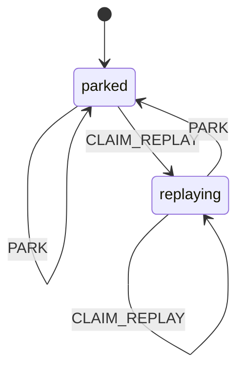

| Event        | From      | To        | Guard |
| ------------ | --------- | --------- | ----- |
| PARK         | parked    | parked    | —     |
| CLAIM_REPLAY | parked    | replaying | —     |
| PARK         | replaying | parked    | —     |
| CLAIM_REPLAY | replaying | replaying | —     |

## package_approval_requests.status

Pending package approvals resolve by owner approval or supersession by another
publish.

Source:
[`packages/worker/src/package-capabilities/package-approval-state.ts`](../../packages/worker/src/package-capabilities/package-approval-state.ts)

States: pending, approved, superseded

Final states: approved, superseded

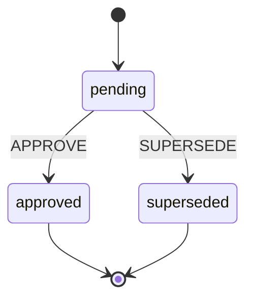

| Event     | From    | To         | Guard |
| --------- | ------- | ---------- | ----- |
| APPROVE   | pending | approved   | —     |
| SUPERSEDE | pending | superseded | —     |

## org_plan_transfers.status

Transfers begin at checkout or retry, acquire or reclaim an applying lease, and
complete or cancel; applying can release back to checkout or retry. Rows or
initial responses may enter directly in another listed state.

Source:
[`packages/worker/src/billing/plan-transfer-state.ts`](../../packages/worker/src/billing/plan-transfer-state.ts)

States: pending_checkout, applying, needs_retry, completed, canceled

Final states: completed, canceled

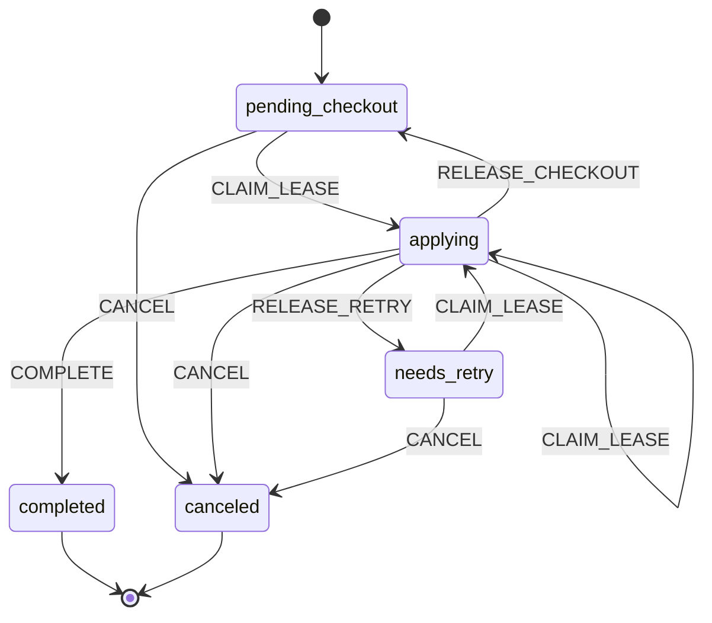

| Event            | From             | To               | Guard |
| ---------------- | ---------------- | ---------------- | ----- |
| CLAIM_LEASE      | pending_checkout | applying         | —     |
| CANCEL           | pending_checkout | canceled         | —     |
| CLAIM_LEASE      | applying         | applying         | —     |
| RELEASE_CHECKOUT | applying         | pending_checkout | —     |
| RELEASE_RETRY    | applying         | needs_retry      | —     |
| COMPLETE         | applying         | completed        | —     |
| CANCEL           | applying         | canceled         | —     |
| CLAIM_LEASE      | needs_retry      | applying         | —     |
| CANCEL           | needs_retry      | canceled         | —     |

## package_codemod_runs.status

Codemod runs heartbeat, finish, fail or abandon; failed and abandoned runs
resume, while a repeated completed continuation may complete again or fail.

Source:
[`packages/worker/src/package-codemods/package-codemod-run-state.ts`](../../packages/worker/src/package-codemods/package-codemod-run-state.ts)

States: running, completed, failed, abandoned

Final states: None

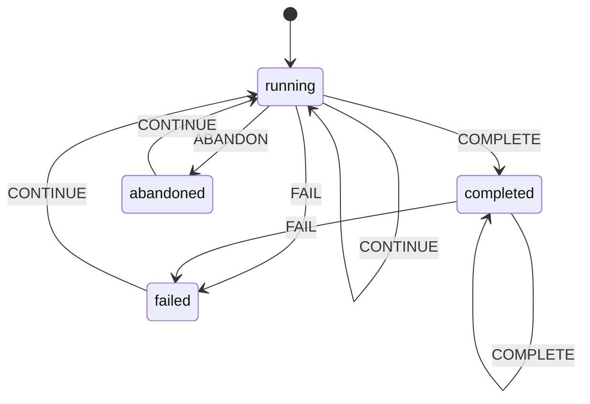

| Event    | From      | To        | Guard |
| -------- | --------- | --------- | ----- |
| CONTINUE | running   | running   | —     |
| COMPLETE | running   | completed | —     |
| FAIL     | running   | failed    | —     |
| ABANDON  | running   | abandoned | —     |
| COMPLETE | completed | completed | —     |
| FAIL     | completed | failed    | —     |
| CONTINUE | failed    | running   | —     |
| CONTINUE | abandoned | running   | —     |

## dr_paced_restore_drill_runs.status

A leased restore drill remains running until its sources finish and the
aggregate passes or fails.

Source:
[`packages/worker/src/dr/d1-paced-restore-drill-run-state.ts`](../../packages/worker/src/dr/d1-paced-restore-drill-run-state.ts)

States: running, passed, failed

Final states: passed, failed

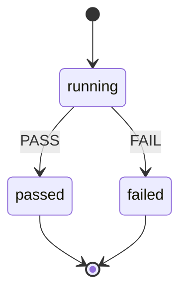

| Event | From    | To     | Guard |
| ----- | ------- | ------ | ----- |
| PASS  | running | passed | —     |
| FAIL  | running | failed | —     |

## package_owner_error_spike.status

Owners trigger pending delivery, become alerted after success, and rearm after
health, inactivity or abandoned delivery; immediate delivery may persist alerted
directly from ok.

Source:
[`packages/worker/src/usage/package-owner-spike-state.ts`](../../packages/worker/src/usage/package-owner-spike-state.ts)

States: ok, pending, alerted

Final states: None

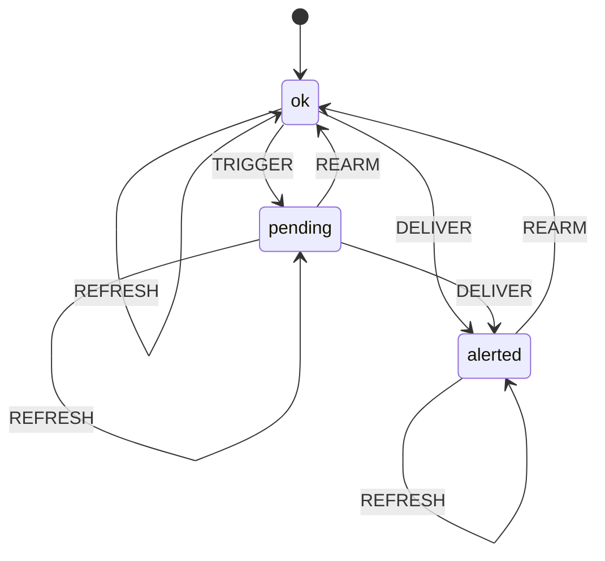

| Event   | From    | To      | Guard |
| ------- | ------- | ------- | ----- |
| REFRESH | ok      | ok      | —     |
| TRIGGER | ok      | pending | —     |
| DELIVER | ok      | alerted | —     |
| REFRESH | pending | pending | —     |
| REARM   | pending | ok      | —     |
| DELIVER | pending | alerted | —     |
| REFRESH | alerted | alerted | —     |
| REARM   | alerted | ok      | —     |

## admin_account_deletion_approvals.lifecycle

Approvals expire or are consumed for deletion, with consumption rolled back on
failure and expiry assessed on the next read.

Source:
[`packages/worker/universal/account-deletion-approval-state.ts`](../../packages/worker/universal/account-deletion-approval-state.ts)

States: pending, consumed, expired

Final states: expired

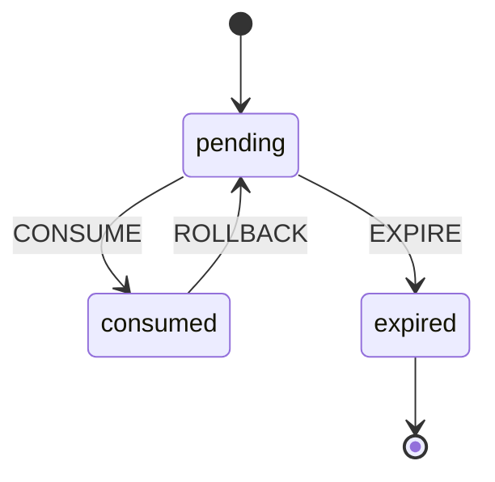

| Event    | From     | To       | Guard |
| -------- | -------- | -------- | ----- |
| CONSUME  | pending  | consumed | —     |
| EXPIRE   | pending  | expired  | —     |
| ROLLBACK | consumed | pending  | —     |

## community_reports.status

Open community reports resolve or dismiss once.

Source:
[`packages/worker/src/community/community-report-state.ts`](../../packages/worker/src/community/community-report-state.ts)

States: open, resolved, dismissed

Final states: resolved, dismissed

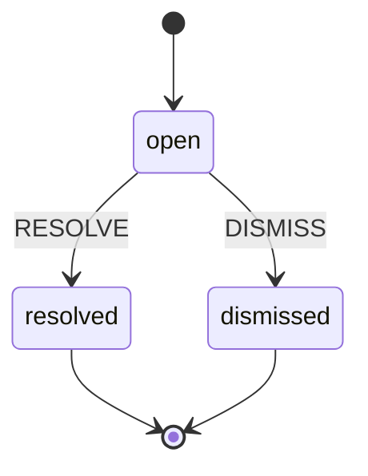

| Event   | From | To        | Guard |
| ------- | ---- | --------- | ----- |
| RESOLVE | open | resolved  | —     |
| DISMISS | open | dismissed | —     |

## credential_inventory_runs.status

Inventory scans advance a cursor while scanning and complete at the last page.

Source:
[`packages/worker/src/credentials/credential-inventory-run-state.ts`](../../packages/worker/src/credentials/credential-inventory-run-state.ts)

States: scanning, complete

Final states: complete

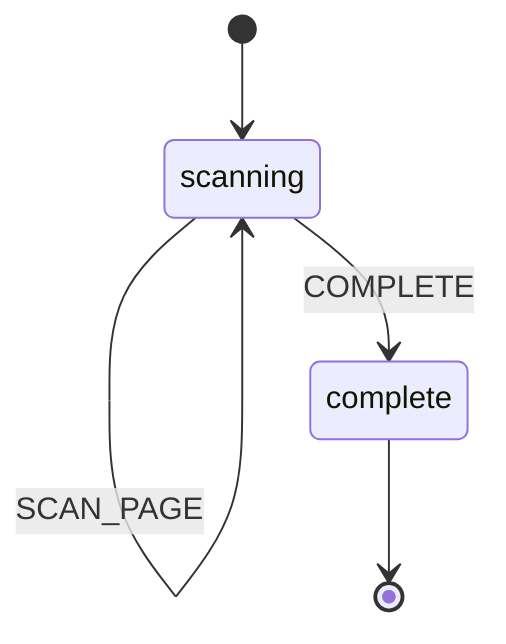

| Event     | From     | To       | Guard |
| --------- | -------- | -------- | ----- |
| SCAN_PAGE | scanning | scanning | —     |
| COMPLETE  | scanning | complete | —     |

## dr_paced_restore_drill_sources.status

Per-source progress setters can start, restart or refinalize any source; the
coordinator normally skips completed sources.

Source:
[`packages/worker/src/dr/d1-paced-restore-drill-source-state.ts`](../../packages/worker/src/dr/d1-paced-restore-drill-source-state.ts)

States: pending, running, passed, failed

Final states: None

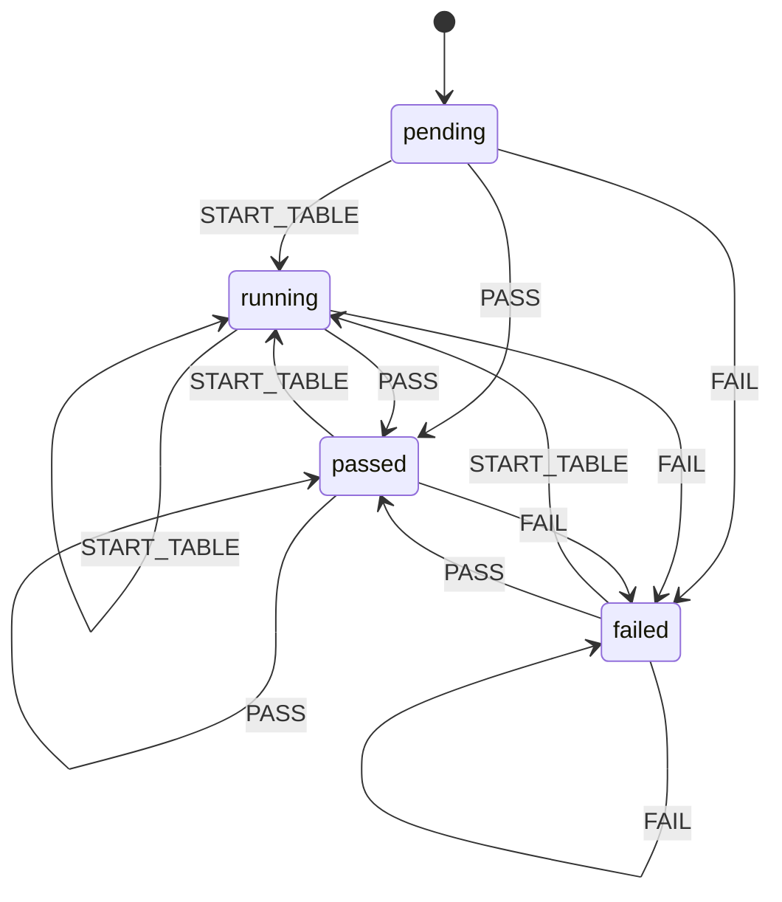

| Event       | From    | To      | Guard |
| ----------- | ------- | ------- | ----- |
| START_TABLE | pending | running | —     |
| PASS        | pending | passed  | —     |
| FAIL        | pending | failed  | —     |
| START_TABLE | running | running | —     |
| PASS        | running | passed  | —     |
| FAIL        | running | failed  | —     |
| START_TABLE | passed  | running | —     |
| PASS        | passed  | passed  | —     |
| FAIL        | passed  | failed  | —     |
| START_TABLE | failed  | running | —     |
| PASS        | failed  | passed  | —     |
| FAIL        | failed  | failed  | —     |

## email_inbound_dedupe_pointer.state

Dedupe windows start pending, tombstone on message deletion, and reset after
expiry; repeat tombstones are idempotent.

Source:
[`packages/worker/src/email/inbound-dedupe-pointer-state.ts`](../../packages/worker/src/email/inbound-dedupe-pointer-state.ts)

States: pending, rejected

Final states: None

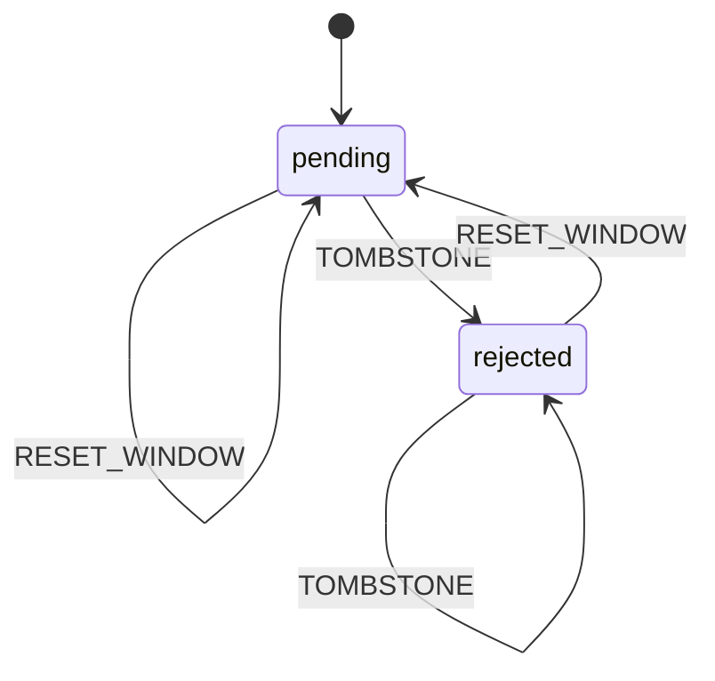

| Event        | From     | To       | Guard |
| ------------ | -------- | -------- | ----- |
| RESET_WINDOW | pending  | pending  | —     |
| TOMBSTONE    | pending  | rejected | —     |
| RESET_WINDOW | rejected | pending  | —     |
| TOMBSTONE    | rejected | rejected | —     |

## email_inbound_delivery.state

Inbound deliveries acquire storage or cleanup leases, release or reclaim them,
finalize receipt, or reject; missing stored messages permit refinalization.

Source:
[`packages/worker/src/email/inbound-delivery-state.ts`](../../packages/worker/src/email/inbound-delivery-state.ts)

States: pending, storing, cleaning, received, rejected, orphan-cleaned

Final states: rejected

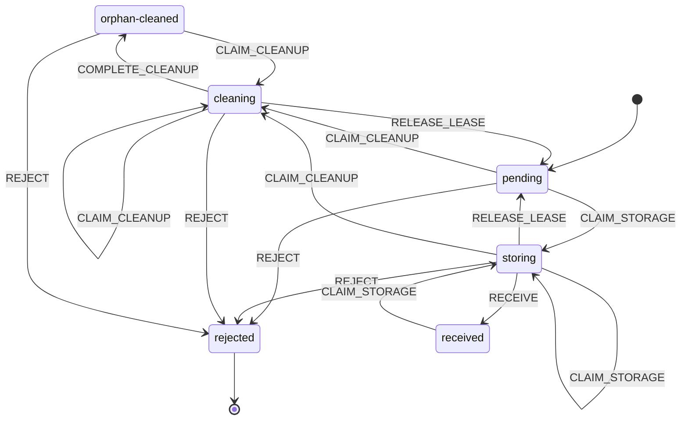

| Event            | From           | To             | Guard |
| ---------------- | -------------- | -------------- | ----- |
| CLAIM_STORAGE    | pending        | storing        | —     |
| CLAIM_CLEANUP    | pending        | cleaning       | —     |
| REJECT           | pending        | rejected       | —     |
| CLAIM_STORAGE    | storing        | storing        | —     |
| RELEASE_LEASE    | storing        | pending        | —     |
| RECEIVE          | storing        | received       | —     |
| CLAIM_CLEANUP    | storing        | cleaning       | —     |
| REJECT           | storing        | rejected       | —     |
| CLAIM_CLEANUP    | cleaning       | cleaning       | —     |
| RELEASE_LEASE    | cleaning       | pending        | —     |
| COMPLETE_CLEANUP | cleaning       | orphan-cleaned | —     |
| REJECT           | cleaning       | rejected       | —     |
| CLAIM_STORAGE    | received       | storing        | —     |
| CLAIM_CLEANUP    | orphan-cleaned | cleaning       | —     |
| REJECT           | orphan-cleaned | rejected       | —     |

## email_inbound_subscription_effect.state

Subscription delivery claims or reclaims processing, completes or retries to
dead-letter, and refinalization resets the effect to pending.

Source:
[`packages/worker/src/email/inbound-subscription-effect-state.ts`](../../packages/worker/src/email/inbound-subscription-effect-state.ts)

States: pending, processing, complete, dead-letter

Final states: None

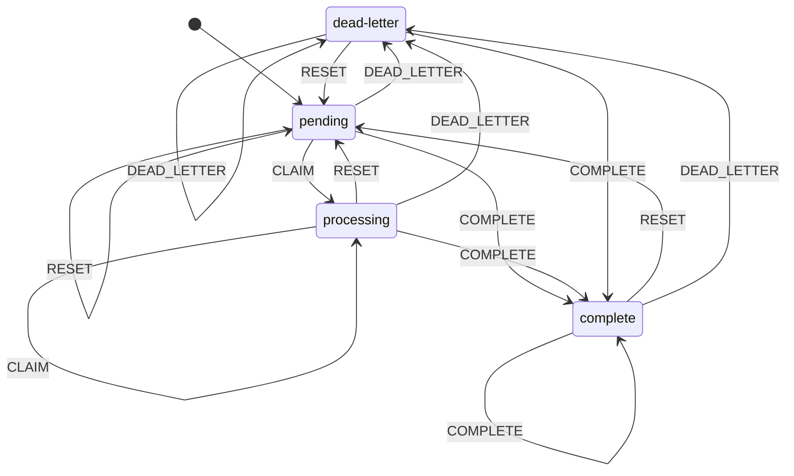

| Event       | From        | To          | Guard |
| ----------- | ----------- | ----------- | ----- |
| RESET       | pending     | pending     | —     |
| CLAIM       | pending     | processing  | —     |
| COMPLETE    | pending     | complete    | —     |
| DEAD_LETTER | pending     | dead-letter | —     |
| CLAIM       | processing  | processing  | —     |
| RESET       | processing  | pending     | —     |
| COMPLETE    | processing  | complete    | —     |
| DEAD_LETTER | processing  | dead-letter | —     |
| RESET       | complete    | pending     | —     |
| COMPLETE    | complete    | complete    | —     |
| DEAD_LETTER | complete    | dead-letter | —     |
| RESET       | dead-letter | pending     | —     |
| COMPLETE    | dead-letter | complete    | —     |
| DEAD_LETTER | dead-letter | dead-letter | —     |

## enablements.state

Enablements start on, pause or rewrite a pause cause, resume after access
recovers, and turn off permanently.

Source:
[`packages/worker/src/enablements/enablement-state.ts`](../../packages/worker/src/enablements/enablement-state.ts)

States: on, paused, off

Final states: off

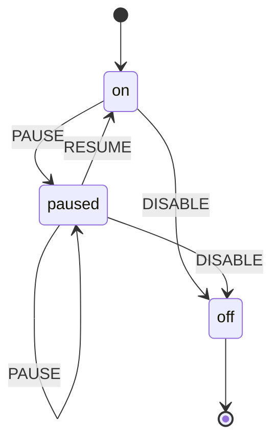

| Event   | From   | To     | Guard |
| ------- | ------ | ------ | ----- |
| PAUSE   | on     | paused | —     |
| DISABLE | on     | off    | —     |
| PAUSE   | paused | paused | —     |
| RESUME  | paused | on     | —     |
| DISABLE | paused | off    | —     |

## referrals.status

Pending referrals reject fraud or reward qualifying invoices; incomplete reward
delivery may retry. Existing reward SQL also rewrites rejected rows when their
credit marker is unset, despite preflight rejection.

Source:
[`packages/worker/src/entitlements/referral-state.ts`](../../packages/worker/src/entitlements/referral-state.ts)

States: pending, rewarded, rejected

Final states: None

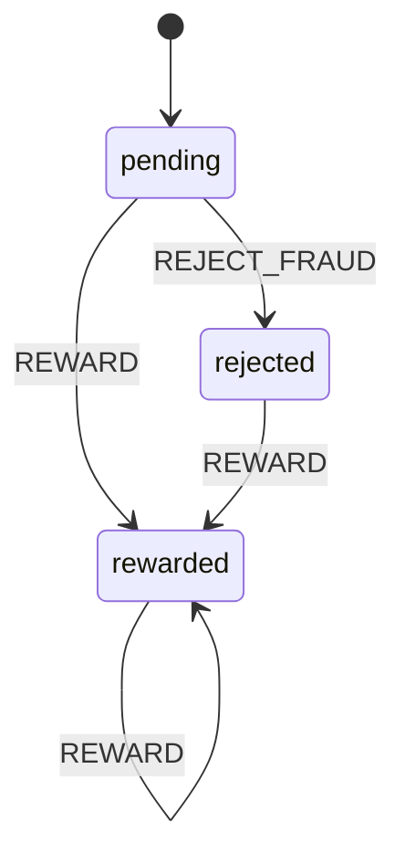

| Event        | From     | To       | Guard          |
| ------------ | -------- | -------- | -------------- |
| REJECT_FRAUD | pending  | rejected | —              |
| REWARD       | pending  | rewarded | —              |
| REWARD       | rewarded | rewarded | —              |
| REWARD       | rejected | rewarded | creditsPending |

## execution_context_queued.lifecycle

Queued rows enter a starting handoff that always releases its cancellation
fence, then retry or leave the queue after dispatch, cancellation, failure or
expiry.

Source:
[`packages/worker/src/execution-contexts/queued-run-state.ts`](../../packages/worker/src/execution-contexts/queued-run-state.ts)

States: queued, starting, finished, cancelled, expired

Final states: finished, cancelled, expired

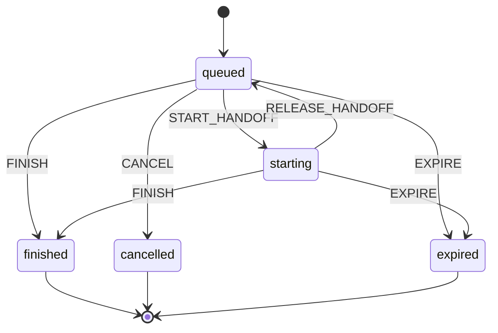

| Event           | From     | To        | Guard |
| --------------- | -------- | --------- | ----- |
| START_HANDOFF   | queued   | starting  | —     |
| FINISH          | queued   | finished  | —     |
| CANCEL          | queued   | cancelled | —     |
| EXPIRE          | queued   | expired   | —     |
| RELEASE_HANDOFF | starting | queued    | —     |
| FINISH          | starting | finished  | —     |
| EXPIRE          | starting | expired   | —     |

## execution_context_runs.state

Dispatch offers commit or abort and rejected offers can retry; committed runs
finish once, while the existing offer-failure setter can still abort or reject
any nonfinal row.

Source:
[`packages/worker/src/execution-contexts/run-dispatch-state.ts`](../../packages/worker/src/execution-contexts/run-dispatch-state.ts)

States: dispatched, committed, succeeded, failed, cancelled, lost, rejected,
aborted

Final states: succeeded, failed, cancelled, lost

```mermaid
stateDiagram-v2
    [*] --> dispatched
    dispatched --> committed: COMMIT
    dispatched --> aborted: ABORT
    dispatched --> rejected: REJECT
    committed --> succeeded: SUCCEED
    committed --> failed: FAIL
    committed --> cancelled: CANCEL
    committed --> lost: LOSE
    committed --> aborted: ABORT
    committed --> rejected: REJECT
    rejected --> dispatched: OFFER
    rejected --> rejected: REJECT
    rejected --> aborted: ABORT
    aborted --> dispatched: OFFER
    aborted --> rejected: REJECT
    aborted --> aborted: ABORT
    succeeded --> [*]
    failed --> [*]
    cancelled --> [*]
    lost --> [*]
```

| Event   | From       | To         | Guard |
| ------- | ---------- | ---------- | ----- |
| COMMIT  | dispatched | committed  | —     |
| ABORT   | dispatched | aborted    | —     |
| REJECT  | dispatched | rejected   | —     |
| SUCCEED | committed  | succeeded  | —     |
| FAIL    | committed  | failed     | —     |
| CANCEL  | committed  | cancelled  | —     |
| LOSE    | committed  | lost       | —     |
| ABORT   | committed  | aborted    | —     |
| REJECT  | committed  | rejected   | —     |
| OFFER   | rejected   | dispatched | —     |
| REJECT  | rejected   | rejected   | —     |
| ABORT   | rejected   | aborted    | —     |
| OFFER   | aborted    | dispatched | —     |
| REJECT  | aborted    | rejected   | —     |
| ABORT   | aborted    | aborted    | —     |

## follows.status

Active follows pause when delivery access fails and resume after a creator
reauthorizes them.

Source:
[`packages/worker/src/follow/follow-state.ts`](../../packages/worker/src/follow/follow-state.ts)

States: active, paused

Final states: None

```mermaid
stateDiagram-v2
    [*] --> active
    active --> paused: PAUSE
    paused --> active: REAUTHORIZE
```

| Event       | From   | To     | Guard |
| ----------- | ------ | ------ | ----- |
| PAUSE       | active | paused | —     |
| REAUTHORIZE | paused | active | —     |

## user_email_claims.status

Email addresses can be claimed, released and reclaimed; either state may be
inserted. Rows or initial responses may enter directly in another listed state.

Source:
[`packages/worker/src/identity/email-claim-state.ts`](../../packages/worker/src/identity/email-claim-state.ts)

States: claimed, released

Final states: None

```mermaid
stateDiagram-v2
    [*] --> claimed
    claimed --> released: RELEASE
    released --> claimed: CLAIM
```

| Event   | From     | To       | Guard |
| ------- | -------- | -------- | ----- |
| RELEASE | claimed  | released | —     |
| CLAIM   | released | claimed  | —     |

## org_invite_links.status

An active invite link can be explicitly revoked; expiry and exhaustion are
derived eligibility conditions.

Source:
[`packages/worker/src/orgs/invite-link-state.ts`](../../packages/worker/src/orgs/invite-link-state.ts)

States: active, revoked

Final states: revoked

```mermaid
stateDiagram-v2
    [*] --> active
    active --> revoked: REVOKE
    revoked --> [*]
```

| Event  | From   | To      | Guard |
| ------ | ------ | ------- | ----- |
| REVOKE | active | revoked | —     |

## platform_feedback.status

Feedback triages or closes, closed feedback reopens to triaged, and review edits
may preserve status.

Source:
[`packages/worker/src/platform-feedback/platform-feedback-state.ts`](../../packages/worker/src/platform-feedback/platform-feedback-state.ts)

States: open, triaged, resolved, dismissed

Final states: None

```mermaid
stateDiagram-v2
    [*] --> open
    open --> open: REVIEW_OPEN
    open --> triaged: TRIAGE
    open --> resolved: RESOLVE
    open --> dismissed: DISMISS
    triaged --> triaged: TRIAGE
    triaged --> resolved: RESOLVE
    triaged --> dismissed: DISMISS
    resolved --> resolved: RESOLVE
    resolved --> triaged: TRIAGE
    dismissed --> dismissed: DISMISS
    dismissed --> triaged: TRIAGE
```

| Event       | From      | To        | Guard |
| ----------- | --------- | --------- | ----- |
| REVIEW_OPEN | open      | open      | —     |
| TRIAGE      | open      | triaged   | —     |
| RESOLVE     | open      | resolved  | —     |
| DISMISS     | open      | dismissed | —     |
| TRIAGE      | triaged   | triaged   | —     |
| RESOLVE     | triaged   | resolved  | —     |
| DISMISS     | triaged   | dismissed | —     |
| RESOLVE     | resolved  | resolved  | —     |
| TRIAGE      | resolved  | triaged   | —     |
| DISMISS     | dismissed | dismissed | —     |
| TRIAGE      | dismissed | triaged   | —     |

## package_invocation_ledger.status

Invocation claims heartbeat or reclaim an in-progress attempt and atomically
persist its completed or failed response.

Source:
[`packages/worker/src/run-records/package-invocation-state.ts`](../../packages/worker/src/run-records/package-invocation-state.ts)

States: in_progress, completed, failed

Final states: completed, failed

```mermaid
stateDiagram-v2
    [*] --> in_progress
    in_progress --> in_progress: CLAIM
    in_progress --> completed: COMPLETE
    in_progress --> failed: FAIL
    completed --> [*]
    failed --> [*]
```

| Event    | From        | To          | Guard |
| -------- | ----------- | ----------- | ----- |
| CLAIM    | in_progress | in_progress | —     |
| COMPLETE | in_progress | completed   | —     |
| FAIL     | in_progress | failed      | —     |

## component_probe.status

Consecutive failure and recovery thresholds move a component between operational
and down.

Source:
[`packages/status/incident-state.ts`](../../packages/status/incident-state.ts)

States: operational, down

Final states: None

```mermaid
stateDiagram-v2
    [*] --> operational
    operational --> down: OPEN_INCIDENT
    down --> operational: RESOLVE_INCIDENT
```

| Event            | From        | To          | Guard |
| ---------------- | ----------- | ----------- | ----- |
| OPEN_INCIDENT    | operational | down        | —     |
| RESOLVE_INCIDENT | down        | operational | —     |

## host_background_command.state

Background commands exit, time out, kill or fail; a spawn error can finish a
command already stopped by timeout or kill.

Source:
[`packages/cli/src/execution-context/host-command-state.ts`](../../packages/cli/src/execution-context/host-command-state.ts)

States: running, exited, killed, timed_out, failed

Final states: exited, failed

```mermaid
stateDiagram-v2
    [*] --> running
    running --> timed_out: TIMEOUT
    running --> failed: SPAWN_ERROR
    running --> exited: EXIT
    running --> killed: KILL
    killed --> failed: SPAWN_ERROR
    timed_out --> failed: SPAWN_ERROR
    exited --> [*]
    failed --> [*]
```

| Event       | From      | To        | Guard |
| ----------- | --------- | --------- | ----- |
| TIMEOUT     | running   | timed_out | —     |
| SPAWN_ERROR | running   | failed    | —     |
| EXIT        | running   | exited    | —     |
| KILL        | running   | killed    | —     |
| SPAWN_ERROR | killed    | failed    | —     |
| SPAWN_ERROR | timed_out | failed    | —     |

## backup_export_controller.kind

The owned export controller polls pending exports and restarts lost exports
until complete, preserving its bounded retry and polling rules. Rows or initial
responses may enter directly in another listed state.

Source:
[`packages/backup-control-plane/backup-export-state.ts`](../../packages/backup-control-plane/backup-export-state.ts)

States: complete, pending, lost

Final states: complete

```mermaid
stateDiagram-v2
    [*] --> pending
    pending --> pending: EXPORT_PENDING
    pending --> complete: EXPORT_READY
    pending --> lost: EXPORT_LOST
    lost --> pending: EXPORT_PENDING
    lost --> complete: EXPORT_READY
    lost --> lost: EXPORT_LOST
    complete --> [*]
```

| Event          | From    | To       | Guard |
| -------------- | ------- | -------- | ----- |
| EXPORT_PENDING | pending | pending  | —     |
| EXPORT_READY   | pending | complete | —     |
| EXPORT_LOST    | pending | lost     | —     |
| EXPORT_PENDING | lost    | pending  | —     |
| EXPORT_READY   | lost    | complete | —     |
| EXPORT_LOST    | lost    | lost     | —     |

## UI flows

## admin_codemods.ui_run

Paged execution owns its progress and terminal feedback; a requested stop is
fenced until the current step and history reconciliation finish.

Source:
[`packages/worker/client/routes/admin-codemod-run-state.ts`](../../packages/worker/client/routes/admin-codemod-run-state.ts)

States: idle, running, stopping, complete, error

Final states: None

```mermaid
stateDiagram-v2
    [*] --> idle
    idle --> running
    running --> running
    running --> stopping
    running --> complete
    running --> error
    stopping --> stopping
    stopping --> complete
    stopping --> error
    complete --> running
    error --> running
```

Legacy transition table (no named events yet).

| State    | May transition to                  |
| -------- | ---------------------------------- |
| idle     | running                            |
| running  | running, stopping, complete, error |
| stopping | stopping, complete, error          |
| complete | running                            |
| error    | running                            |

## avatar.ui_crop

Decoded previews exist only while editing or preparing; decode failures cannot
be applied and preparation failures can be retried.

Source:
[`packages/worker/client/routes/avatar-crop-state.ts`](../../packages/worker/client/routes/avatar-crop-state.ts)

States: decoding, ready, applying, decode_error, prepare_error

Final states: None

```mermaid
stateDiagram-v2
    [*] --> decoding
    decoding --> decoding
    decoding --> ready
    decoding --> decode_error
    ready --> decoding
    ready --> applying
    applying --> decoding
    applying --> prepare_error
    decode_error --> decoding
    prepare_error --> decoding
    prepare_error --> applying
```

Legacy transition table (no named events yet).

| State         | May transition to             |
| ------------- | ----------------------------- |
| decoding      | decoding, ready, decode_error |
| ready         | decoding, applying            |
| applying      | decoding, prepare_error       |
| decode_error  | decoding                      |
| prepare_error | decoding, applying            |

## clipboard.ui_feedback

One clipboard write owns feedback until success or failure; its transient label
resets after the feedback interval.

Source:
[`packages/worker/client/routes/clipboard-feedback-state.ts`](../../packages/worker/client/routes/clipboard-feedback-state.ts)

States: idle, copying, copied, error

Final states: None

```mermaid
stateDiagram-v2
    [*] --> idle
    idle --> copying
    copying --> copied
    copying --> error
    copied --> copying
    copied --> idle
    error --> copying
    error --> idle
```

Legacy transition table (no named events yet).

| State   | May transition to |
| ------- | ----------------- |
| idle    | copying           |
| copying | copied, error     |
| copied  | copying, idle     |
| error   | copying, idle     |

## connect_oauth.device_poll

A device session polls with transient retries until provider completion or
expiry; an already committed late approval remains authoritative after the local
deadline.

Source:
[`packages/worker/client/routes/connect-oauth-device-state.ts`](../../packages/worker/client/routes/connect-oauth-device-state.ts)

States: idle, starting, polling, error, success

Final states: None

```mermaid
stateDiagram-v2
    [*] --> idle
    idle --> idle
    idle --> starting
    starting --> polling
    starting --> error
    starting --> idle
    polling --> polling
    polling --> error
    polling --> success
    polling --> idle
    error --> idle
    error --> success
    success --> idle
```

Legacy transition table (no named events yet).

| State    | May transition to             |
| -------- | ----------------------------- |
| idle     | idle, starting                |
| starting | polling, error, idle          |
| polling  | polling, error, success, idle |
| error    | idle, success                 |
| success  | idle                          |

## connect_oauth.step

Client setup advances to browser or device authorization, callbacks can repair
credentials, and only success carries a saved-token receipt.

Source:
[`packages/worker/client/routes/connect-oauth-state.ts`](../../packages/worker/client/routes/connect-oauth-state.ts)

States: setup, connect, device, callback, success

Final states: None

```mermaid
stateDiagram-v2
    [*] --> setup
    [*] --> connect
    setup --> setup
    setup --> connect
    setup --> callback
    connect --> connect
    connect --> setup
    connect --> device
    connect --> callback
    device --> device
    device --> connect
    device --> success
    callback --> callback
    callback --> setup
    callback --> connect
    callback --> success
    success --> success
    success --> setup
```

Legacy transition table (no named events yet).

| State    | May transition to                 |
| -------- | --------------------------------- |
| setup    | setup, connect, callback          |
| connect  | connect, setup, device, callback  |
| device   | device, connect, success          |
| callback | callback, setup, connect, success |
| success  | success, setup                    |

## connect_oauth.operation

One setup or authorize request fences submission independently of the displayed
OAuth step and its feedback.

Source:
[`packages/worker/client/routes/connect-oauth-state.ts`](../../packages/worker/client/routes/connect-oauth-state.ts)

States: idle, submitting

Final states: None

```mermaid
stateDiagram-v2
    [*] --> idle
    idle --> submitting
    submitting --> idle
```

Legacy transition table (no named events yet).

| State      | May transition to |
| ---------- | ----------------- |
| idle       | submitting        |
| submitting | idle              |

## desktop.setup_operation

Bridge actions fence user input through reconciliation; only a failed operation
carries an error and retry clears it.

Source:
[`packages/worker/client/routes/desktop-setup-operation-state.ts`](../../packages/worker/client/routes/desktop-setup-operation-state.ts)

States: idle, running, error

Final states: None

```mermaid
stateDiagram-v2
    [*] --> idle
    idle --> running
    running --> idle
    running --> error
    error --> idle
    error --> running
```

Legacy transition table (no named events yet).

| State   | May transition to |
| ------- | ----------------- |
| idle    | running           |
| running | idle, error       |
| error   | idle, running     |

## desktop.setup_step

The resumable setup wizard registers a personal machine before optional team
attachment and permits explicit reset or forget.

Source:
[`packages/worker/universal/desktop-setup-step-state.ts`](../../packages/worker/universal/desktop-setup-step-state.ts)

States: overview, register, attach, done, forget

Final states: None

```mermaid
stateDiagram-v2
    [*] --> overview
    overview --> overview
    overview --> register
    overview --> attach
    overview --> done
    overview --> forget
    register --> register
    register --> overview
    register --> attach
    register --> done
    register --> forget
    attach --> attach
    attach --> overview
    attach --> done
    attach --> forget
    done --> done
    done --> overview
    done --> forget
    forget --> forget
    forget --> overview
```

Legacy transition table (no named events yet).

| State    | May transition to                        |
| -------- | ---------------------------------------- |
| overview | overview, register, attach, done, forget |
| register | register, overview, attach, done, forget |
| attach   | attach, overview, done, forget           |
| done     | done, overview, forget                   |
| forget   | forget, overview                         |

## email_verification.feedback

Resending and checking email verification are exclusive requests; each retry
clears the previous feedback.

Source:
[`packages/worker/client/routes/email-verification-state.ts`](../../packages/worker/client/routes/email-verification-state.ts)

States: idle, sending, checking, success, error

Final states: None

```mermaid
stateDiagram-v2
    [*] --> idle
    idle --> sending
    idle --> checking
    sending --> idle
    sending --> success
    sending --> error
    checking --> idle
    checking --> success
    checking --> error
    success --> sending
    success --> checking
    error --> sending
    error --> checking
```

Legacy transition table (no named events yet).

| State    | May transition to    |
| -------- | -------------------- |
| idle     | sending, checking    |
| sending  | idle, success, error |
| checking | idle, success, error |
| success  | sending, checking    |
| error    | sending, checking    |

## landing_testimonials.pointer

One pointer owns a pending gesture until horizontal drag, browser scroll handoff
or release; another pointer cannot steal an active gesture.

Source:
[`packages/worker/client/routes/landing-pointer-state.ts`](../../packages/worker/client/routes/landing-pointer-state.ts)

States: idle, pending, drag, scroll

Final states: None

```mermaid
stateDiagram-v2
    [*] --> idle
    idle --> pending
    pending --> pending
    pending --> drag
    pending --> scroll
    pending --> idle
    drag --> drag
    drag --> idle
    scroll --> idle
```

Legacy transition table (no named events yet).

| State   | May transition to           |
| ------- | --------------------------- |
| idle    | pending                     |
| pending | pending, drag, scroll, idle |
| drag    | drag, idle                  |
| scroll  | idle                        |

## login.form

Password, provider and passkey sign-in share one submission fence, retryable
errors and username-confirmation feedback.

Source:
[`packages/worker/client/routes/login-state.ts`](../../packages/worker/client/routes/login-state.ts)

States: idle, confirming, submitting, success, error

Final states: None

```mermaid
stateDiagram-v2
    [*] --> idle
    idle --> idle
    idle --> confirming
    idle --> submitting
    idle --> error
    confirming --> idle
    confirming --> confirming
    confirming --> submitting
    confirming --> error
    submitting --> idle
    submitting --> success
    submitting --> error
    success --> idle
    success --> submitting
    success --> error
    error --> idle
    error --> confirming
    error --> submitting
    error --> error
```

Legacy transition table (no named events yet).

| State      | May transition to                   |
| ---------- | ----------------------------------- |
| idle       | idle, confirming, submitting, error |
| confirming | idle, confirming, submitting, error |
| submitting | idle, success, error                |
| success    | idle, submitting, error             |
| error      | idle, confirming, submitting, error |

## oauth_consent.interaction

Sign-in and consent decisions are mutually exclusive; cached navigation can
release sign-in or redirect fences without replaying a decision.

Source:
[`packages/worker/client/routes/oauth-consent-state.ts`](../../packages/worker/client/routes/oauth-consent-state.ts)

States: idle, signing_in, deciding, error, redirecting, guest, reset_complete

Final states: guest, reset_complete

```mermaid
stateDiagram-v2
    [*] --> idle
    idle --> signing_in
    idle --> deciding
    signing_in --> idle
    signing_in --> error
    deciding --> idle
    deciding --> error
    deciding --> guest
    deciding --> reset_complete
    deciding --> redirecting
    error --> signing_in
    error --> deciding
    redirecting --> idle
    guest --> [*]
    reset_complete --> [*]
```

Legacy transition table (no named events yet).

| State          | May transition to                               |
| -------------- | ----------------------------------------------- |
| idle           | signing_in, deciding                            |
| signing_in     | idle, error                                     |
| deciding       | idle, error, guest, reset_complete, redirecting |
| error          | signing_in, deciding                            |
| redirecting    | idle                                            |
| guest          | — (terminal)                                    |
| reset_complete | — (terminal)                                    |

## passkey.registration_ui

A registration owns options and its browser ceremony through server
confirmation; other passkey mutations retain native Query state.

Source:
[`packages/worker/client/routes/passkey-ceremony-state.ts`](../../packages/worker/client/routes/passkey-ceremony-state.ts)

States: idle, requesting, ceremony

Final states: None

```mermaid
stateDiagram-v2
    [*] --> idle
    idle --> requesting
    requesting --> ceremony
    requesting --> idle
    ceremony --> idle
```

Legacy transition table (no named events yet).

| State      | May transition to |
| ---------- | ----------------- |
| idle       | requesting        |
| requesting | ceremony, idle    |
| ceremony   | idle              |

## password_reset.form

Password reset requests and confirmations submit once, display their result and
clear old feedback on retry.

Source:
[`packages/worker/client/routes/password-reset-state.ts`](../../packages/worker/client/routes/password-reset-state.ts)

States: idle, submitting, success, error

Final states: None

```mermaid
stateDiagram-v2
    [*] --> idle
    idle --> submitting
    idle --> error
    submitting --> success
    submitting --> error
    success --> submitting
    success --> error
    error --> submitting
    error --> error
```

Legacy transition table (no named events yet).

| State      | May transition to |
| ---------- | ----------------- |
| idle       | submitting, error |
| submitting | success, error    |
| success    | submitting, error |
| error      | submitting, error |

## package_publish.ui_checks

Checks are scoped to the selected commit; changing or clearing that commit
releases the old result before starting a new attempt.

Source:
[`packages/worker/client/routes/publish-commit-check-state.ts`](../../packages/worker/client/routes/publish-commit-check-state.ts)

States: idle, running, passed, failed, unavailable

Final states: None

```mermaid
stateDiagram-v2
    [*] --> idle
    [*] --> running
    idle --> idle
    idle --> running
    running --> idle
    running --> running
    running --> passed
    running --> failed
    running --> unavailable
    passed --> idle
    passed --> running
    failed --> idle
    failed --> running
    unavailable --> idle
    unavailable --> running
```

Legacy transition table (no named events yet).

| State       | May transition to                          |
| ----------- | ------------------------------------------ |
| idle        | idle, running                              |
| running     | idle, running, passed, failed, unavailable |
| passed      | idle, running                              |
| failed      | idle, running                              |
| unavailable | idle, running                              |

## two_factor_verify.form

Two-factor verification keeps a single in-flight request, clears failure
feedback on retry and stays busy while navigating on success.

Source:
[`packages/worker/client/routes/two-factor-verify-state.ts`](../../packages/worker/client/routes/two-factor-verify-state.ts)

States: idle, submitting, error

Final states: None

```mermaid
stateDiagram-v2
    [*] --> idle
    idle --> submitting
    idle --> error
    submitting --> error
    error --> submitting
    error --> error
```

Legacy transition table (no named events yet).

| State      | May transition to |
| ---------- | ----------------- |
| idle       | submitting, error |
| submitting | error             |
| error      | submitting, error |

## ui.undoable_action

One deferred action can be undone or committed exactly once; replacements
serialize behind any previous settlement.

Source:
[`packages/worker/client/routes/undoable-action-state.ts`](../../packages/worker/client/routes/undoable-action-state.ts)

States: idle, waiting, committing, undoing

Final states: None

```mermaid
stateDiagram-v2
    [*] --> idle
    idle --> waiting
    waiting --> committing
    waiting --> undoing
    committing --> idle
    undoing --> idle
```

Legacy transition table (no named events yet).

| State      | May transition to   |
| ---------- | ------------------- |
| idle       | waiting             |
| waiting    | committing, undoing |
| committing | idle                |
| undoing    | idle                |

## username.availability_ui

Editing resets or checks a candidate; only the current check may publish a
result, and empty or invalid drafts cannot receive old results.

Source:
[`packages/worker/client/routes/username-availability-state.ts`](../../packages/worker/client/routes/username-availability-state.ts)

States: idle, checking, available, taken, reserved, invalid, unknown

Final states: None

```mermaid
stateDiagram-v2
    [*] --> idle
    idle --> idle
    idle --> checking
    idle --> invalid
    checking --> idle
    checking --> checking
    checking --> available
    checking --> taken
    checking --> reserved
    checking --> invalid
    checking --> unknown
    available --> idle
    available --> checking
    available --> invalid
    taken --> idle
    taken --> checking
    taken --> invalid
    reserved --> idle
    reserved --> checking
    reserved --> invalid
    invalid --> idle
    invalid --> checking
    invalid --> invalid
    unknown --> idle
    unknown --> checking
    unknown --> invalid
```

Legacy transition table (no named events yet).

| State     | May transition to                                            |
| --------- | ------------------------------------------------------------ |
| idle      | idle, checking, invalid                                      |
| checking  | idle, checking, available, taken, reserved, invalid, unknown |
| available | idle, checking, invalid                                      |
| taken     | idle, checking, invalid                                      |
| reserved  | idle, checking, invalid                                      |
| invalid   | idle, checking, invalid                                      |
| unknown   | idle, checking, invalid                                      |

## username_signup.form

A chosen username is confirmed before account creation, with failed submissions
retryable without losing the confirmed draft.

Source:
[`packages/worker/client/routes/username-signup-state.ts`](../../packages/worker/client/routes/username-signup-state.ts)

States: idle, confirming, submitting, error

Final states: None

```mermaid
stateDiagram-v2
    [*] --> idle
    idle --> idle
    idle --> confirming
    idle --> error
    confirming --> idle
    confirming --> confirming
    confirming --> submitting
    confirming --> error
    submitting --> error
    error --> idle
    error --> confirming
    error --> submitting
    error --> error
```

Legacy transition table (no named events yet).

| State      | May transition to                   |
| ---------- | ----------------------------------- |
| idle       | idle, confirming, error             |
| confirming | idle, confirming, submitting, error |
| submitting | error                               |
| error      | idle, confirming, submitting, error |

## desktop.update_readiness

Downloaded readiness survives later failed checks; installation is fenced until
the app quits.

Source: [`packages/desktop/updates.cjs`](../../packages/desktop/updates.cjs)

States: waiting, downloaded, installing

Final states: None

```mermaid
stateDiagram-v2
    [*] --> waiting
    waiting --> downloaded
    downloaded --> downloaded
    downloaded --> installing
    installing --> downloaded
    installing --> installing
```

Legacy transition table (no named events yet).

| State      | May transition to      |
| ---------- | ---------------------- |
| waiting    | downloaded             |
| downloaded | downloaded, installing |
| installing | downloaded, installing |

## desktop.update_check

One update check owns its promise through download and manual feedback,
independently of downloaded readiness.

Source: [`packages/desktop/updates.cjs`](../../packages/desktop/updates.cjs)

States: idle, checking

Final states: None

```mermaid
stateDiagram-v2
    [*] --> idle
    idle --> checking
    checking --> idle
```

Legacy transition table (no named events yet).

| State    | May transition to |
| -------- | ----------------- |
| idle     | checking          |
| checking | idle              |

## desktop.machine_operation

Connection and daemon actions run exclusively; a retry clears earlier errors
while OS runner observations remain external.

Source: [`packages/desktop/execution.cjs`](../../packages/desktop/execution.cjs)

States: idle, running, error

Final states: None

```mermaid
stateDiagram-v2
    [*] --> idle
    idle --> running
    idle --> error
    running --> idle
    running --> running
    running --> error
    error --> idle
    error --> running
    error --> error
```

Legacy transition table (no named events yet).

| State   | May transition to    |
| ------- | -------------------- |
| idle    | running, error       |
| running | idle, running, error |
| error   | idle, running, error |

## Status enums (not state machines)

### runs.status

Runs normally finish with success or error, including finish without begin;
non-scheduled replace upserts accept any status, while scheduled ticks fence
terminal rewrites.

Source:
[`packages/worker/src/run-records/run-state.ts`](../../packages/worker/src/run-records/run-state.ts)

Values: running, success, error

### community_listings.status

Listings can be published, delisted or republished; status updates may repeat
the current value.

Source:
[`packages/worker/src/community/community-listing-state.ts`](../../packages/worker/src/community/community-listing-state.ts)

Values: active, delisted

### email_messages.processing_status

Email metadata inserts and timestamp-fenced partial updates accept all
processing statuses; normal outbound sends move stored to sent or failed.

Source:
[`packages/worker/src/email/email-processing-state.ts`](../../packages/worker/src/email/email-processing-state.ts)

Values: stored, sent, failed

### repo_sessions.status

Repo session storage accepts all status replacements; normal sessions publish or
discard, including repeated finalization.

Source:
[`packages/worker/src/repo/repo-session-state.ts`](../../packages/worker/src/repo/repo-session-state.ts)

Values: active, published, discarded

### user_usage_campaigns.lifecycle

Ledger phase replacements preserve legacy PascalCase stored tags via the
exported mapping; evaluator activation and cooling history gates remain
unchanged.

Source:
[`packages/worker/src/usage/usage-campaign-state.ts`](../../packages/worker/src/usage/usage-campaign-state.ts)

Values: verified_no_mcp, connected_no_package, packaged_single_client,
activated, cooling, limit_aware, paid

### mcp_memories.status

Memory insert and update APIs accept all status replacements, including archive,
restore and deletion; soft deletion remains separate.

Source:
[`packages/worker/src/mcp/memory/memory-state.ts`](../../packages/worker/src/mcp/memory/memory-state.ts)

Values: active, deleted, archived
